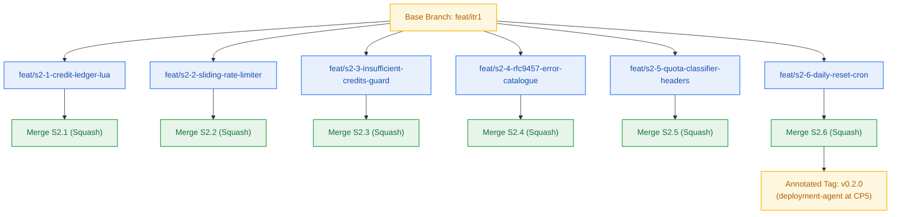

# Git Plan — Milestone M2: Metering Spine & Quota Throttling

> **Author:** git-planner-agent · **Date:** 2026-10-23 · **Status:** Final  
> **Base Branch:** `feat/itr1` · **Convention Source:** `_documentation/planning/conventions.md`  
> **Target Release Tag:** `v0.2.0` · **Derived Version Impact:** Minor (`0.1.0` → `0.2.0`)  
> **Repository State Inspected:** `git log --oneline -n 5`, `git branch --list`, `git tag --list` — PASS  



---

## 1. Branch Topology

| Story ID | Branch Name | Base Branch | Merge Strategy | PR Title | Breaking |
|---|---|---|---|---|:---:|
| **S2.1** | `feat/s2-1-credit-ledger-lua` | `feat/itr1` | squash | `feat(metering): atomic upstash redis lua credit ledger` | no |
| **S2.2** | `feat/s2-2-sliding-rate-limiter` | `feat/itr1` | squash | `feat(metering): per-user 5 rps sliding rate limiter` | no |
| **S2.3** | `feat/s2-3-insufficient-credits-guard` | `feat/itr1` | squash | `feat(metering): ingress credit guard and http 402 short-circuit` | no |
| **S2.4** | `feat/s2-4-rfc9457-error-catalogue` | `feat/itr1` | squash | `feat(contracts): closed 17-member rfc 9457 error catalogue` | no |
| **S2.5** | `feat/s2-5-quota-classifier-headers` | `feat/itr1` | squash | `feat(metering): quota error classifier and ratelimit headers` | no |
| **S2.6** | `feat/s2-6-daily-reset-cron` | `feat/itr1` | squash | `feat(metering): idempotent daily 08:00 utc credit reset cron` | no |

---

## 2. Commit Sequence Specification

### S2.1 — Atomic Upstash Redis Lua Credit Ledger Service
```text
feat(metering): atomic upstash redis lua credit ledger

Context:
- Multi-threaded requests race to debit account credits, risking negative balances and double-spending.

Changes:
- Implement CreditLedgerService in packages/metering with Upstash Redis client.
- Author debit-credits.lua script executing balance check and decrement in a single EVALSHA call.
- Support automatic SCRIPT LOAD reload on NOSCRIPT cache miss.

Validation:
- bun test packages/metering/tests/credit-ledger.test.ts: 3 passed, 0 failed.
- 100 concurrent debits against 10.0 balance result in exactly 20 debits and 0 negative balance.

Refs: S2.1, FR-014, FR-015, BR-013, BR-014, NFR-011
```

### S2.2 — Per-User 5 RPS Sliding Window Rate Limiter
```text
feat(metering): per-user 5 rps sliding rate limiter

Context:
- Burst traffic can overwhelm Google AI Studio free tier quotas (15 RPM).

Changes:
- Implement sliding-window.lua using sorted set scoring by millisecond timestamp.
- Author RateLimiterService enforcing 5 RPS limit and calculating Retry-After header.
- Guarantee throttled requests debit zero credits.

Validation:
- bun test packages/metering/tests/rate-limiter.test.ts: 3 passed, 0 failed.
- 6th request within 1s rejected with allowed=false and retry_after=1.

Refs: S2.2, FR-017, BR-016, BR-017, NFR-012
```

### S2.3 — Ingress Credit Guard and HTTP 402 Short-Circuit
```text
feat(metering): ingress credit guard and http 402 short-circuit

Context:
- Requests with insufficient balance must be short-circuited before reaching expensive downstream LLMs.

Changes:
- Author MeteringGuard evaluating balance against action cost.
- Short-circuit with HTTP 402 INSUFFICIENT_CREDITS problem details.
- Verify zero downstream handler invocations on refusal.

Validation:
- bun test packages/metering/tests/metering-guard.test.ts: 2 passed, 0 failed.

Refs: S2.3, FR-016, BR-015
```

### S2.4 — Closed 17-Member RFC 9457 Error Catalogue
```text
feat(contracts): closed 17-member rfc 9457 error catalogue

Context:
- Error responses must follow RFC 9457 application/problem+json with immutable type URIs.

Changes:
- Author packages/contracts/src/error-catalog.ts defining closed 17-member union.
- Implement ProblemDetails serializer enforcing required members and secret redaction.

Validation:
- bun test packages/contracts/tests/errors.test.ts: 3 passed, 0 failed.

Refs: S2.4, FR-025, FR-027, BR-028..BR-032, NFR-027
```

### S2.5 — Upstream Provider Quota Classifier & RateLimit Headers
```text
feat(metering): quota error classifier and ratelimit headers

Context:
- Upstream quota exhaustion must be distinguished from generic infrastructure outages.

Changes:
- Implement QuotaClassifier mapping Google 429 RESOURCE_EXHAUSTED to SERVICE_LIMIT_REACHED.
- Append RateLimit-Policy, RateLimit, and Retry-After headers to HTTP responses.

Validation:
- bun test packages/metering/tests/quota-classifier.test.ts: 3 passed, 0 failed.

Refs: S2.5, FR-026, FR-028, FR-029, BR-028, BR-029, NFR-025
```

### S2.6 — Idempotent Daily 08:00 UTC Credit Reset Cron
```text
feat(metering): idempotent daily 08:00 utc credit reset cron

Context:
- Balances must reset daily to 10.0 credits at 08:00 UTC without credit carry-over.

Changes:
- Author daily-reset.lua guarded by SET reset:{date}:{userId} 1 NX EX 86400.
- Implement executeDailyReset() service and QStash scheduled webhook handler.
- Verify unspent credits permanently expire.

Validation:
- bun test packages/metering/tests/daily-reset.test.ts: 3 passed, 0 failed.
- Concurrent executions are strictly idempotent.

Refs: S2.6, FR-014, FR-024, BR-025, BR-026, NFR-023, NFR-024
```

---

## 3. Release Tag Plan

| Field | Value |
|---|---|
| **Tag Name** | `v0.2.0` |
| **Version Impact** | Minor (`v0.1.0` → `v0.2.0`) — delivers backward-compatible metering capability |
| **Breaking Changes Present** | No |
| **Created By** | `deployment-agent` (Checkpoint 5), annotated |
| **Collision Check** | PASS — `git tag --list` verified (no existing `v0.2.0` tag) |
| **Decision Owner** | `pm-agent` |

```text
Release v0.2.0: Milestone M2 Metering Spine & Quota Throttling

Highlights:
- Atomic Upstash Redis Lua credit ledger with 10.0 daily credit grant.
- Sliding window rate limiter enforcing 5 RPS per user with Retry-After headers.
- Insufficient credits short-circuit returning HTTP 402 with zero upstream calls.
- Closed 17-member RFC 9457 Problem Details error catalogue.
- Idempotent daily 08:00 UTC credit reset via Upstash QStash without carry-over.

Database:
- Redis key namespace: credits:{userId}, rl:{userId}:{window}, reset:{date}:{userId}
```

---
*Authored by git-planner-agent at Checkpoint 3/4.*
