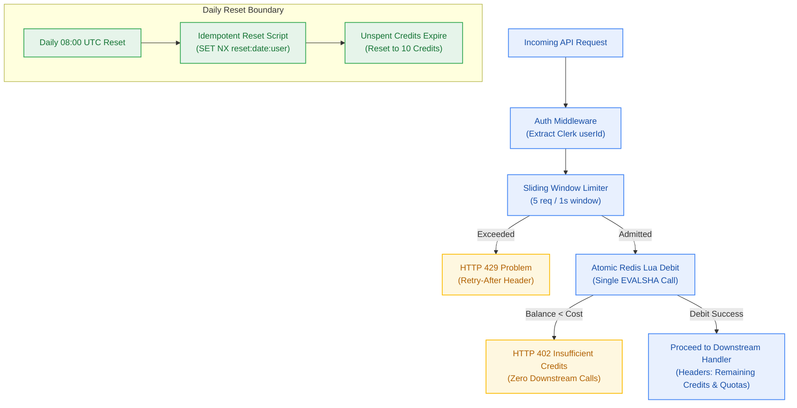

# Milestone Charter — M2: Metering Spine & Quota Throttling (v0.2.0)

> **Status:** Planned (Deferred pending M0 Workspace Scaffolding and M1 Core Auth; reconciled from prior drift)  
> **Author:** pm-agent (Stage 2 Owner) · **Date:** 2026-10-23  
> **Target Version:** `v0.2.0` · **Risk Tier:** HIGH  
> **Grounding:** `project-brief.md` (FR-014..FR-018, FR-024..FR-029; BR-013..BR-017, BR-025..BR-032; NFR-011..NFR-013, NFR-020, NFR-023..NFR-030)  

---

## 1. Overview

Milestone M2 establishes the platform's core economic and quota enforcement spine (`v0.2.0`). It constructs the atomic Upstash Redis Lua credit ledger, sliding window rate limiter, RFC 9457 structured error protocol, and daily 08:00 UTC reset cycle. By guarding all ingress requests before downstream LLMs or vector databases are invoked, M2 guarantees that the platform's $0.00/month infrastructure ceiling is inviolate.

---

## 2. Problem

Without an atomic, low-latency metering layer positioned at the edge, concurrent user requests can race to consume expensive downstream resources, resulting in:
1. Negative credit balances and double-spending across parallel tabs or automated scripts.
2. Uncontrolled burst traffic exhausting Google AI Studio and Cloudflare daily quotas, causing system-wide outages for all users.
3. Rapid exhaustion of Upstash's 500,000 monthly command allowance through chatty, multi-command Redis queries.
4. Cryptic HTTP errors that fail to communicate quota resets or remaining credits to the frontend.

---

## 3. Goals

| # | Goal | Measure |
|---|---|---|
| **G-1** | Zero Negative Credit Balances | Multi-threaded race condition tests (100 concurrent debits) show 0 negative balances and 0 lost updates (`NFR-011`, `BR-013`). |
| **G-2** | Strict Ingress Rate Limiting | Rate limiter evaluation p99 < 10 ms; 6th request within 1s returns HTTP 429 with `Retry-After` header (`NFR-012`, `BR-016`). |
| **G-3** | Zero Upstream Calls on Exhaustion | When balance < action cost, request immediately returns HTTP 402 with 0 calls to LLMs or vector stores (`BR-015`). |
| **G-4** | Upstash Command Optimization | Metering + rate limiting consumes ≤ 2 Redis commands per request via Lua script (`NFR-013`). |
| **G-5** | Idempotent Daily Reset | Balances reset to 10 at 08:00 UTC with zero credit carry-over; reset runs exactly once under concurrent requests (`BR-025`, `BR-026`). |
| **G-6** | RFC 9457 Problem Details | 100% of API errors conform to the closed 17-member catalogue with `service`, `quota_period`, and `resets_in_seconds` (`FR-025`–`FR-029`). |

---

## 4. Non-Goals

- ❌ **Commercial Payments & Credit Top-Ups:** Selling additional credits via Stripe/LemonSqueezy is explicitly prohibited in v0.2.0 (`NFR-016`).
- ❌ **Credit Roll-Over Banking:** Unspent daily credits cannot accumulate across days; expired credits are dropped at reset (`BR-024`).
- ❌ **Per-Tenant Custom Rate Limit Configuration:** All users share a uniform 5 RPS sliding limit in this milestone; custom tiered limits are deferred.
- ❌ **Downstream LLM Calling:** M2 establishes the metering guard; actual Gemini and Cloudflare inference execution is owned by M3/M5.

---

## 5. Functional Requirements Mapping

| ID | Requirement | Source Trace | Story Target |
|---|---|---|---|
| **FR-014** | Credit Grant Allocation (10 credits/day default) | A-08, A-10 | S2.1 |
| **FR-015** | Metered Action Debit via Single Redis Lua Script | BR-014 / PTY-010 | S2.2 |
| **FR-016** | Credit Exhaustion Short-Circuit (HTTP 402) | BR-015 / A-02 | S2.3 |
| **FR-017** | Per-User Sliding Rate Limiter (5 RPS, HTTP 429) | BR-016 / PTY-010 | S2.4 |
| **FR-018** | Upstash Redis Shared State Layer (Atomic Scripts) | BR-014 / D-07 | S2.2 |
| **FR-024** | Daily Credit Reset at 08:00 UTC (No Carry-Over) | BR-025 / A-09 | S2.5 |
| **FR-025** | RFC 9457 Structured Problem Error Envelope | BR-028..032 | S2.6 |
| **FR-026** | Service Limit Reporting (`<quota_period>`, `<service>`) | A-16 / BR-029 | S2.6 |
| **FR-027** | Closed 17-Member Error Type Catalogue | CV-017 | S2.6 |
| **FR-028** | Upstream Provider Quota Classification | PTY-010 | S2.7 |
| **FR-029** | Quota State Surfaced in HTTP Headers & Payloads | PTY-010 | S2.8 |

---

## 6. Non-Functional Requirements

| ID | Requirement | Measurable Threshold |
|---|---|---|
| **NFR-011** | Debit Concurrency Safety | Balance never observed negative; zero lost updates on concurrent debits |
| **NFR-012** | Decision Latency | Limiter evaluation p99 < 10 ms; strictly ≤ 5 req/sec admitted per user |
| **NFR-013** | Redis Command Budget | ≤ 4 commands per metered request; total monthly ≤ 500,000 Upstash commands |
| **NFR-020** | Quota Period Alignment | Daily-reset credits back daily provider quotas; zero mid-month outages |
| **NFR-023** | Idempotent Daily Reset | Reset executes exactly once per day per user under concurrent traffic |
| **NFR-024** | Zero Credit Carry-Over | Balance after reset equals `CREDIT_GRANT_DEFAULT`; unspent credits expire |
| **NFR-025** | Error Code Exclusivity | Zero occurrences of `SERVICE_LIMIT_REACHED` for non-quota conditions |
| **NFR-027** | Error Serialization Latency | p99 < 50 ms to format and serialize RFC 9457 error payload |
| **NFR-028** | URI Immutability | Error `type` URIs remain strictly immutable across minor releases |
| **NFR-029** | Machine-Readable Quota | Quota errors expose `service`, `quota_period`, `quota_used`, `resets_in_seconds` |
| **NFR-030** | Truthful Quota Periods | Reported `quota_period` matches provider's configured reset period |

---

## 7. Success Criteria

1. Atomic Lua script debits 0.5 or 1.0 credits and returns updated balance in < 8 ms.
2. 100 simultaneous concurrent debits against an account with 10.0 credits result in exactly 10 or 20 successful debits and balance exactly 0.0, with subsequent calls returning HTTP 402.
3. 6th request within a 1-second window returns HTTP 429 with `Retry-After: 1` and `RateLimit` headers.
4. Requests rejected by the rate limiter debit zero credits (`BR-017`).
5. Simulated 08:00 UTC reset resets balances to 10.0, expires unspent credits, and executes idempotently when triggered by concurrent workers.
6. All error responses across platform endpoints format as RFC 9457 `application/problem+json` matching `@repo/contracts` schemas.

---

## 8. Risks

| Risk | Severity | Mitigation |
|---|---|---|
| Upstash Redis network latency on cold starts | Medium | Use Upstash REST client with Keep-Alive connection pooling on Vercel Edge/Serverless. |
| Redis EVALSHA script cache miss | Low | Client wrapper catches `NOSCRIPT` error and re-loads script via `SCRIPT LOAD`. |
| Time drift across serverless instances during daily reset | Medium | Rely strictly on Redis `TIME` command within Lua scripts rather than host server timestamps (`BR-026`). |

---

## 9. Decision Log

| ID | Decision | Rationale |
|---|---|---|
| **PTY-010** | Single Lua Script for Rate Limiting + Debit | Bundles sliding window check and balance decrement into 1 atomic Redis roundtrip, saving command budget. |
| **A-09** | Daily Reset at 08:00 UTC | Aligns with Google AI Studio's reset boundary (midnight Pacific Time), preventing mid-day quota desyncs. |
| **A-15** | Truthful Quota Period Headers | Informs frontend whether a quota resets tomorrow (daily) or next month, avoiding misleading wait estimates. |

---

## 10. In One Sentence

Milestone M2 constructs the atomic Upstash Redis Lua credit ledger and rate limiting spine that guarantees multi-tenant quota protection and zero cloud spend.

---
*Chartered by pm-agent at Checkpoint 2 (Gate G2).*
