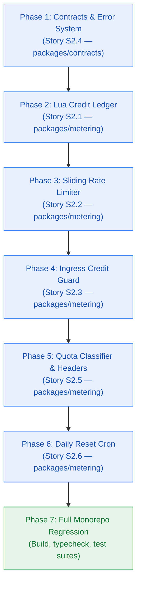

# Developer Execution Plan — Milestone M2: Metering Spine & Quota Throttling

> **Author:** `developer-agent` (Stage 4 Clean-Room Builder)  
> **Target Version:** `v0.2.0` · **Risk Tier:** HIGH  
> **Workflow:** Clean-session implementation per frozen Change Matrices across Stories S2.1 through S2.6  

---

## 1. Task Breakdown by Story & Change Matrix

### Phase 1: Story S2.4 — Closed 17-Member RFC 9457 Problem Details Error Catalog & Serializer
- **Scope:** `packages/contracts`
- **Change Matrix:**
  - `new_files`:
    - `packages/contracts/src/errors.ts`
    - `packages/contracts/src/error-catalog.ts`
    - `packages/contracts/tests/errors.test.ts`
  - `allowed_files`:
    - `packages/contracts/src/index.ts`
    - `packages/contracts/package.json`
  - `forbidden_files`:
    - `apps/**`
    - `packages/metering/**`
- **Tasks:**
  - [x] T2.4.1: Author `packages/contracts/src/error-catalog.ts` exporting closed 17-member catalogue.
  - [x] T2.4.2: Author `packages/contracts/src/errors.ts` with typed serializer, machine-readable quota fields, and secret sanitization.
  - [x] T2.4.3: Export error types and factory functions from `packages/contracts/src/index.ts`.
  - [x] T2.4.4: Author `packages/contracts/tests/errors.test.ts` verifying TC-2.4.1..TC-2.4.3.

### Phase 2: Story S2.1 — Atomic Upstash Redis Lua Credit Ledger Service
- **Scope:** `packages/metering` & `@repo/contracts/src/metering.ts`
- **Change Matrix:**
  - `new_files`:
    - `packages/metering/src/credit-ledger.ts`
    - `packages/metering/src/lua/debit-credits.lua`
    - `packages/metering/tests/credit-ledger.test.ts`
  - `allowed_files`:
    - `packages/metering/src/index.ts`
    - `packages/metering/package.json`
    - `packages/contracts/src/metering.ts`
  - `forbidden_files`:
    - `apps/**`
    - `packages/db/**`
- **Tasks:**
  - [x] T2.1.1: Author `packages/contracts/src/metering.ts` exporting `DebitResult`, `RateLimitResult`, `ResetResult`, and constants.
  - [x] T2.1.2: Scaffold `packages/metering/package.json` with dependencies and export paths.
  - [x] T2.1.3: Implement `packages/metering/src/lua/debit-credits.lua` with atomic balance check, decrement, and rolling 48h TTL.
  - [x] T2.1.4: Implement `CreditLedgerService` in `packages/metering/src/credit-ledger.ts` with `EVALSHA` and automatic `SCRIPT LOAD` on `NOSCRIPT`.
  - [x] T2.1.5: Author `packages/metering/tests/credit-ledger.test.ts` asserting 100 concurrent debit races without negative balance (TC-2.1.1..TC-2.1.3).

### Phase 3: Story S2.2 — Per-User 5 RPS Sliding Window Rate Limiter
- **Scope:** `packages/metering`
- **Change Matrix:**
  - `new_files`:
    - `packages/metering/src/rate-limiter.ts`
    - `packages/metering/src/lua/sliding-window.lua`
    - `packages/metering/tests/rate-limiter.test.ts`
  - `allowed_files`:
    - `packages/metering/src/index.ts`
    - `packages/contracts/src/metering.ts`
  - `forbidden_files`:
    - `apps/**`
    - `packages/db/**`
- **Tasks:**
  - [x] T2.2.1: Implement `packages/metering/src/lua/sliding-window.lua` using Redis Sorted Sets with millisecond timestamps.
  - [x] T2.2.2: Implement `RateLimiterService` in `packages/metering/src/rate-limiter.ts` calculating exact `retry_after`.
  - [x] T2.2.3: Author `packages/metering/tests/rate-limiter.test.ts` verifying 5 RPS admission, 6th request throttle, and zero credit debiting (TC-2.2.1..TC-2.2.3).

### Phase 4: Story S2.3 — Insufficient Credits Ingress Guard & HTTP 402 Short-Circuit
- **Scope:** `packages/metering`
- **Change Matrix:**
  - `new_files`:
    - `packages/metering/src/metering-guard.ts`
    - `packages/metering/tests/metering-guard.test.ts`
  - `allowed_files`:
    - `packages/metering/src/index.ts`
    - `packages/contracts/src/errors.ts`
  - `forbidden_files`:
    - `apps/**`
    - `packages/db/**`
- **Tasks:**
  - [x] T2.3.1: Implement `MeteringGuard` in `packages/metering/src/metering-guard.ts` intercepting incoming requests.
  - [x] T2.3.2: Short-circuit with HTTP 402 Problem Details when balance < cost.
  - [x] T2.3.3: Author `packages/metering/tests/metering-guard.test.ts` asserting zero downstream invocations on refusal (TC-2.3.1..TC-2.3.2).

### Phase 5: Story S2.5 — Upstream Provider Quota Classifier & RateLimit Headers
- **Scope:** `packages/metering`
- **Change Matrix:**
  - `new_files`:
    - `packages/metering/src/quota-classifier.ts`
    - `packages/metering/src/headers.ts`
    - `packages/metering/tests/quota-classifier.test.ts`
  - `allowed_files`:
    - `packages/metering/src/index.ts`
    - `packages/contracts/src/errors.ts`
  - `forbidden_files`:
    - `apps/**`
- **Tasks:**
  - [x] T2.5.1: Implement `QuotaClassifier` in `packages/metering/src/quota-classifier.ts` mapping Google 429 to `SERVICE_LIMIT_REACHED`.
  - [x] T2.5.2: Implement `generateRateLimitHeaders` in `packages/metering/src/headers.ts`.
  - [x] T2.5.3: Author `packages/metering/tests/quota-classifier.test.ts` verifying error classification and header generation (TC-2.5.1..TC-2.5.3).

### Phase 6: Story S2.6 — Idempotent Daily 08:00 UTC Credit Reset Cron & QStash Endpoint
- **Scope:** `packages/metering`
- **Change Matrix:**
  - `new_files`:
    - `packages/metering/src/daily-reset.ts`
    - `packages/metering/src/lua/daily-reset.lua`
    - `packages/metering/tests/daily-reset.test.ts`
  - `allowed_files`:
    - `packages/metering/src/index.ts`
    - `packages/contracts/src/metering.ts`
  - `forbidden_files`:
    - `apps/**`
- **Tasks:**
  - [x] T2.6.1: Implement `packages/metering/src/lua/daily-reset.lua` with `SET reset:{date}:{userId} 1 NX EX 86400`.
  - [x] T2.6.2: Implement `DailyResetEngine` in `packages/metering/src/daily-reset.ts`.
  - [x] T2.6.3: Author `packages/metering/tests/daily-reset.test.ts` verifying 10.0 balance reset, unspent credit expiry, and idempotency (TC-2.6.1..TC-2.6.3).

---
*Authored by developer-agent prior to code modifications.*
