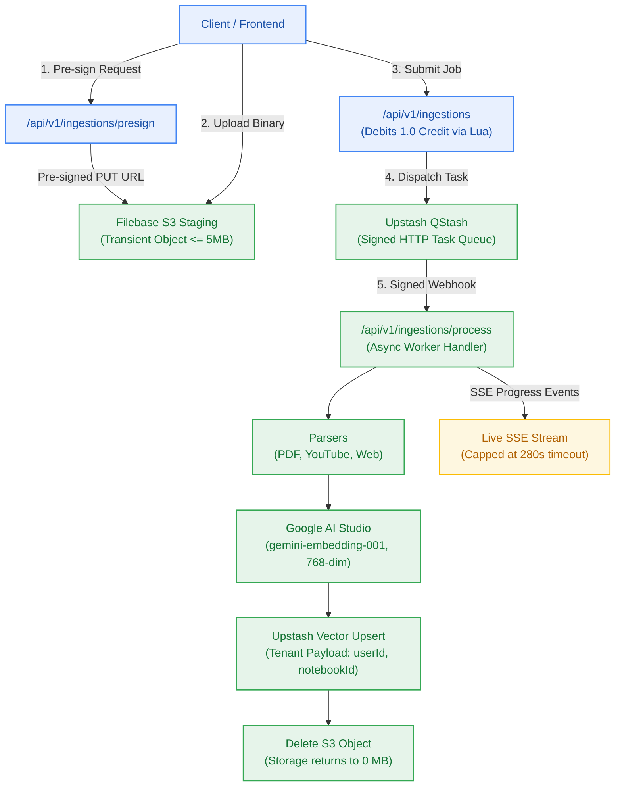

# Milestone Charter — M3: Transient Ingestion Pipeline & Multi-Source Extraction (v0.3.0)

> **Status:** Planned (Follows M2 Metering Spine)  
> **Author:** pm-agent (Stage 2 Owner) · **Date:** 2026-10-23  
> **Target Version:** `v0.3.0` · **Risk Tier:** HIGH  
> **Grounding:** `project-brief.md` (FR-004..FR-007, FR-031, FR-035, FR-037; BR-005..BR-007, BR-033..BR-036, BR-045..BR-046; NFR-004, NFR-014, NFR-024)  

---

## 1. Executive Summary & Outcome

Milestone M3 constructs the platform's multi-source ingestion engine (`v0.3.0`). Users can stage and ingest academic PDFs (≤ 5MB), YouTube video transcripts, and web documentation. Ingestion tasks run asynchronously via Upstash QStash signed webhooks, generate dense embeddings with Google AI Studio (`gemini-embedding-001`), and index vectors into Upstash Vector with strict tenant metadata. Staged S3 binaries are permanently deleted immediately upon vector commit (`BR-046`), and failed ingestions automatically reverse debited credits via an atomic Lua script (`FR-037`, `BR-033`).

---

## 2. In Scope

- **Direct-to-Storage Staging (`FR-004`, `ADR-0003`):**
  - Pre-signed S3 URL generation for Filebase transient staging (`/api/v1/ingestions/presign`).
  - Binary file size limit strictly enforced at 5 MB (`BR-045`).
- **Heterogeneous Extractors (`FR-004`–`FR-006`):**
  - Academic text PDF parser (processing rate > 5 pages/sec, `NFR-004`).
  - YouTube video transcript extraction via subtitles API (< 30s latency).
  - Web article cleaner and DOM parser (Readability extraction).
- **Asynchronous Task Queue & Crons (`ADR-0004`):**
  - Upstash QStash webhook dispatch with cryptographic `Upstash-Signature` verification.
  - Automatic exponential retry on transient network errors.
- **Semantic Vector Indexing (`FR-007`):**
  - Dense 768-dimensional embeddings via Google AI Studio (`gemini-embedding-001`).
  - In-process fallback embedding via `@huggingface/transformers` (`bge-small-en-v1.5`).
  - Upsert to Upstash Vector with tenant payload `{ user_id, document_id, notebook_id }`.
- **Transient Storage Invariant & Hygiene (`BR-046`):**
  - Automatic `DeleteObjectCommand` against Filebase S3 immediately post-upsert.
  - Zero-storage verification: bucket storage returns to 0 MB when workers are idle.
- **Progress Tracking & Credit Refund (`FR-035`, `FR-037`):**
  - Server-Sent Events (SSE) streaming live ingestion status (`0%` → `100%`) capped at 280s.
  - Lua compensation script reversing the 1.0 credit debit if ingestion terminally fails (`BR-033`).

---

## 3. Out of Scope

- Multi-step query decomposition or HyDE reasoning (owned by Milestone M5).
- Notebook canvas graph rendering (owned by Milestone M4).
- Cross-session episodic memory extraction (owned by Milestone M6).

---

## 4. Acceptance Criteria & Gate Status

| ID | Criterion | Evidence Target | Gate |
|:---:|---|---|:---:|
| **AC-3.1** | PDF & YouTube Parsing Throughput | 35-page PDF parses at > 5 pages/sec; YouTube transcript extracted in < 30s | G5 |
| **AC-3.2** | Upstash Vector Indexing | Vector upsert commits with correct tenant payload and 768-dim vector | G5 |
| **AC-3.3** | Zero-Byte S3 Hygiene | Filebase S3 staged object is deleted immediately upon vector commit (`BR-046`) | G6 |
| **AC-3.4** | SSE Progress Streaming | Client receives deterministic progress events (cap 280s) with `Last-Event-ID` recovery | G6 |
| **AC-3.5** | Atomic Credit Rollback | Terminal extraction failure refunds 1.0 credit via Lua; balance verified intact | G6 |

---

## 5. Next Steps & Pipeline Handoff

1. Follows completion and sign-off of Milestone M2 (Metering Spine).
2. `sprint-agent` authors `m3-transient-ingestion/sprint-status.yaml` and story cards.
3. Hands off to `developer-agent` for extractor and QStash handler implementation.
