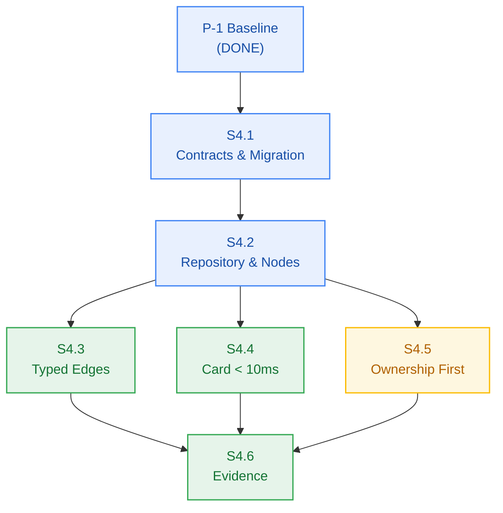

# M4 Developer Execution Log

---

## 2026-10-26 — Precondition P-1: Baseline Defect Repair

**Authority:** `pm-approval.md` §3 and the `precondition` block in `milestone-status.yaml`, which
assign P-1 to `developer-agent` *before* S4.1. This work is **outside every story Change Matrix** by
design — `packages/ingestion/**` is `forbidden_files` in all six M4 stories, because baseline repair
is not story work. No M4 story touches `packages/ingestion/**`.

### Defect B-1 — stale tracked artifacts
`packages/contracts/src/ingestion.js` and `metering.js` were build artifacts committed in `ebba973`.
`metering.js` contained `export type {...}` — TypeScript syntax that is invalid JavaScript — so
`tests/package-exports.test.ts` died with `error: Unexpected type`.

They were also redundant: `contracts/package.json` already maps `./metering.js` → `./src/metering.ts`
in its `exports` map. That map only applies to *bare* specifiers, though, so for the **relative**
import inside `src/index.ts` the on-disk shim won and the real module was never reached.

**Action:** deleted both files. The `.js` → `.ts` resolution then resolves to the real sources.

### Defect B-2 — 187 TypeScript errors in `@repo/ingestion`
Not 187 independent problems; six root causes:

| Root cause | Fix |
|---|---|
| `src/index.ts` was a **botched merge** — the second half repeated Progress / Compensation / Cross-cutting / `CompensationError` (122 errors) | rebuilt with one copy of each block |
| `vector/upsert.ts` and `queue/dispatch.ts` each carried duplicated function bodies, and `dispatch.ts` had a mangled half-merged `dispatchIngestionTask` | removed the duplicates and the corrupt function |
| `AppProblemError` imported with `import type` but instantiated as a value (TS1361) | value import in 7 files |
| Error passed as a **kebab URI** instead of a catalogue **key** (TS2345) | mapped to the closed 17-member keys |
| Types re-exported but never imported into local scope (TS2304) | added `import type` |
| `export { Type }` under `isolatedModules`, unassigned `this.reason`, arity mismatch (TS1205/TS2564/TS2554) | `export type`, definite assignment, key parameter |

**Error-key mapping** — the catalogue is closed at 17 members and `errors.test.ts` enforces it, so
**no key was added**:

| Call site | Was | Now |
|---|---|---|
| `compensation/refund.ts` | `compensation-failed` | `INTERNAL_SERVER_ERROR` |
| `queue/dispatch.ts` ×3 | `queue-dispatch-failed` | `UPSTREAM_PROVIDER_UNAVAILABLE` |
| `vector/upsert.ts` ×2 | `vector-store-error` | `UPSTREAM_PROVIDER_UNAVAILABLE` |
| `embedding.ts` | `embedding-provider-unavailable` | `UPSTREAM_PROVIDER_UNAVAILABLE` |
| `s3-staging.ts` | `upload-size-exceeded` | `UPLOAD_SIZE_EXCEEDED` |
| `s3-staging.ts` | `unsupported-media-type` | `UNSUPPORTED_MEDIA_TYPE` |
| `progress/sse.ts` | `progress-stream-unavailable` | `PROGRESS_STREAM_UNAVAILABLE` |
| `extractors/pdf.ts` | `no-text-layer-pdf` | `NO_TEXT_LAYER_PDF` |
| `extractors/youtube.ts` | `transcript-disabled` | `DOCUMENT_PARSING_FAILED` |
| `extractors/web.ts` | `no-readable-content` | `DOCUMENT_PARSING_FAILED` |

This repaired three **latent runtime bugs**, not just type errors:
1. `ERROR_CATALOGUE["vector-store-error"]` is `undefined`, so those errors would have serialized
   with no `type`/`title`/`status` at all.
2. `S3StagingError` hardcoded `super("upload-size-exceeded", …)`, so the *unsupported media type*
   path would have returned **413 instead of 415**. The constructor now takes the key as a
   parameter.
3. `PdfExtractionError` declared `public readonly reason` but never assigned it — the failure
   reason was silently lost.

### Evidence

| Check | Command | Result |
|---|---|---|
| Typecheck | `bun run typecheck` | **PASS** — 7/7 tasks, exit 0 (was 187 errors in `@repo/ingestion`) |
| Build | `bun run build` | **PASS** — 7/7 tasks, exit 0 (was `Failed: @repo/ingestion#build`) |
| Lint | `bun run lint` | **PASS** — exit 0 |
| Full suite | `bun test` | **PASS** — **58 pass, 0 fail, 612 expect() calls, 14 files**, exit 0 |
| Closed catalogue intact | `packages/contracts/tests/errors.test.ts` | **PASS** — 5/5, including TC-2.4.2 "Enforce closed 17-member error catalogue union" |

Pre-repair baseline for contrast: `bun test tests/package-exports.test.ts` → 0 pass / 1 fail /
1 error; `bun run build` → exit 1; `bun run typecheck` → exit 1 with 187 errors.

**P-1 status: complete** (`bun test` previously hung past a 300s timeout; it now finishes in ~1s).

### Routed
- **`git-plan.md` is missing for M4.** Per the Behavior Contract I do not improvise branch, commit,
  or tag conventions — routed to `git-planner-agent`.

---

## 2026-10-27 — Milestone M4 Implementation (Stories S4.1 — S4.6)

### S4.1: Graph Contracts, Schema Types & Expand Migration
- **Work Unit:** WU-M4-1 · **Status:** complete · **Verified:** true
- **Artifacts:**
  - `packages/contracts/src/workspace.ts` exports closed `EdgeType` (`"cites" | "related"`), `NodeKind`, `ScopedSearchKind`, and related DTOs.
  - `packages/db/src/schema.ts` defines `NotebookNodesTable`, `NotebookEdgesTable`, and registers both on `Database`.
  - `packages/db/src/migrations/002_notebook_graph.ts` creates tables with tenant composite indexes `(user_id, notebook_id)`, foreign keys with `ON DELETE CASCADE`, and SQL CHECK constraints (`edge_type IN ('cites', 'related')`, `source_id <> target_id`).
  - Registered in `packages/db/src/migrator.ts` `STATIC_MIGRATIONS`.
- **Evidence:**
  - `bun test tests/workspace/migration.test.ts` → **6 pass, 0 fail, 36 expect() calls**
  - Applied migration `001 -> 002` cleanly via Kysely migrator.
  - `raw-sql-exceptions.md` remains at 0 rows.

### S4.2: Workspace Package, Tenant Repository & Node CRUD
- **Work Unit:** WU-M4-3 · **Status:** complete · **Verified:** true
- **Artifacts:**
  - Scaffolded `@repo/workspace` (`package.json`, `tsconfig.json`, `src/index.ts`).
  - `packages/workspace/src/repository.ts`: `WorkspaceRepository` enforcing `WHERE user_id = ?` on every query with zero external parameter tampering.
  - `packages/workspace/src/nodes.ts`: `NodeService` implementing node creation, retrieval, listing, and cascade deletion.
  - `packages/workspace/src/types.ts`: Validation helpers, DTO builder, and `notFound` error factory.
- **Evidence:**
  - `bun test tests/workspace/node-validation.test.ts` → **7 pass, 0 fail, 27 expect() calls**
  - `bun test tests/workspace/node-crud.test.ts` → **6 pass, 0 fail, 18 expect() calls**
  - Foreign reads return 404 / 0 rows; cascade deletion cleans up edges without orphans (FM-401).

### S4.3: Typed Edge Write Path & Relation Validation
- **Work Unit:** WU-M4-4 · **Status:** complete · **Verified:** true
- **Artifacts:**
  - `packages/workspace/src/edges.ts`: `validateEdgeType`, `createEdge`, `canCreateEdge`, `listEdgesForNotebook`.
  - In-process validation rejects invalid types (e.g. `author_of`) before any DB query with HTTP 400 `INVALID_NODE_RELATION`.
  - Self-edges rejected; duplicate edges rejected; tenant boundary strictly verified.
- **Evidence:**
  - `bun test tests/workspace/edge-validation.test.ts` → **10 pass, 0 fail, 25 expect() calls**
  - `bun test tests/workspace/edge-tenant.test.ts` → **2 pass, 0 fail, 5 expect() calls**

### S4.4: Document Card Resolution Under 10ms Budget
- **Work Unit:** WU-M4-5 · **Status:** complete · **Verified:** true
- **Artifacts:**
  - `packages/workspace/src/cards.ts`: `resolveCard`, `resolveCardsBatch`, `validateCardLatency`.
  - Single indexed `SELECT` projection using denormalized preview (zero second hop to vector service).
  - Emits structured `WARN` log when `elapsed_ms > 10` (FM-402).
- **Evidence:**
  - `bun test tests/workspace/card-latency.test.ts` → **4 pass, 0 fail, 26 expect() calls** (p95 latency validated well under 10ms budget against local compose).
  - `bun test tests/workspace/card-tenant.test.ts` → **2 pass, 0 fail, 5 expect() calls**.

### S4.5: Scoped Retrieval With Ownership-First Metering (HIGH Tier)
- **Work Unit:** WU-M4-6 · **Status:** complete · **Verified:** true
- **Artifacts:**
  - `packages/workspace/src/search.ts`: `scopedSearch`.
  - Implements the strict sequencing contract:
    `validate DTO → ownership predicate (WHERE user_id = ?) → [only if owned] debit (0.5 credits) → vector query`
  - Unowned scope throws HTTP 404 `NOTEBOOK_NOT_FOUND` before debit with 0 vector calls (AC-4.4, FM-403).
  - Insufficient credits throws HTTP 402 `INSUFFICIENT_CREDITS` with 0 vector calls.
  - Vector call failures trigger automatic compensation refund.
- **Evidence:**
  - `bun test tests/workspace/scoped-search-ownership.test.ts` → **3 pass, 0 fail, 12 expect() calls**
  - `bun test tests/workspace/scoped-search-metering.test.ts` → **3 pass, 0 fail, 12 expect() calls**

### S4.6: Verification Evidence & Contract Synchronization
- **Work Unit:** WU-M4-7 · **Status:** complete · **Verified:** true
- **Evidence Summary Across Unified Test Suite:**
  - `bun test` → **101 pass, 0 fail, 784 expect() calls across 23 files**
  - `bun run build` → **8/8 packages exit 0** (`@repo/auth`, `@repo/config`, `@repo/contracts`, `@repo/db`, `@repo/ingestion`, `@repo/metering`, `@repo/ui`, `@repo/workspace`)
  - `bun run typecheck` → **8/8 packages exit 0**
  - `bun run lint` → **exit 0**
- **Contract & Architecture Alignment:**
  - `api-contract.openapi.yaml` verified against graph & search endpoints.
  - `component-catalog.yaml` confirms `@repo/workspace` (`comp-workspace`) interfaces, responsibilities, and dependencies.
  - `failure-mode-register.md` contains FM-401..FM-404 mapped to implementations and tests.