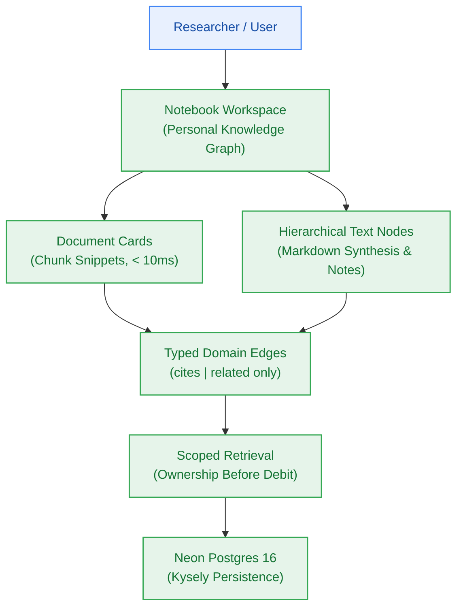
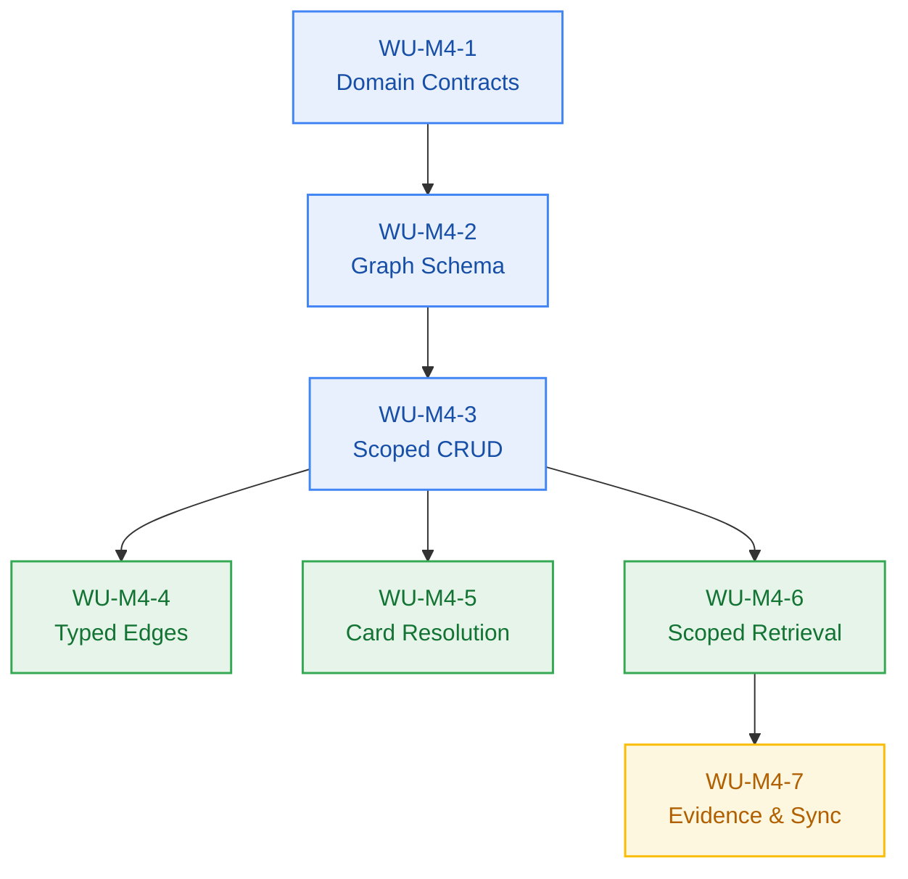

# Milestone Charter — M4: Notebook Workspace & Domain Graph (v0.4.0)

> **Status:** Planned (Follows M3 Ingestion Pipeline)  
> **Author:** pm-agent (Stage 2 Owner) · **Date:** 2026-10-23 · **Revised:** 2026-10-26  
> **Target Version:** `v0.4.0` · **Risk Tier:** MEDIUM · **Gate Target:** G5  
> **Grounding:** `project-brief.md` (**FR-031, FR-032, FR-033, FR-034**; **BR-002, BR-036**; **NFR-007**)

---

## 1. Executive Summary & Outcome

Milestone M4 delivers the personal knowledge workspace and relational domain graph (`v0.4.0`). Researchers organize extracted document chunks, synthesize findings into hierarchical text nodes, and establish typed relationships (`cites` and `related`). The workspace supports sub-10ms document-card resolution (`FR-033`), strict tenant-isolated queries preventing cross-user data leakage (`NFR-007`, `BR-002`), and schema validation rejecting malformed edge relationships with HTTP 400 (`FR-032`).

---

## 2. In Scope

- **Interactive Notebook Workspace (`FR-031`):**
  - CRUD operations for notebooks (exists from M1), notebook nodes, and document reference cards.
  - Document reference cards rendering chunk snippets with source metadata in < 10ms (`FR-033`).
- **Domain Graph Relationships (`FR-032`, `FR-033`):**
  - Typed directional edges connecting text nodes and document-backed nodes.
  - Edge types strictly restricted to `cites` or `related`; any unsupported string is rejected with HTTP 400 `invalid-node-relation` (`FR-032`).
- **Scoped Knowledge Retrieval (`FR-034`):**
  - Queries bounded to a declared scope: node, branch, or notebook.
  - Ownership validated against the authenticated tenant **before any credit debit is committed** (`BR-036`).
- **Persistence & Tenant Isolation (`BR-002`, `NFR-007`):**
  - Neon Postgres schema migrations via Kysely (`notebook_nodes`, `notebook_edges` — `notebooks` already exists from M1).
  - Composite indexes on `(user_id, notebook_id)` for high-performance scoped traversal.

---

## 3. Out of Scope

- Multi-step LLM query synthesis or citation generation (owned by Milestone M5).
- Cross-notebook global search ranking (owned by Milestone M5).
- Autonomous 7-day retention sweeper, `expires_at` warning cadence, and tombstones (owned by Milestone M7; `BR-038`, `BR-039`).
- Arbitrary user-defined edge ontologies or unbounded graph properties (explicit PRD non-goal).

---

## 4. Acceptance Criteria & Gate Status

| ID | Criterion | Grounding | Evidence Target | Gate |
|:---:|---|---|---|:---:|
| **AC-4.1** | Document Card Latency | `FR-033` | Card metadata and preview chunks resolve in < 10ms from database | G5 |
| **AC-4.2** | Typed Edge Validation | `FR-032` | Creating edge with type not in `['cites','related']` returns HTTP 400 `invalid-node-relation` | G5 |
| **AC-4.3** | Tenant Data Isolation | `BR-002`, `NFR-007` | User B cannot view, query, or link nodes belonging to User A (HTTP 404, zero rows leaked) | G6 |
| **AC-4.4** | Ownership Pre-Check | `FR-034`, `BR-036` | Scoped search against an unowned notebook rejects with HTTP 404 `notebook-not-found` **before** any credit debit | G6 |

> **Delta 2026-10-26 (PM decision `M4-PM-001`) — status code conflict resolved.**
> `epic-004` AC-3 previously specified HTTP 403 `forbidden-tenant-access` for a scoped search
> targeting another user's notebook, contradicting this charter's AC-4.4 (HTTP 404).
> **Sealed:** foreign or unowned notebook references resolve as **HTTP 404 `notebook-not-found` with 0 credits debited.**
> *Deciding fact:* `/notebooks/{notebookId}` (already shipped in M1) scopes its SELECT by `user_id`
> and answers 404, so a 403 here would contradict a live contract.
> *Strongest argument for the rejected option:* 403 `forbidden-tenant-access` is explicit and
> self-documenting for an audit reader. *Why it lost:* it confirms to the caller that another
> tenant's notebook ID exists, which is an enumeration oracle — directly against the `BR-002` /
> `NFR-007` posture. `403 forbidden-tenant-access` stays in the catalogue for tenant-scope
> violations that carry **no** resource identifier (e.g. an edge payload referencing a foreign
> `document_id`). `epic-004` AC-3 has been aligned to this decision.

---

## 5. Implementation Plan (Stage 2 → Stage 3 → Stage 4)

| Unit | Outcome | Depends On | Tier | Completion Condition | Verification |
|---|---|---|:---:|---|---|
| **WU-M4-1** | Shared graph contracts: node/edge types, `EdgeType` union, RFC 9457 `invalid-node-relation` binding | — | LOW | Types exported from `@repo/contracts` and consumed by `@repo/db` | Typecheck + unit test on edge-type narrowing |
| **WU-M4-2** | Kysely migrations for `notebook_nodes`, `notebook_edges` + composite indexes `(user_id, notebook_id)` | WU-M4-1 | MEDIUM | Migrator applies cleanly on fresh DB and on existing M1–M3 DB | `bun test` database persistence suite; fresh-clone migrate |
| **WU-M4-3** | Tenant-scoped notebook/node/card CRUD (create, read, list, delete) behind repository contract | WU-M4-2 | MEDIUM | Every read/write is bounded by `user_id` + `notebook_id` | Cross-tenant penetration tests (AC-4.3) |
| **WU-M4-4** | Typed edge write path with `cites` \| `related` validation and cycle/self-edge guards | WU-M4-3 | MEDIUM | Invalid edge type returns HTTP 400 with RFC 9457 body | AC-4.2 test |
| **WU-M4-5** | Document-backed card resolution with preview chunk + source metadata | WU-M4-3 | MEDIUM | p95 resolution < 10ms against local compose | Latency measurement on representative fixture |
| **WU-M4-6** | Scoped retrieval (node / branch / notebook) with ownership pre-check **before** metering debit | WU-M4-3 | HIGH | Unowned scope → HTTP 404, **0 credits debited**, zero downstream vector calls | AC-4.4 test + balance assertion |
| **WU-M4-7** | Verification evidence for AC-4.1..AC-4.4, contract/catalog/registration sync | WU-M4-4, WU-M4-5, WU-M4-6 | LOW | All four ACs evidenced; `dbw doctor` clean | `bun test`, `bun run build`, `bun run typecheck` |

**Risk statement (MEDIUM tier):** the blast radius is confined to `packages/db`, `packages/contracts`,
and a new workspace surface; no existing public contract is broken, and the release is an
expand-phase, backward-compatible minor bump. The single HIGH-tier unit (WU-M4-6) touches the
metering boundary, so it carries an explicit precondition — ownership validation must execute and
return before any debit call is issued — and a recovery consideration: a debit already issued on a
failed path must be reversed through the existing atomic `refund-credits.lua`.

**Stopping point:** each unit is independently verifiable and lands on branch `milestone/m4-notebook-workspace`,
topic branch per story as `<type>/s4-<n>-<slug>` per `conventions.md` §3.1.

---

## 6. Next Steps & Pipeline Handoff

1. Follows completion and sign-off of Milestone M3 (Ingestion Pipeline) — **complete**.
2. `architect-agent` authors the M4 design blueprint and OpenAPI/graph contracts.
3. `sprint-agent` authors `m4-notebook-workspace/sprint-status.yaml` and story cards with frozen Change Matrices.
4. `pm-agent` verifies and approves the plan before handoff to `developer-agent`.
