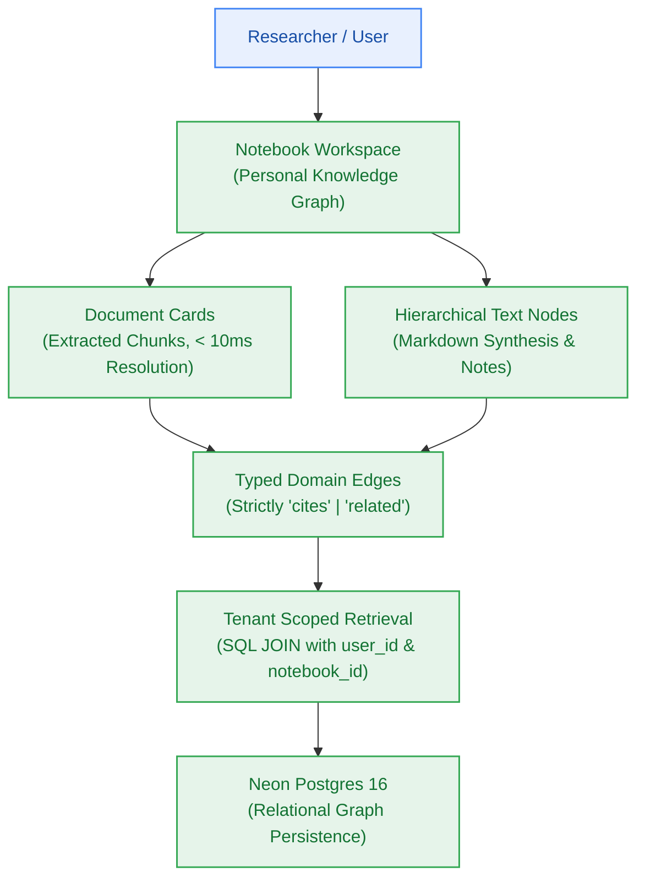

# Milestone Charter — M4: Notebook Workspace & Domain Graph (v0.4.0)

> **Status:** Planned (Follows M2 Metering & Ingestion Setup)  
> **Author:** pm-agent (Stage 2 Owner) · **Date:** 2026-10-23  
> **Target Version:** `v0.4.0` · **Risk Tier:** MEDIUM  
> **Grounding:** `project-brief.md` (FR-013, FR-019..FR-020, FR-032..FR-033; BR-021..BR-024, BR-038..BR-040; NFR-007, NFR-015)  

---

## 1. Executive Summary & Outcome

Milestone M4 delivers the personal knowledge workspace and relational domain graph (`v0.4.0`). Researchers organize extracted document chunks, synthesize findings into hierarchical text nodes, and establish typed relationships (`cites` and `related`). The workspace supports sub-10ms card resolution (`NFR-015`), strict tenant-isolated queries preventing cross-user data leakage (`NFR-007`, `BR-002`), and schema validation rejecting malformed edge relationships with HTTP 400 (`BR-022`).

---

## 2. In Scope

- **Interactive Notebook Canvas (`FR-013`):**
  - CRUD operations for notebooks, nodes, and document cards.
  - Document reference cards rendering chunk snippets with source metadata in < 10ms (`NFR-015`).
- **Domain Graph Relationships (`FR-019`, `FR-020`):**
  - Typed directional edges connecting nodes and document cards.
  - Edge types strictly restricted to `cites` or `related`; any unsupported string is rejected with HTTP 400 `INVALID_EDGE_TYPE` (`BR-022`).
- **Scoped Knowledge Retrieval (`FR-032`, `FR-033`):**
  - Queries bounded to specific notebook contexts (`BR-038`).
  - Validation ensuring user ownership of notebook before credit debits are committed (`BR-039`).
- **Persistence & Tenant Isolation (`BR-002`, `BR-021`):**
  - Neon Postgres schema migrations via Kysely (`notebooks`, `notebook_nodes`, `notebook_edges`).
  - Composite indexes on `(user_id, notebook_id)` for high-performance scoped traversal.

---

## 3. Out of Scope

- Multi-step LLM query synthesis or citation generation (owned by Milestone M5).
- Cross-notebook global search ranking (owned by Milestone M5).
- Autonomous 7-day retention sweeper (owned by Milestone M7).

---

## 4. Acceptance Criteria & Gate Status

| ID | Criterion | Evidence Target | Gate |
|:---:|---|---|:---:|
| **AC-4.1** | Document Card Latency | Card metadata and preview chunks resolve in < 10ms from database | G5 |
| **AC-4.2** | Typed Edge Validation | Creating edge with type not in `['cites', 'related']` returns HTTP 400 | G5 |
| **AC-4.3** | Tenant Data Isolation | User B cannot view, query, or link nodes belonging to User A (HTTP 404/403) | G6 |
| **AC-4.4** | Ownership Pre-Check | Scoped search against unowned notebook rejects with HTTP 404 before credit debit | G6 |

---

## 5. Next Steps & Pipeline Handoff

1. Follows completion and sign-off of Milestone M3 (Ingestion Pipeline).
2. `sprint-agent` authors `m4-notebook-workspace/sprint-status.yaml` and story cards.
3. Hands off to `developer-agent` for workspace API and UI component implementation.
