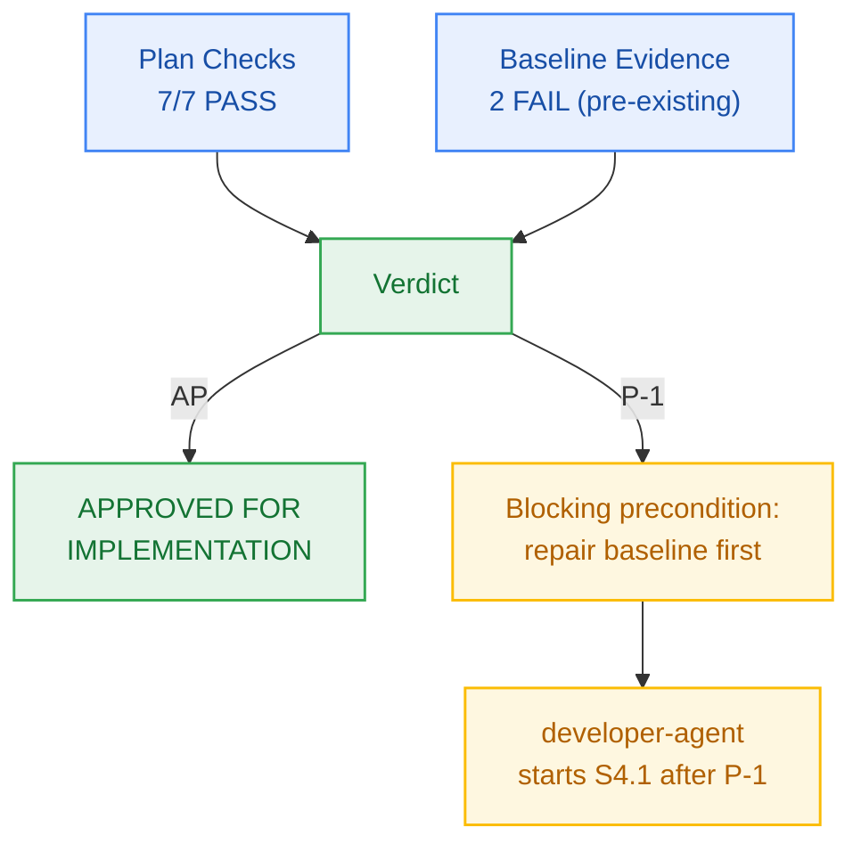

# M4 Sprint Plan — PM Verification & Approval

> **Author:** `pm-agent` (Stage 2 Owner) · **Date:** 2026-10-26  
> **Scope of this record:** approval of the M4 **plan** for handoff to `developer-agent`.  
> **Explicitly not:** code-complete sign-off or story-level verification — those remain `test-agent`'s.

---

## 1. Verification Results

### 1.1 Plan Checks (Checkpoint 2 / Gate G5)

| # | Check | Result | Evidence |
|:--:|---|:---:|---|
| 1 | Every external capability tagged, research-backed, or classified `CUSTOM-DOMAIN-LOGIC` | **PASS** | Design §4 evaluates 4 real options; adjacency-list chosen over Neo4j with stated costs; no new vendor introduced |
| 2 | Milestone has concrete verifiable criteria (checks, not vibes) | **PASS** | `milestone.md` §4 AC-4.1..AC-4.4, each with a grounded FR/BR and an evidence target |
| 3 | Every story passes the 5-point atomicity test; no padding | **PASS** | 6 stories for 7 work units; max 8 new files (S4.2); none truncated to a round number |
| 4 | Every story carries `build_vs_buy_ref`, `tests`, `observability` | **PASS** | All 6 stories on the board carry all three fields |
| 5 | Story dependency ordering forms a DAG with no cycles | **PASS** | Script-validated: `S4.1 → S4.2 → {S4.3,S4.4,S4.5} → S4.6`; all referenced ids resolve |
| 6 | File paths in stories match actual repo structure and conventions | **PASS** | Paths verified against `packages/` (auth, config, contracts, db, ingestion, metering, ui) and `tests/`; no `apps/` path claimed — that directory does not exist in this repo |
| 7 | Every required specialist dispatch issued and logged `ACCEPTED` | **PASS** | `planning-dispatch-log.md` carries DSP-016..DSP-020, all `ACCEPTED` |
| — | Board exists with frozen Change Matrices | **PASS** | `sprint-status.yaml` parses; 6 stories × `new_files`/`allowed_files`/`forbidden_files`; no root file in any `allowed_files` (Two-Floor rule) |
| — | Contracts parse | **PASS** | `api-contract.openapi.yaml` → 17 paths, 23 schemas, 9 responses, 3 parameters; `component-catalog.yaml` → 10 components, 7 rules |

**Plan verdict: 7/7 + 3 structural checks PASS.**

### 1.2 Baseline Evidence (repository state at approval time)

| Check | Result | Evidence |
|---|:---:|---|
| `bun run typecheck` | **FAIL** | 187 errors, **all** in `@repo/ingestion` (`src/vector/upsert.ts`, `src/embedding.ts`, `src/extractors/pdf.ts`, `src/compensation/refund.ts`) |
| `bun run build` | **FAIL** | `Failed: @repo/ingestion#build`; 4/7 tasks succeed, 3 cached |
| `bun test tests/database-persistence.test.ts` | **PASS** | 4 pass, 0 fail, 33 `expect()` calls |
| `bun test tests/monorepo-layout.test.ts` | **PASS** | 3 pass, 0 fail, 16 `expect()` calls |
| `bun test packages/contracts/tests/errors.test.ts` | **PASS** | 5 pass, 0 fail (RFC 9457 catalogue intact) |
| `bun test tests/package-exports.test.ts` | **FAIL** | 0 pass, 1 fail: `error: Unexpected type` at `packages/contracts/src/metering.js:1:8` |
| `bun test` (full suite) | **NOT_VERIFIED** | Timed out at 300s; not run to completion. Recorded `NOT_VERIFIED`, never `PASS` |
| `npx --no-install dbw doctor` | **NOT_VERIFIED** | `dbw` CLI is not installed in this workspace (`npx --no-install dbw` → *could not determine executable*). Config was read from `.dbw/config.yaml` instead |

---

## 2. Findings — Pre-Existing Baseline Defects

Neither defect is caused by M4 planning; both were introduced by commit **`ebba973`** (`feat(m3): complete transient ingestion pipeline milestone`), which signed off as *"6/6 build; 6/6 typecheck"* in `milestone-status.yaml`. **That recorded evidence does not match the repository.**

| ID | Defect | Root Cause | Impact |
|---|---|---|---|
| **B-1** | `tests/package-exports.test.ts` fails with `error: Unexpected type` | `packages/contracts/src/ingestion.js` and `metering.js` are **stale build artifacts committed to git**, shadowing their `.ts` sources | Every contract-export assertion is unreachable |
| **B-2** | `@repo/ingestion` build and typecheck fail (187 errors) | Unresolved type imports, `import type` used as a value, duplicate `buildVectorPointId`, missing names, and error keys outside the closed 17-member RFC 9457 union (e.g. `vector-store-error`, `compensation-failed`, `embedding-provider-unavailable`, `no-text-layer-pdf`) | `bun run build` and `bun run typecheck` exit 1 workspace-wide |

> **PM characterization:** this is **plan-vs-execution drift** the workflow missed — the M3 close-out recorded `PASS` for checks that were not actually green. It has been captured as a dated delta in `prd.md` per the drift-guidance rule, not silently absorbed.

### Handling decision (sealed as `M4-PM-002`)
**Approve the M4 plan; gate implementation on a blocking precondition.** A red baseline makes M4 story evidence unattributable — `developer-agent` cannot distinguish a regression it introduced from one it inherited.

- **Rejected alternative:** repair the baseline first, then approve. *Strongest argument for it:* a clean tree is the simplest starting point. *Why it lost:* the repair is unambiguously `developer-agent`'s work under M3's own Change Matrices, and holding M4's plan hostage to it would block design review that has already passed — the repair runs as **P-1 before S4.1**, in the same handoff.
- **Rejected alternative:** approve and let M4 proceed regardless. *Why it lost:* M4's AC evidence is measured by `bun test`/`build`/`typecheck` exit codes; those codes are already non-zero for unrelated reasons, so no M4 story could be honestly certified.

---

## 3. Verdict

> ## ✅ APPROVED FOR IMPLEMENTATION — with blocking precondition **P-1**

**Approved artifacts:**
- `_documentation/planning/milestones/m4-notebook-workspace/milestone.md`
- `_documentation/planning/milestones/m4-notebook-workspace/sprint-status.yaml` (6 stories, frozen Change Matrices)
- `_documentation/planning/milestones/m4-notebook-workspace/stories/*` (6 cards)
- `_documentation/planning/architecture/05-m4-notebook-workspace-and-domain-graph.md`
- `_documentation/planning/contracts/api-contract.openapi.yaml` (M4 graph surface)

**P-1 (blocking, owner `developer-agent`, before S4.1):**
1. Delete the stale tracked artifacts `packages/contracts/src/ingestion.js` and `packages/contracts/src/metering.js`, restoring `tests/package-exports.test.ts` to green.
2. Repair `@repo/ingestion` so `bun run build` and `bun run typecheck` exit 0 — including adding the missing RFC 9457 error keys or remapping them to the existing closed 17-member catalogue.
3. Re-run and record real evidence for the M3 rows in `milestone-status.yaml` (currently claiming `6/6 build; 6/6 typecheck`).

**After P-1**, `developer-agent` starts at **S4.1** and proceeds in dependency order `S4.2 → {S4.3, S4.4, S4.5} → S4.6`. Story closure still requires `test-agent`-certified evidence; this approval does not substitute for it.

**Gate state:** `Gate G5 → PASS (plan)`, with `CP2 exit` held open until P-1 is cleared.

---

## 4. Sealed Decisions

| ID | Decision | Owner | Rationale |
|---|---|---|---|
| `M4-PM-001` | Foreign/unowned notebook → **HTTP 404 `notebook-not-found`**, 0 credits debited; 403 reserved for no-resource-id tenant violations | `pm-agent` | Matches the shipped `/notebooks/{notebookId}` 404 contract; 403 would be an existence oracle against `BR-002`/`NFR-007`. Supersedes `epic-004` AC-3's 403 |
| `M4-PM-002` | Approve M4 plan with **blocking precondition P-1** on baseline repair | `pm-agent` | Red baseline makes M4 verification evidence unattributable; repair belongs to `developer-agent` under M3's matrices |
| `M4-PM-003` | M4 grounding corrected to **FR-031..FR-034, BR-002, BR-036, NFR-007** | `pm-agent` | Charter previously cited `FR-013` (M9), `FR-019`/`FR-020` (M6), and mislabelled `BR-021`/`BR-022`/`BR-038`/`BR-039`/`NFR-015` |
| `M4-ARCH-001` | Adjacency-list graph in existing Neon/Kysely rather than a graph DB | `architect-agent` | Buys ACID + composite tenant index at $0.00; Neo4j rejected as trading the cost invariant for unused traversal depth |
| `M4-ARCH-002` | Ownership is a **predicate on the reading statement**, not a separate existence probe | `architect-agent` | Removes the TOCTOU window and a round trip (DSP-018) |
| `M4-ARCH-003` | Edge-type enforced twice — API union **and** DB `CHECK` | `architect-agent` | API gives the 400; the constraint guarantees the invariant survives future write paths |
