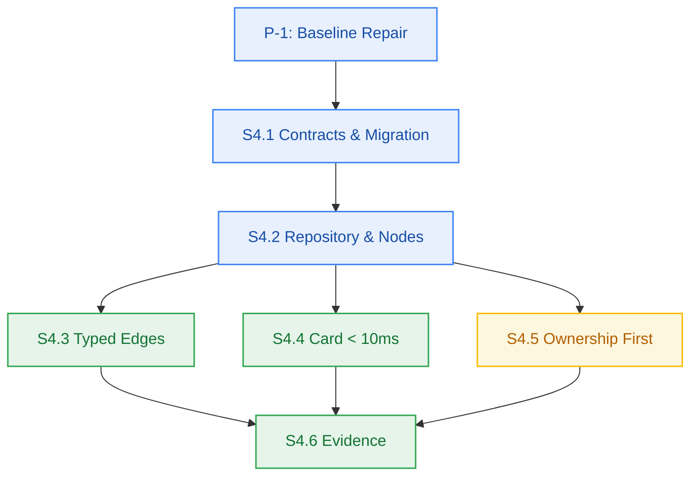

# M4 Dev Plan

**Commands:** `build=bun run build` · `test=bun test` · `lint=bun run lint` · `typecheck=bun run typecheck`

## Authority note (precondition P-1)

`packages/ingestion/**` is `forbidden_files` in **every** M4 story matrix — correctly, because
baseline repair is not story work. P-1's authority is `pm-approval.md` §3 and the `precondition`
block in `milestone-status.yaml`, which assign it to `developer-agent` explicitly *before* S4.1.
So P-1 tasks are executed outside any story matrix and are recorded here, not in a story row.
No M4 story will touch `packages/ingestion/**`.

## P-1 Baseline Repair

### Defect B-1 — stale tracked artifacts
- `packages/contracts/src/ingestion.js` = `export * from "./ingestion.ts"`
- `packages/contracts/src/metering.js` = `export type {...} from "./metering.ts"` (**invalid JS**)

`contracts/package.json` already maps `./metering.js` → `./src/metering.ts`, so the exports map
makes the shims redundant. For *relative* imports inside `src/index.ts` the exports map does not
apply, so `./metering.js` resolves to the on-disk shim and blows up at runtime with
`error: Unexpected type`.

- **T-P1-1:** delete both `.js` shims → `bun test tests/package-exports.test.ts`

### Defect B-2 — 187 TS errors in `@repo/ingestion`
Six root causes, not 187 independent problems:

| # | Root cause | Errors | Fix |
|---|---|---:|---|
| R1 | `index.ts` is a **botched merge** — second half repeats Progress/Compensation/Cross-cutting/`CompensationError` blocks | 122 | keep one copy of each block |
| R2 | `vector/upsert.ts`, `queue/dispatch.ts` each contain a duplicated function (`formatVectorPoint`, `buildVectorPointId`, `createIngestionJobAccepted`) | ~20 | drop the duplicate impl |
| R3 | `AppProblemError` imported via `import type` but instantiated as a value | ~12 | value import |
| R4 | Error passed as **kebab URI** instead of catalogue **key** | ~10 | map to closed 17-member keys |
| R5 | Missing type imports (`ExtractedPdfResult`, `IngestionChunkPayload`, …) | ~15 | import from `@repo/contracts/ingestion` |
| R6 | `export {Type}` under `isolatedModules`, `reason` without initializer, arg-count mismatch | ~15 | `export type`, definite assignment, fix arity |

**R4 mapping (catalogue is CLOSED at 17 — `errors.test.ts` enforces it; no key added):**

| Call site | Passed today | Mapped key |
|---|---|---|
| `compensation/refund.ts:50` | `compensation-failed` | `INTERNAL_SERVER_ERROR` |
| `queue/dispatch.ts` (×3) | `queue-dispatch-failed` | `UPSTREAM_PROVIDER_UNAVAILABLE` |
| `vector/upsert.ts:41` | `vector-store-error` | `UPSTREAM_PROVIDER_UNAVAILABLE` |
| `embedding.ts:102` | `embedding-provider-unavailable` | `UPSTREAM_PROVIDER_UNAVAILABLE` |
| `s3-staging.ts:126` | `upload-size-exceeded` | `UPLOAD_SIZE_EXCEEDED` |
| `progress/sse.ts:129` | `progress-stream-unavailable` | `PROGRESS_STREAM_UNAVAILABLE` |
| `extractors/pdf.ts:10` | `no-text-layer-pdf` | `NO_TEXT_LAYER_PDF` |
| `extractors/youtube.ts:10` | `transcript-disabled` | `DOCUMENT_PARSING_FAILED` (detail carries reason) |
| `extractors/web.ts:10` | `no-readable-content` | `DOCUMENT_PARSING_FAILED` (detail carries reason) |

This also repairs a **latent runtime bug**: `ERROR_CATALOGUE["vector-store-error"]` is `undefined`,
so any of these errors thrown today would serialize with no type/title/status.

- **T-P1-2:** delete shims, then work R1→R6 per file → `bun run typecheck` exits 0
- **T-P1-3:** `bun run build` exits 0
- **T-P1-4:** re-record real evidence for M3 rows in `milestone-status.yaml` (owner `pm-agent` — routed, not self-authored)

## M4 Stories (frozen matrices — see `sprint-status.yaml`)

| Task | Story | Build | Verifies |
|---|---|---|---|
| T-1 | S4.1 | `contracts/src/workspace.ts`, `db/migrations/002_notebook_graph.ts` | AC-4.2 type union |
| T-2 | S4.2 | `packages/workspace/{package,tsconfig,src/*}` | AC-4.3 |
| T-3 | S4.3 | `workspace/src/edges.ts` | AC-4.2 |
| T-4 | S4.4 | `workspace/src/cards.ts` | AC-4.1 |
| T-5 | S4.5 | `workspace/src/search.ts` | AC-4.4 |
| T-6 | S4.6 | evidence + contract sync | all |

## Open issues
- **`git-plan.md` is missing for M4.** Per the Behavior Contract I do not improvise branch/commit
  conventions — routed to `git-planner-agent`. No commits are made in this session.