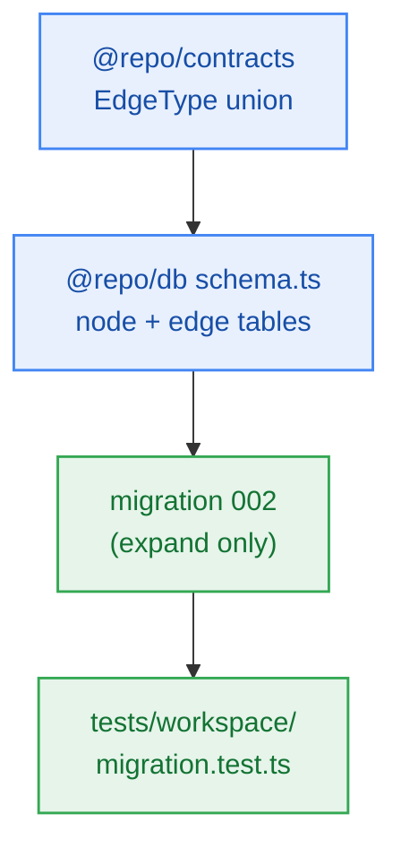

# S4.1 — Graph Contracts, Schema Types & Expand Migration

> **Work Unit:** WU-M4-1 · **Effort:** 3 · **Priority:** p0 · **Risk Tier:** LOW  
> **Owner:** `developer-agent` · **Depends on:** — (sprint entry point)



## Goal
Establish the persistence and type foundation for the M4 domain graph: a closed `EdgeType` union, Kysely table types for `notebook_nodes` / `notebook_edges`, and an **expand-only** migration `002`.

## Acceptance Criteria
1. `EdgeType` exported from `@repo/contracts` as `"cites" | "related"` — no wider.
2. Kysely interfaces for `notebook_nodes` and `notebook_edges` added to `packages/db/src/schema.ts` and registered on `Database`.
3. `002_notebook_graph.ts` creates both tables with:
   - composite index `(user_id, notebook_id)` on each table,
   - `CHECK (edge_type IN ('cites','related'))` and `CHECK (source_id <> target_id)`,
   - `FOREIGN KEY … ON DELETE CASCADE` to `notebooks` and to `notebook_nodes`,
   - `UNIQUE (source_id, target_id, edge_type)`.
4. Migrator runs `001 → 002` on a fresh database **and** on a database already migrated through `001`.
5. `raw-sql-exceptions.md` stays at 0 rows (everything expressed through the Kysely migration builder).

## Change Matrix (frozen)
| Class | Paths |
|---|---|
| **new_files** | `packages/contracts/src/workspace.ts`, `packages/db/src/migrations/002_notebook_graph.ts`, `tests/workspace/migration.test.ts` |
| **allowed_files** | `packages/contracts/src/**`, `packages/db/src/**`, `tests/workspace/**` |
| **forbidden_files** | `packages/metering/**`, `packages/auth/**`, `packages/ingestion/**`, `packages/config/**`, `packages/ui/**`, `packages/workspace/**`, `tests/*.test.ts`, `infra/**`, `apps/**`, `_documentation/**` |

## Verification Hook
```bash
bun test tests/workspace/migration.test.ts && bun run typecheck
```
Evidence must show the CHECK constraint rejecting a non-`cites`/`related` `edge_type` at the SQL level.

## Rollout / Compatibility
Expand-only. No existing column is altered or dropped, so the running M1–M3 code is unaffected. Nothing to contract later.
