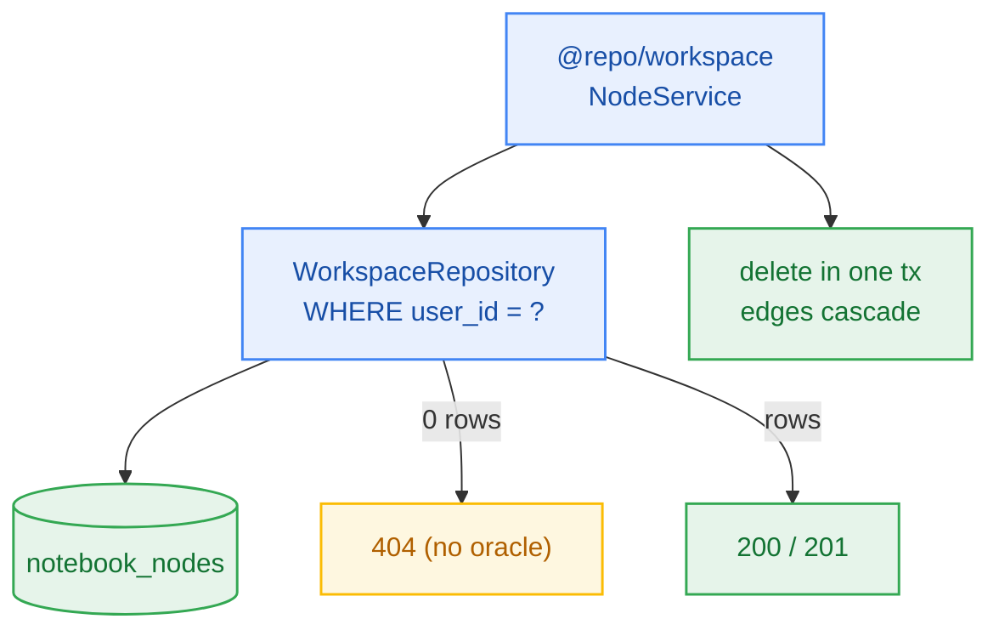

# S4.2 — Workspace Package, Tenant Repository & Node CRUD

> **Work Unit:** WU-M4-3 · **Effort:** 5 · **Priority:** p0 · **Risk Tier:** MEDIUM  
> **Owner:** `developer-agent` · **Depends on:** S4.1



## Goal
Stand up `@repo/workspace` with a tenant-scoped repository and node CRUD. Ownership is a **predicate on the reading statement**, never a separate existence probe (no TOCTOU window).

## Acceptance Criteria
1. `@repo/workspace` scaffolded: `package.json`, `tsconfig.json`, `src/index.ts`.
2. `WorkspaceRepository` list/create/read/delete for nodes, every statement carrying `WHERE user_id = ?` from `TenantContext` — never from the request payload.
3. Foreign node/notebook → typed not-found result (HTTP 404 mapping, sealed `M4-PM-001`), zero rows returned.
4. `kind='document'` requires `document_id`; `kind='text'` requires `content`.
5. Deleting a node removes its edges in the same transaction — 0 orphan rows (FM-401).
6. Writes to a notebook with `deleted_at IS NOT NULL` abort with not-found (FM-404).

## Change Matrix (frozen)
| Class | Paths |
|---|---|
| **new_files** | `packages/workspace/package.json`, `packages/workspace/tsconfig.json`, `packages/workspace/src/index.ts`, `packages/workspace/src/repository.ts`, `packages/workspace/src/nodes.ts`, `packages/workspace/src/types.ts`, `tests/workspace/node-crud.test.ts`, `tests/workspace/node-validation.test.ts` |
| **allowed_files** | `packages/workspace/**`, `packages/db/src/**`, `packages/contracts/src/**`, `tests/workspace/**`, `_documentation/planning/contracts/api-contract.openapi.yaml` |
| **forbidden_files** | `packages/metering/**`, `packages/auth/**`, `packages/ingestion/**`, `packages/config/**`, `packages/ui/**`, `tests/*.test.ts`, `infra/**`, `apps/**`, `_documentation/**` |

## Verification Hook
```bash
bun test tests/workspace/node-crud.test.ts tests/workspace/node-validation.test.ts && bun run build && bun run typecheck
```

## Rollout / Compatibility
Additive package. `@repo/metering` is **not** touched — node CRUD does not debit credits.
