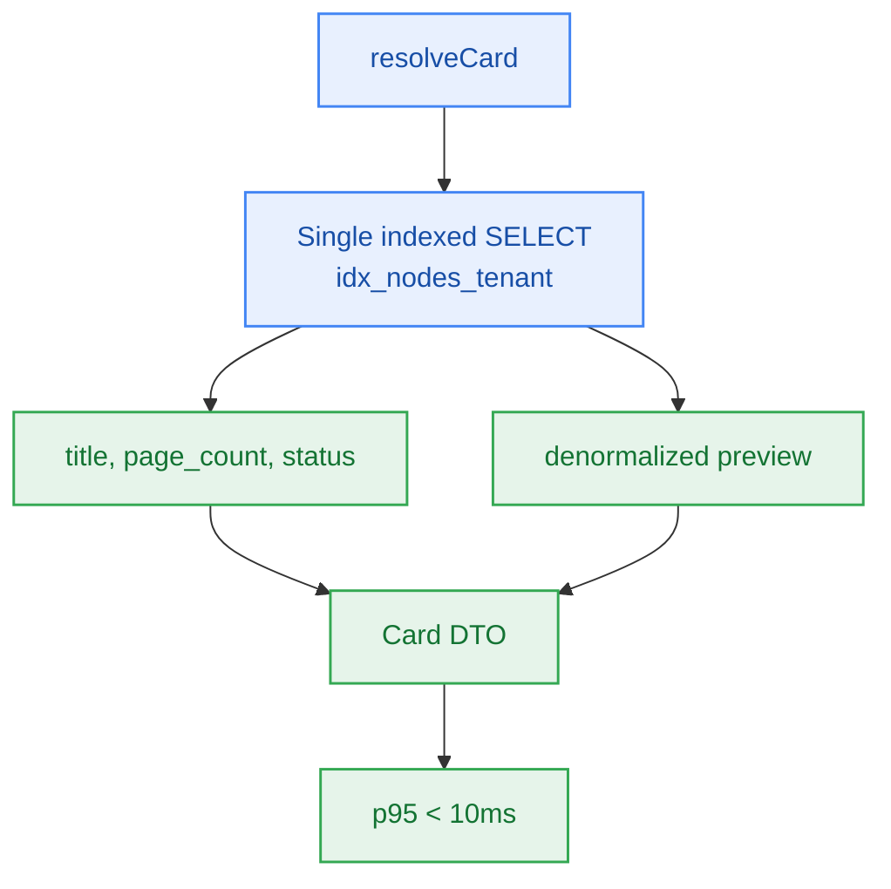

# S4.4 — Document Card Resolution Under the 10ms Budget

> **Work Unit:** WU-M4-5 · **Effort:** 4 · **Priority:** p1 · **Risk Tier:** MEDIUM  
> **Owner:** `developer-agent` · **Depends on:** S4.2



## Goal
Resolve a document-backed node's card (title, page count, status, source type, preview chunk) in **< 10ms p95**, with one round trip.

## Acceptance Criteria
1. `resolveCard` returns `title`, `page_count`, `status`, `source_type`, `preview`, `chunk_index`.
2. **AC-4.1:** p95 over ≥ 100 samples against local compose is < 10ms. Measured at p95, never mean (FM-402).
3. Exactly one indexed statement per card — no second hop to Upstash Vector.
4. Foreign node → 404 with zero rows.
5. `elapsed_ms > 10` emits a `WARN` carrying `user_id`, `notebook_id`, `elapsed_ms`.

## Latency Budget
| Step | Budget |
|---|---|
| Index seek `(user_id, notebook_id)` | ≤ 1ms |
| Row fetch (column-limited) | ≤ 3ms |
| Connection acquisition (pooled) | ≤ 3ms |
| Serialize + respond | ≤ 2ms |

## Change Matrix (frozen)
| Class | Paths |
|---|---|
| **new_files** | `packages/workspace/src/cards.ts`, `tests/workspace/card-latency.test.ts`, `tests/workspace/card-tenant.test.ts` |
| **allowed_files** | `packages/workspace/**`, `packages/db/src/**`, `tests/workspace/**`, `_documentation/planning/contracts/api-contract.openapi.yaml` |
| **forbidden_files** | `packages/metering/**`, `packages/auth/**`, `packages/ingestion/**`, `packages/config/**`, `packages/ui/**`, `tests/*.test.ts`, `infra/**`, `apps/**`, `_documentation/**` |

## Verification Hook
```bash
bun test tests/workspace/card-latency.test.ts tests/workspace/card-tenant.test.ts
```
Evidence must include the measured p95 number, not just a pass/fail.

## Rollout / Compatibility
Additive. Preview is denormalized at write time, so no read-path dependency on the vector service is introduced.
