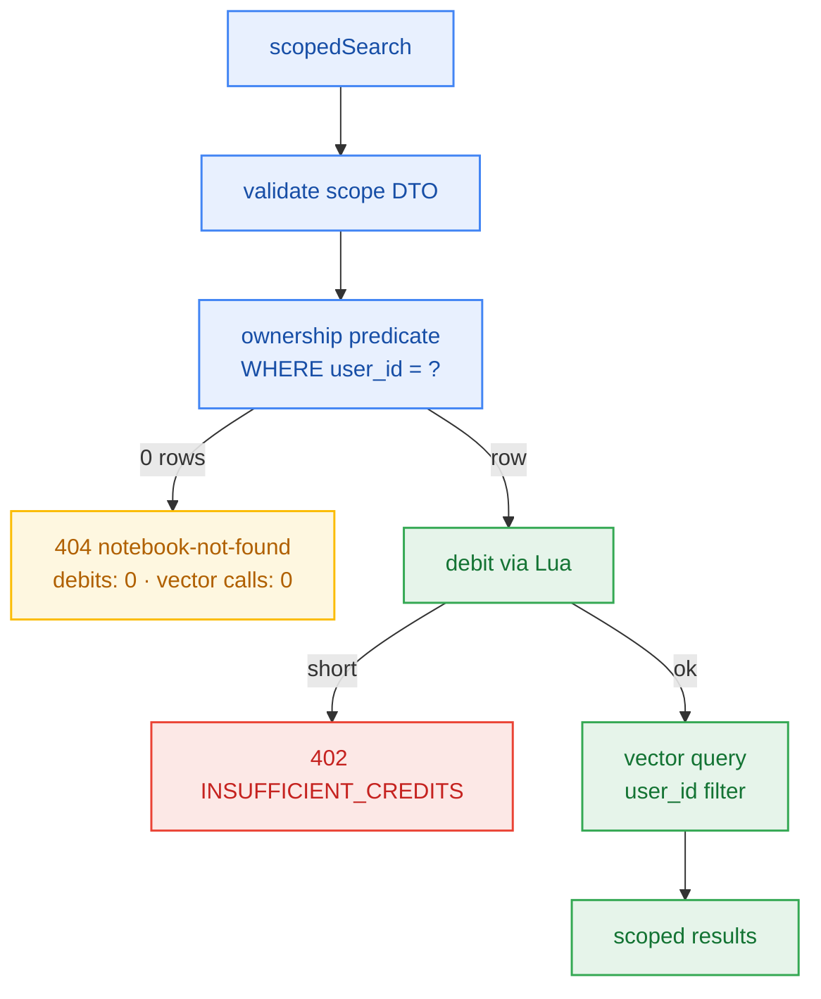

# S4.5 — Scoped Retrieval With Ownership Checked Before Debit

> **Work Unit:** WU-M4-6 · **Effort:** 5 · **Priority:** p0 · **Risk Tier:** **HIGH**  
> **Owner:** `developer-agent` · **Depends on:** S4.2



## Goal
Implement scoped retrieval (`node` | `branch` | `notebook`) where the ownership predicate **structurally gates** the metering debit.

## Hard Sequencing Contract
```
validate DTO → ownership predicate → [only if owned] debit → vector query
```
There must be no code path in which `debitCredits()` is reachable without the predicate having returned ≥ 1 row.

## Acceptance Criteria
1. Malformed `scope_kind` → HTTP 400 before any other work.
2. **AC-4.4:** unowned scope → HTTP 404 `notebook-not-found`, `credits_balance` **unchanged**, vector client invocation count **0**.
3. Ownership is a `WHERE user_id = ?` predicate on the reading statement, not a separate probe.
4. Owned scope debits **exactly once**, then queries Upstash Vector with the mandatory `user_id` filter (`NFR-007`).
5. Insufficient balance → HTTP 402 with zero vector calls.

## Preconditions & Recovery
- **Precondition:** S4.2's repository contract merged; `debitCredits` has a single call site, inside the gated path.
- **Recovery:** debit succeeded + vector call threw → restore via existing atomic `refund-credits.lua`, surface HTTP 503.
- **Stop condition:** any test observing `credits_balance` change on an unowned scope halts the story and returns it to `architect-agent` (FM-403, AP=H).

## Change Matrix (frozen)
| Class | Paths |
|---|---|
| **new_files** | `packages/workspace/src/search.ts`, `tests/workspace/scoped-search-ownership.test.ts`, `tests/workspace/scoped-search-metering.test.ts` |
| **allowed_files** | `packages/workspace/**`, `tests/workspace/**`, `_documentation/planning/contracts/api-contract.openapi.yaml` |
| **forbidden_files** | `packages/metering/**`, `packages/auth/**`, `packages/ingestion/**`, `packages/config/**`, `packages/ui/**`, `packages/db/**`, `tests/*.test.ts`, `infra/**`, `apps/**`, `_documentation/**` |

> `@repo/metering` is a **dependency, not an editable file**: the story consumes `debitCredits` through its public contract and may not modify the ledger, Lua scripts, or its config.

## Verification Hook
```bash
bun test tests/workspace/scoped-search-ownership.test.ts tests/workspace/scoped-search-metering.test.ts
```
The ownership test asserts **three** things together: 404 status, unchanged balance, zero vector calls.

## Rollout / Compatibility
Additive endpoint. Authorization runs before metering, so an unauthorized probe costs the platform no credit and the caller no balance.
