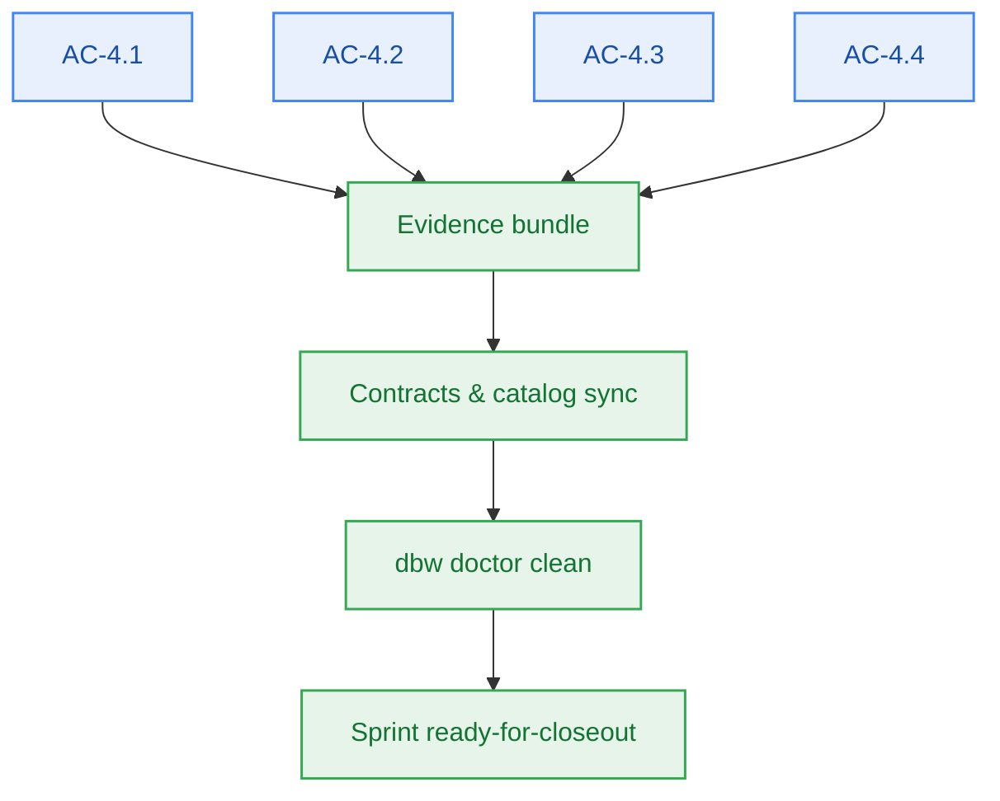

# S4.6 — M4 Verification Evidence & Contract Synchronization

> **Work Unit:** WU-M4-7 · **Effort:** 3 · **Priority:** p0 · **Risk Tier:** LOW  
> **Owner:** `developer-agent` · **Depends on:** S4.3, S4.4, S4.5



## Goal
Produce evidence for all four M4 acceptance criteria and bring every dependent document into sync so the milestone can close.

## Acceptance Criteria
1. AC-4.1..AC-4.4 each carry **named** passing evidence (command + output). Anything not run is recorded `NOT_VERIFIED`, never `PASS`.
2. `api-contract.openapi.yaml`, `component-catalog.yaml`, and `05-m4-notebook-workspace-and-domain-graph.md` match what was implemented.
3. FM-401..FM-404 remain present in `failure-mode-register.md` and are mapped to their stories.
4. `bun test && bun run build && bun run typecheck` all exit 0 (unified M0–M4 suite).
5. `npx --no-install dbw doctor` reports no `OUTSTANDING` documentation row.

## Change Matrix (frozen)
| Class | Paths |
|---|---|
| **new_files** | `tests/workspace/**`, `_documentation/planning/milestones/m4-notebook-workspace/dev-log.md` |
| **allowed_files** | `tests/workspace/**`, `_documentation/planning/milestones/m4-notebook-workspace/**`, `_documentation/planning/milestones/milestone-status.yaml`, `_documentation/planning/contracts/api-contract.openapi.yaml`, `_documentation/planning/contracts/component-catalog.yaml`, `_documentation/planning/architecture/05-m4-notebook-workspace-and-domain-graph.md` |
| **forbidden_files** | `packages/metering/**`, `packages/auth/**`, `packages/ingestion/**`, `packages/config/**`, `packages/ui/**`, `packages/db/**`, `packages/contracts/**`, `packages/workspace/**`, `tests/*.test.ts`, `infra/**`, `apps/**` |

## Verification Hook
```bash
bun test && bun run build && bun run typecheck && npx --no-install dbw doctor
```

## Rollout / Compatibility
Documentation and evidence only — no runtime change.
