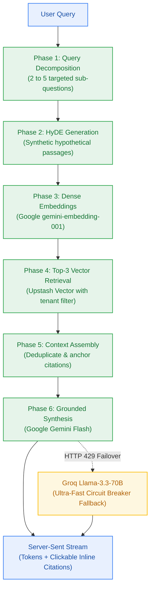

# Milestone Charter — M5: 6-Phase Grounded Reasoning Engine (v0.5.0)

> **Status:** Planned (Follows M3 Ingestion & M4 Notebook Workspace)  
> **Author:** pm-agent (Stage 2 Owner) · **Date:** 2026-10-23  
> **Target Version:** `v0.5.0` · **Risk Tier:** HIGH  
> **Grounding:** `project-brief.md` (FR-008..FR-011, FR-036, FR-038..FR-039; BR-008..BR-009, BR-041..BR-042; NFR-001..NFR-003, NFR-022; ADR-0004)  

---

## 1. Executive Summary & Outcome

Milestone M5 delivers the core 6-phase grounded reasoning pipeline (`v0.5.0`). It addresses the shallow retrieval problem by decomposing complex user prompts into 2–5 sub-questions, generating hypothetical document embeddings (HyDE), and retrieving top-3 vectors per question from Upstash Vector under strict tenant isolation. The response streams tokens with clickable inline citations using Google Gemini 1.5/2.0 Flash as primary inference, backed by an automatic circuit breaker that fails over to Groq Llama-3.3-70B under quota exhaustion (`ADR-0004`).

---

## 2. In Scope

- **Phase 1: Query Decomposition (`FR-008`):**
  - Heuristic analysis splitting complex multi-part queries into 2 to 5 distinct sub-questions.
- **Phase 2: HyDE Synthesis (`FR-009`):**
  - Fast generation of hypothetical answer passages to bridge vocabulary mismatch.
- **Phase 3 & 4: Multi-Vector Retrieval (`FR-010`, `ADR-0004`):**
  - Embedding queries via Google AI Studio (`gemini-embedding-001`).
  - Upstash Vector search retrieving top-3 chunks per sub-question with tenant payload filter `{ user_id }` (`BR-008`).
  - Latency SLA: p95 vector retrieval < 100 ms (`NFR-001`).
- **Phase 5 & 6: Grounded Synthesis & Streaming (`FR-011`):**
  - Prompt assembly enforcing zero hallucination outside retrieved context (`BR-009`).
  - Google Gemini Flash streaming synthesis with Time-to-First-Token p90 < 1,500 ms (`NFR-002`).
  - Clickable citation anchors `[1]`, `[2]` linking directly to document chunk previews.
- **Resilience & Fallback Circuit Breaker (`NFR-022`, `ADR-0004`):**
  - Transparent interceptor: on Google AI Studio HTTP 429 `RESOURCE_EXHAUSTED`, switch request immediately to Groq Llama-3.3-70B Versatile with zero user disruption.
  - End-to-end pipeline latency SLA: p90 < 4,500 ms (`NFR-003`).

---

## 3. Out of Scope

- Long-term episodic memory extraction across user sessions (owned by Milestone M6).
- Public marketing landing page or unauthenticated views (owned by Milestone M8).
- Multi-user concurrency load testing (owned by Milestone M9).

---

## 4. Acceptance Criteria & Gate Status

| ID | Criterion | Evidence Target | Gate |
|:---:|---|---|:---:|
| **AC-5.1** | Query Decomposition | Complex query splits into 2–5 distinct sub-questions with 100% valid JSON | G5 |
| **AC-5.2** | Top-3 Scoped Vector Search | Upstash Vector returns top-3 chunks with p95 latency < 100ms and zero cross-tenant hits | G5 |
| **AC-5.3** | Grounded Citation Stream | Synthesized response streams tokens; every assertion links to a retrieved chunk | G6 |
| **AC-5.4** | Groq Fallback Circuit Breaker | Simulated Gemini 429 triggers transparent Groq failover without throwing 5xx to client | G6 |
| **AC-5.5** | End-to-End Latency SLA | Complete 6-phase reasoning pipeline executes in p90 < 4,500 ms | G6 |

---

## 5. Next Steps & Pipeline Handoff

1. Follows completion and sign-off of Milestone M3 (Ingestion) and M4 (Notebook Workspace).
2. `sprint-agent` authors `m5-reasoning-engine/sprint-status.yaml` and story cards.
3. Hands off to `developer-agent` for reasoning pipeline and Groq fallback implementation.
