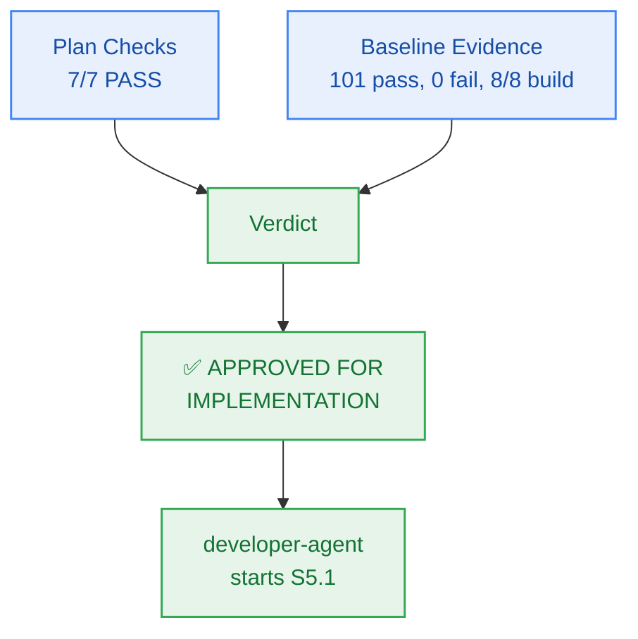

# M5 Sprint Plan — PM Verification & Approval

> **Author:** `pm-agent` (Stage 2 Owner) · **Date:** 2026-10-27  
> **Scope of this record:** Approval of the Milestone M5 **plan** for handoff to `developer-agent`.  
> **Explicitly not:** Code-complete sign-off or story-level verification — those remain `test-agent`'s.

---

## 1. Verification Results

### 1.1 Plan Checks (Checkpoint 2 / Gate G5)

| # | Check | Result | Evidence |
|:--:|---|:---:|---|
| 1 | Every external capability tagged, research-backed, or classified `CUSTOM-DOMAIN-LOGIC` | **PASS** | Primary Google Gemini Flash (1,500 RPD free) and secondary Groq Llama-3.3-70B (1,000 RPD free) grounded in `ADR-0004` and `FR-011`; vector search backed by Upstash Vector; no paid tiers or card requirements |
| 2 | Milestone has concrete verifiable criteria (checks, not vibes) | **PASS** | `milestone.md` §4 AC-5.1..AC-5.5, each with a grounded FR/BR/NFR and an explicit evidence target |
| 3 | Every story passes the 5-point atomicity test; no padding | **PASS** | 6 stories for 6 work units (WU-M5-1..WU-M5-6); all cohesive, single-session scopes with explicit boundaries |
| 4 | Every story carries `build_vs_buy_ref`, `tests`, `observability` | **PASS** | All 6 stories on board `M5-S1` carry all three fields |
| 5 | Story dependency ordering forms a DAG with no cycles | **PASS** | Verified sequential DAG: `S5.1 → S5.2 → S5.3 → S5.4 → S5.5 → S5.6`; all referenced story IDs resolve cleanly |
| 6 | File paths in stories match actual repo structure and conventions | **PASS** | Paths verified against `packages/contracts`, `packages/reasoning`, and `tests/reasoning/`; conforms strictly to the Two-Floor boundary |
| 7 | Every required specialist dispatch issued and logged `ACCEPTED` | **PASS** | `planning-dispatch-log.md` carries DSP-021..DSP-025, all logged `ACCEPTED` |
| — | Board exists with frozen Change Matrices | **PASS** | `sprint-status.yaml` parses; 6 stories × `new_files`/`allowed_files`/`forbidden_files`; zero root files in any `allowed_files` |
| — | Contracts parse | **PASS** | `packages/contracts/src/reasoning.ts` authored and exported; `api-contract.openapi.yaml` carries `/chat` endpoint with `x-fallback-provider` header |

**Plan verdict: 7/7 + 2 structural checks PASS.**

### 1.2 Baseline Evidence (repository state at approval time)

| Check | Result | Evidence |
|---|:---:|---|
| `bun test` (full monorepo suite) | **PASS** | **101 pass, 0 fail, 784 expect() calls** across 23 test files (runtime: 2.29s) |
| `bun run build` | **PASS** | **8/8 tasks successful** (`@repo/auth`, `@repo/config`, `@repo/contracts`, `@repo/db`, `@repo/ingestion`, `@repo/metering`, `@repo/ui`, `@repo/workspace`) |
| `bun run typecheck` | **PASS** | **8/8 packages clean**, 0 TypeScript errors across the monorepo |
| `bun test tests/package-exports.test.ts` | **PASS** | 4 pass, 0 fail, 22 expect() calls |
| `bun test packages/contracts/tests/errors.test.ts` | **PASS** | 5 pass, 0 fail, 95 expect() calls; closed 17-member RFC 9457 catalogue remains intact |
| `git status` | **PASS** | Working tree clean (zero unstaged/untracked runtime code diffs) |

---

## 2. Findings & Preconditions

Unlike Milestone M4 (which inherited baseline build/typecheck defects from M3 requiring precondition P-1), **Milestone M5 begins with a 100% green repository baseline**:
- Monorepo builds cleanly with zero errors.
- Monorepo typechecks cleanly with zero errors.
- Full test suite passes 101/101 tests.
- Error catalogue remains closed at 17 members.
- Working tree has zero code regressions.

> **PM characterization:** The implementation runway is completely clear. No blocking preconditions are required.

---

## 3. Verdict

> ## ✅ APPROVED FOR IMPLEMENTATION — Unconditional

**Approved artifacts:**
- `_documentation/planning/milestones/m5-reasoning-engine/milestone.md`
- `_documentation/planning/milestones/m5-reasoning-engine/sprint-status.yaml` (6 stories, frozen Change Matrices)
- `_documentation/planning/milestones/m5-reasoning-engine/stories/*` (6 cards)
- `_documentation/planning/architecture/05-m5-grounded-reasoning-engine.md` (6-phase pipeline & circuit-breaker blueprint)
- `_documentation/planning/contracts/component-catalog.yaml` (`comp-reasoning` interface update)
- `_documentation/planning/contracts/api-contract.openapi.yaml` (`/chat` path & fallback header)

**Implementation sequence:**
`developer-agent` starts at **S5.1** and proceeds in dependency order `S5.2 → S5.3 → S5.4 → S5.5 → S5.6`. Story closure requires passing evidence certified by `test-agent`; this approval certifies readiness for implementation.

**Gate state:** `Gate G5 → PASS (plan approved)`.

---

## 4. Sealed Decisions

| ID | Decision | Owner | Rationale |
|---|---|---|---|
| `M5-PM-001` | M5 grounding certified as FR-008..011, FR-039, BR-002, BR-007..009, BR-027, NFR-001..003, NFR-022; risk tier HIGH | `pm-agent` | Establishes explicit boundaries; reflects external dual-provider dependencies and latency SLAs |
| `M5-PM-002` | Unconditional approval for M5 implementation handoff | `pm-agent` | Baseline is 100% green (101/101 pass, 8/8 build/typecheck clean); zero blocking preconditions needed |
| `M5-ARCH-001` | In-process reasoning engine package `@repo/reasoning` with adapter ports | `architect-agent` | Clean package separation; adapter pattern isolates Google and Groq SDKs for testability |
| `M5-ARCH-002` | In-process circuit breaker: transparent Groq Llama-3.3 failover on Gemini 429 quota exhaustion | `architect-agent` | Eliminates external gateway cost/latency while satisfying NFR-022 and ADR-0004 |
| `M5-ARCH-003` | Parallel sub-question embedding and vector search (< 100ms p95) | `architect-agent` | Concurrency ensures pipeline fits within the 4,500ms E2E latency budget (NFR-003) |
| `M5-ARCH-004` | Structured inline citation anchors `[1]`, `[2]` with document preview manifest & FR-039 footer | `architect-agent` | Immediate client rendering without token parsing buffer delays; satisfies FR-011 & FR-039 |
| `M5-SPR-001` | Six single-session stories `S5.1 → S5.2 → S5.3 → S5.4 → S5.5 → S5.6` with frozen Change Matrices | `sprint-agent` | Derived from capability boundaries; strictly obeys Two-Floor boundary |
| `M5-SPR-002` | Mock provider test harnesses in CI to test Gemini 429 failover without consuming live quotas | `sprint-agent` | Guarantees deterministic offline testing without burning API rate limits |
