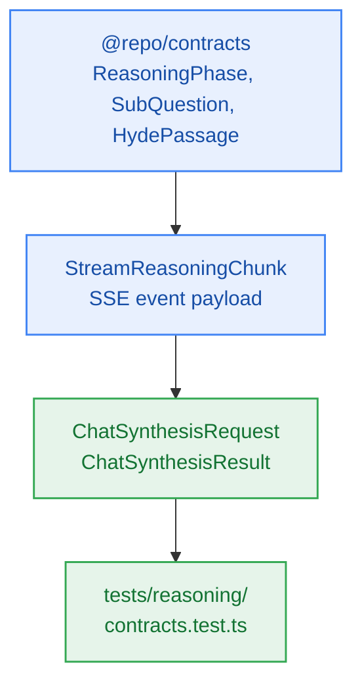

# S5.1 — Shared Reasoning Contracts, DTO Types & Streaming Envelopes

> **Work Unit:** WU-M5-1 · **Effort:** 3 · **Priority:** p0 · **Risk Tier:** LOW  
> **Owner:** `developer-agent` · **Depends on:** — (sprint entry point)



## Goal
Establish the shared TypeScript contract types and streaming event schemas for the 6-phase grounded reasoning engine under `@repo/contracts`.

## Acceptance Criteria
1. Export the closed union `ReasoningPhase`: `"decomposition" | "hyde" | "embedding" | "retrieval" | "assembly" | "synthesis"`.
2. Export `SubQuestion`, `HydePassage`, `RetrievedContextChunk`, `CitationAnchor`, `UnavailableSourceInfo`, `ChatSynthesisRequest`, `ChatSynthesisResult`, and `InferenceProviderType`.
3. Export `StreamReasoningEventType` supporting `"phase_start" | "sub_questions" | "citations" | "token" | "unavailable_sources" | "done" | "error"`.
4. Validate `ChatSynthesisRequest` (minLength: 3, maxLength: 2000, valid UUID `notebook_id`).
5. Ensure the closed 17-member RFC 9457 error catalogue remains exactly 17 entries with zero modifications.

## Change Matrix (frozen)
| Class | Paths |
|---|---|
| **new_files** | `packages/contracts/src/reasoning.ts`, `tests/reasoning/contracts.test.ts` |
| **allowed_files** | `packages/contracts/src/**`, `tests/reasoning/**` |
| **forbidden_files** | `packages/metering/**`, `packages/auth/**`, `packages/ingestion/**`, `packages/config/**`, `packages/ui/**`, `packages/workspace/**`, `packages/db/**`, `packages/reasoning/**`, `tests/*.test.ts`, `infra/**`, `apps/**`, `_documentation/**` |

## Verification Hook
```bash
bun test tests/reasoning/contracts.test.ts && bun test packages/contracts/tests/errors.test.ts && bun run typecheck
```

## Rollout / Compatibility
Expand-only. Adds new types to `@repo/contracts` without altering any existing interfaces or schemas.
