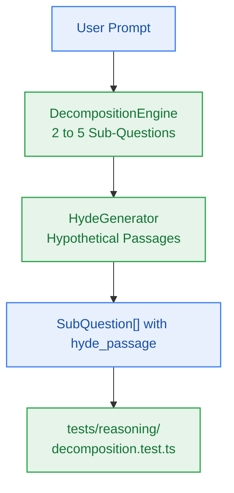

# S5.2 — Query Decomposition (Phase 1) & HyDE Synthetic Passage Generator (Phase 2)

> **Work Unit:** WU-M5-2 · **Effort:** 4 · **Priority:** p0 · **Risk Tier:** MEDIUM  
> **Owner:** `developer-agent` · **Depends on:** S5.1



## Goal
Scaffold package `@repo/reasoning` and implement Phase 1 (Query Decomposition into 2–5 sub-questions) and Phase 2 (HyDE synthetic passage generation) to bridge vocabulary mismatch before vector retrieval.

## Acceptance Criteria
1. Scaffold `@repo/reasoning` under monorepo conventions (`package.json`, `tsconfig.json`, `src/index.ts`).
2. Implement `DecompositionEngine`: decomposes complex prompts into 2 to 5 targeted sub-questions (`FR-008`, `BR-007`, AC-5.1).
3. Short/simple prompts (< 50 chars) return 2 sub-questions (original query + targeted variation).
4. Implement `HydeGenerator`: synthesizes concise 50–100 word speculative passages per sub-question (`FR-009`).
5. Execution completes within p90 < 1,000ms.
6. Provide deterministic heuristic fallback on unparseable LLM output.

## Change Matrix (frozen)
| Class | Paths |
|---|---|
| **new_files** | `packages/reasoning/package.json`, `packages/reasoning/tsconfig.json`, `packages/reasoning/src/index.ts`, `packages/reasoning/src/decomposition.ts`, `packages/reasoning/src/hyde.ts`, `packages/reasoning/src/types.ts`, `tests/reasoning/decomposition.test.ts` |
| **allowed_files** | `packages/reasoning/**`, `packages/contracts/src/**`, `tests/reasoning/**` |
| **forbidden_files** | `packages/metering/**`, `packages/auth/**`, `packages/ingestion/**`, `packages/config/**`, `packages/ui/**`, `packages/workspace/**`, `packages/db/**`, `tests/*.test.ts`, `infra/**`, `apps/**`, `_documentation/**` |

## Verification Hook
```bash
bun test tests/reasoning/decomposition.test.ts && bun run typecheck
```

## Rollout / Compatibility
Expand-only. Introduces `@repo/reasoning` package. No impact on existing routes.
