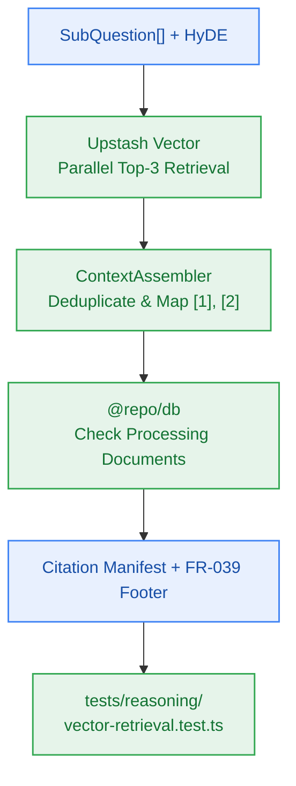

# S5.3 — Multi-Vector Top-3 Retrieval & Context Assembly with Citations (Phase 3..5)

> **Work Unit:** WU-M5-3 · **Effort:** 5 · **Priority:** p0 · **Risk Tier:** HIGH  
> **Owner:** `developer-agent` · **Depends on:** S5.2



## Goal
Implement Phase 3 & 4 (parallel dense vector search retrieving strictly top-3 chunks per sub-question with tenant filter) and Phase 5 (context assembly, deduplication, citation index assignment `[1]`, `[2]`, and unavailable sources footer per `FR-039`).

## Acceptance Criteria
1. Query Upstash Vector concurrently across all sub-questions with tenant filter `{ user_id }` and optional notebook filter (`FR-010`, `BR-008`, `BR-002`, AC-5.2).
2. Retrieve at most top-3 chunks per sub-question (`BR-008`).
3. Vector query latency resolves with p95 < 100ms (`NFR-001`).
4. Deduplicate identical chunks across sub-questions, keeping highest similarity score.
5. Generate deterministic numeric citation anchors `[1]`, `[2]` with source preview metadata.
6. Inspect notebook document statuses; if any document has status `queued`, `processing`, or `failed`, append an explicit disclosure footer (`FR-039`).

## Change Matrix (frozen)
| Class | Paths |
|---|---|
| **new_files** | `packages/reasoning/src/retrieval.ts`, `packages/reasoning/src/assembly.ts`, `tests/reasoning/vector-retrieval.test.ts`, `tests/reasoning/context-assembly.test.ts` |
| **allowed_files** | `packages/reasoning/**`, `tests/reasoning/**` |
| **forbidden_files** | `packages/metering/**`, `packages/auth/**`, `packages/ingestion/**`, `packages/config/**`, `packages/ui/**`, `packages/workspace/**`, `packages/db/**`, `tests/*.test.ts`, `infra/**`, `apps/**`, `_documentation/**` |

## Verification Hook
```bash
bun test tests/reasoning/vector-retrieval.test.ts && bun test tests/reasoning/context-assembly.test.ts && bun run typecheck
```

## Rollout / Compatibility
Expand-only. Pure vector retrieval and context assembling logic inside `@repo/reasoning`.
