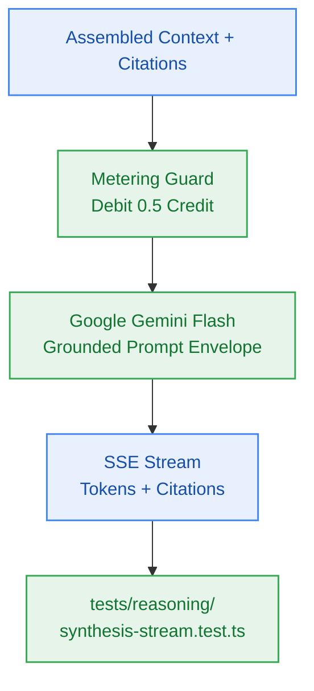

# S5.4 — Grounded Synthesis Streaming via Google Gemini Flash (Phase 6)

> **Work Unit:** WU-M5-4 · **Effort:** 5 · **Priority:** p0 · **Risk Tier:** HIGH  
> **Owner:** `developer-agent` · **Depends on:** S5.3



## Goal
Implement Phase 6 (grounded LLM synthesis streaming via Google Gemini Flash with clickable inline citations `[1]`, `[2]`, zero hallucination outside retrieved context, and atomic 0.5 credit metering debit).

## Acceptance Criteria
1. Grounded prompt envelope strictly binds model to retrieved context; asserts zero hallucination (`BR-009`, AC-5.3).
2. If context is empty, outputs deterministic notice: `"Insufficient context available in your notes to answer this question."` (`BR-009`).
3. Synthesized text streams token-by-token with clickable citation anchors `[1]`, `[2]`.
4. Time-to-First-Token completes within p90 < 1,500ms (`NFR-002`).
5. Atomically debits 0.5 credits via `@repo/metering` Lua script before synthesis begins; balance < 0.5 short-circuits with HTTP 402 (`BR-014`, `BR-015`).

## Change Matrix (frozen)
| Class | Paths |
|---|---|
| **new_files** | `packages/reasoning/src/providers/gemini.ts`, `packages/reasoning/src/synthesis.ts`, `tests/reasoning/synthesis-stream.test.ts`, `tests/reasoning/reasoning-metering.test.ts` |
| **allowed_files** | `packages/reasoning/**`, `tests/reasoning/**` |
| **forbidden_files** | `packages/metering/**`, `packages/auth/**`, `packages/ingestion/**`, `packages/config/**`, `packages/ui/**`, `packages/workspace/**`, `packages/db/**`, `tests/*.test.ts`, `infra/**`, `apps/**`, `_documentation/**` |

## Verification Hook
```bash
bun test tests/reasoning/synthesis-stream.test.ts && bun test tests/reasoning/reasoning-metering.test.ts && bun run typecheck
```

## Rollout / Compatibility
Expand-only. Implements the primary inference path behind the `InferenceProvider` interface.
