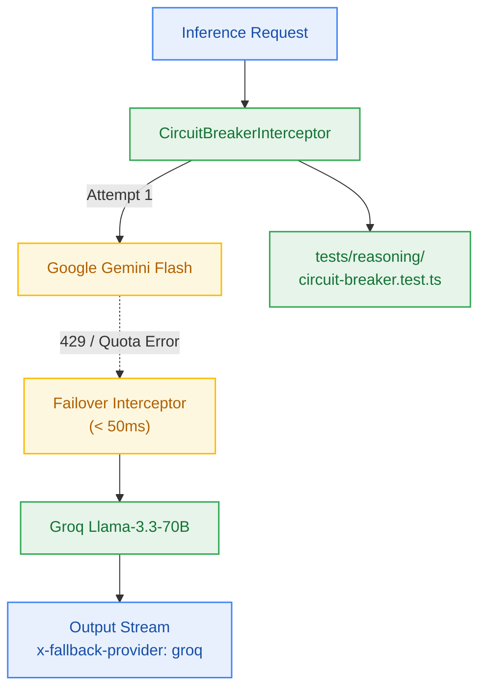

# S5.5 — Transparent Groq Llama-3.3-70B Fallback Circuit-Breaker on Gemini 429

> **Work Unit:** WU-M5-5 · **Effort:** 4 · **Priority:** p0 · **Risk Tier:** HIGH  
> **Owner:** `developer-agent` · **Depends on:** S5.4



## Goal
Implement the resilient in-process circuit-breaker interceptor that detects Google AI Studio HTTP 429 / `RESOURCE_EXHAUSTED` quota errors and transparently fails over to Groq Llama-3.3-70B Versatile with zero user interruption (`NFR-022`, `ADR-0004`, AC-5.4).

## Acceptance Criteria
1. Implement `CircuitBreakerInterceptor` wrapping `InferenceProvider` calls.
2. Intercepts HTTP 429, `RESOURCE_EXHAUSTED`, or TTFT timeouts (> 3,000ms) on Gemini Flash and immediately routes the identical context envelope to Groq Llama-3.3-70B.
3. Injects response header or stream metadata `x-fallback-provider: groq`.
4. Zero 5xx errors thrown to the client during failover.
5. Ingests request `AbortSignal`; aborting the client connection immediately halts upstream generation (`FM-504`).
6. If both providers fail, surfaces HTTP 502 `UPSTREAM_PROVIDER_UNAVAILABLE` and triggers automatic 0.5 credit refund.

## Change Matrix (frozen)
| Class | Paths |
|---|---|
| **new_files** | `packages/reasoning/src/providers/groq.ts`, `packages/reasoning/src/circuit-breaker.ts`, `tests/reasoning/circuit-breaker.test.ts` |
| **allowed_files** | `packages/reasoning/**`, `tests/reasoning/**` |
| **forbidden_files** | `packages/metering/**`, `packages/auth/**`, `packages/ingestion/**`, `packages/config/**`, `packages/ui/**`, `packages/workspace/**`, `packages/db/**`, `tests/*.test.ts`, `infra/**`, `apps/**`, `_documentation/**` |

## Verification Hook
```bash
bun test tests/reasoning/circuit-breaker.test.ts && bun run typecheck
```

## Rollout / Compatibility
Expand-only. Secondary provider fallback layer completely contained inside `@repo/reasoning`.
