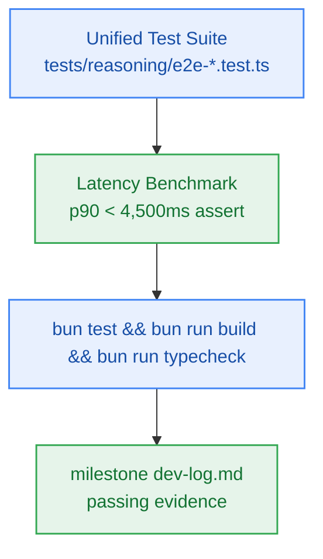

# S5.6 — End-to-End Integration Test Harness, Latency Benchmark Verification & Docs Sync

> **Work Unit:** WU-M5-6 · **Effort:** 3 · **Priority:** p0 · **Risk Tier:** LOW  
> **Owner:** `developer-agent` · **Depends on:** S5.5



## Goal
Establish the end-to-end integration test harness, execute the benchmark suite verifying pipeline latency SLA (`NFR-003`), verify full workspace build and typecheck, and compile the milestone execution evidence into `dev-log.md`.

## Acceptance Criteria
1. End-to-end multi-step reasoning pipeline completes in p90 < 4,500ms over >= 50 synthetic test runs on mock provider harness (`NFR-003`, AC-5.5).
2. Criteria AC-5.1 through AC-5.5 all carry named passing verification evidence.
3. Full monorepo test suite passes (`bun test` exit 0).
4. Strict TypeScript typecheck and production build pass across all workspace packages (`bun run build && bun run typecheck` exit 0).
5. Milestone `dev-log.md` created with timestamped command outputs and test execution proof.
6. Documentation files synchronized with zero open drift.

## Change Matrix (frozen)
| Class | Paths |
|---|---|
| **new_files** | `tests/reasoning/e2e-reasoning.test.ts`, `tests/reasoning/e2e-latency.test.ts`, `_documentation/planning/milestones/m5-reasoning-engine/dev-log.md` |
| **allowed_files** | `tests/reasoning/**`, `tests/monorepo-build.test.ts`, `_documentation/planning/milestones/m5-reasoning-engine/**`, `_documentation/planning/milestones/milestone-status.yaml`, `_documentation/planning/contracts/api-contract.openapi.yaml`, `_documentation/planning/contracts/component-catalog.yaml` |
| **forbidden_files** | `packages/metering/**`, `packages/auth/**`, `packages/ingestion/**`, `packages/config/**`, `packages/ui/**`, `packages/workspace/**`, `packages/db/**`, `packages/contracts/**`, `packages/reasoning/**`, `tests/package-exports.test.ts`, `infra/**`, `apps/**` |

## Verification Hook
```bash
bun test tests/reasoning/e2e-reasoning.test.ts && bun test tests/reasoning/e2e-latency.test.ts && bun test && bun run build && bun run typecheck
```

## Rollout / Compatibility
Documentation and test verification only. No runtime application changes.
