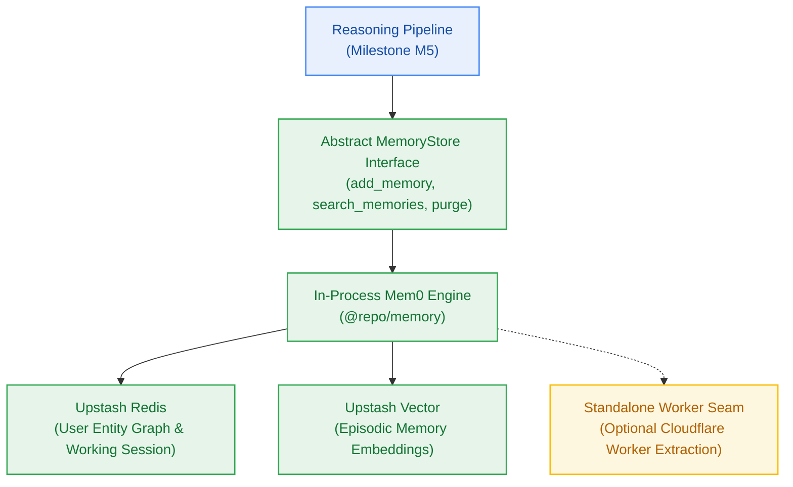

# Milestone Charter — M6: Pluggable Long-Term Memory Store (v0.6.0)

> **Status:** Ready for Implementation (PM Approved Unconditionally)  
> **Author:** pm-agent (Stage 2 Owner) · **Date:** 2026-10-27  
> **Target Version:** `v0.6.0` · **Risk Tier:** MEDIUM  
> **Grounding:** `project-brief.md` (FR-019, FR-020, FR-023; BR-002, BR-018..BR-020; NFR-008, NFR-014, NFR-016, NFR-019; ADR-0004)  

---

## 1. Executive Summary & Outcome

Milestone M6 introduces cross-session user memory without incurring external vendor costs (`v0.6.0`). It defines a vendor-agnostic `MemoryStore` interface implemented via an in-process Mem0 instance backed by Upstash Redis and Upstash Vector (`ADR-0004`). The reasoning engine automatically recalls salient user preferences, previous research themes, and domain constraints across sessions with search latency < 150 ms (`NFR-008`) while preserving the strict $0.00/month infrastructure ceiling (`NFR-016`).

---

## 2. In Scope

- **Abstract Memory Interface (`FR-023`):**
  - Canonical `MemoryStore` TypeScript interface exporting:
    - `add(userId: string, text: string, metadata?: Record<string, unknown>): Promise<void>`
    - `search(userId: string, query: string, limit?: number): Promise<MemoryItem[]>`
    - `deleteUserMemories(userId: string): Promise<void>`
- **In-Process Mem0 Adapter (`ADR-0004`):**
  - Native integration with `@upstash/redis` for graph/kv associations.
  - Native integration with `@upstash/vector` for semantic memory retrieval.
  - Architectural extraction seam: zero tight coupling to Next.js route handlers, allowing future extraction into a standalone worker if required.
- **Tenant Isolation & Zero-Cost Governance (`BR-018`, `NFR-016`):**
  - Strict filtering by `user_id` preventing memory leakage between users (`BR-002`).
  - Zero external memory vendor fees: $0.00/month verified against billing ceilings.
  - Memory search latency SLA: p95 < 150 ms (`NFR-008`).

---

## 3. Out of Scope

- Synchronous memory extraction during token streaming (runs asynchronously post-response).
- Cross-user collaborative memory sharing.
- Autonomous weekly retention sweeps (owned by Milestone M7).

---

## 4. Acceptance Criteria & Gate Status

| ID | Criterion | Evidence Target | Gate |
|:---:|---|---|:---:|
| **AC-6.1** | Interface Abstraction | 100% of memory calls route through `MemoryStore`; zero direct Mem0 calls in routes | G5 |
| **AC-6.2** | Upstash Backend Parity | Episodic memory upserts to Upstash Vector and retrieves accurately via semantic similarity | G5 |
| **AC-6.3** | Memory Retrieval SLA | Memory search query executes with p95 latency < 150 ms | G6 |
| **AC-6.4** | Multi-Tenant Memory Boundary | User B receives empty array when querying memories seeded by User A | G6 |

---

## 5. Next Steps & Pipeline Handoff

1. Milestone M5 (Reasoning Engine) verified complete (154/154 pass, 9/9 build/typecheck).
2. `sprint-agent` authored `m6-pluggable-memory/sprint-status.yaml` and 6 story cards (`S6.1`..`S6.6`).
3. `pm-agent` approved sprint plan unconditionally (`pm-approval.md`, Gate G5 PASS).
4. Hands off to `developer-agent` starting with story **S6.1** in dependency order.
