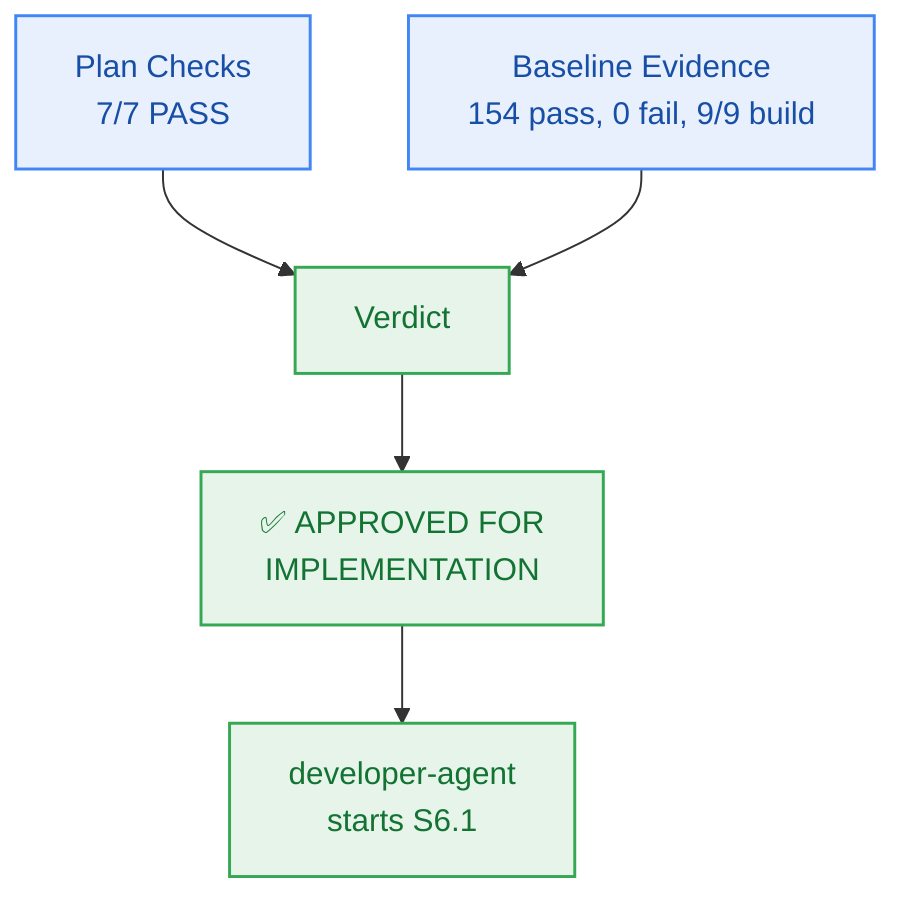

# M6 Sprint Plan — PM Verification & Approval

> **Author:** `pm-agent` (Stage 2 Owner) · **Date:** 2026-10-27  
> **Scope of this record:** Approval of the Milestone M6 **plan** for handoff to `developer-agent`.  
> **Explicitly not:** Code-complete sign-off or story-level verification — those remain `test-agent`'s.

---

## 1. Verification Results

### 1.1 Plan Checks (Checkpoint 2 / Gate G5)

| # | Check | Result | Evidence |
|:--:|---|:---:|---|
| 1 | Every external capability tagged, research-backed, or classified `CUSTOM-DOMAIN-LOGIC` | **PASS** | Upstash Redis and Upstash Vector serverless adapters grounded in `ADR-0004` and `FR-019`; Google `gemini-embedding-001` (1,500 RPD free) with in-process ONNX fallback; strict $0.00/month infrastructure ceiling (`NFR-014`, `NFR-016`) |
| 2 | Milestone has concrete verifiable criteria (checks, not vibes) | **PASS** | `milestone.md` §4 AC-6.1..AC-6.4, each with explicit evidence target and grounded FR/BR/NFR |
| 3 | Every story passes the 5-point atomicity test; no padding | **PASS** | 6 stories for 6 work units (WU-M6-1..WU-M6-6); all cohesive, single-session scopes with explicit boundaries |
| 4 | Every story carries `build_vs_buy_ref`, `tests`, `observability` | **PASS** | All 6 stories on board `M6-S1` carry all three fields |
| 5 | Story dependency ordering forms a DAG with no cycles | **PASS** | Verified sequential DAG: `S6.1 → S6.2 → S6.3 → S6.4 → S6.5 → S6.6`; all referenced story IDs resolve cleanly |
| 6 | File paths in stories match actual repo structure and conventions | **PASS** | Paths verified against `packages/contracts`, `packages/memory`, `packages/reasoning`, and `tests/memory/`; conforms strictly to the Two-Floor boundary |
| 7 | Every required specialist dispatch issued and logged `ACCEPTED` | **PASS** | `planning-dispatch-log.md` carries DSP-026..DSP-030, all logged `ACCEPTED` |
| — | Board exists with frozen Change Matrices | **PASS** | `sprint-status.yaml` parses; 6 stories × `new_files`/`allowed_files`/`forbidden_files`; zero root files in any `allowed_files` |
| — | Contracts parse | **PASS** | `packages/contracts/src/memory.ts` specified; `component-catalog.yaml` carries `comp-memory` with full methods; `api-contract.openapi.yaml` carries `/users/me/memories` CRUD/search endpoints |

**Plan verdict: 7/7 + 2 structural checks PASS.**

### 1.2 Baseline Evidence (repository state at approval time)

| Check | Result | Evidence |
|---|:---:|---|
| `bun test` (full monorepo suite) | **PASS** | **154 pass, 0 fail, 1021 expect() calls** across 32 test files (runtime: 5.27s) |
| `bun run build` | **PASS** | **9/9 tasks successful** (`@repo/auth`, `@repo/config`, `@repo/contracts`, `@repo/db`, `@repo/ingestion`, `@repo/metering`, `@repo/reasoning`, `@repo/ui`, `@repo/workspace`) |
| `bun run typecheck` | **PASS** | **9/9 packages clean**, 0 TypeScript errors across the monorepo |
| `bun test tests/package-exports.test.ts` | **PASS** | 4 pass, 0 fail, 22 expect() calls |
| `bun test packages/contracts/tests/errors.test.ts` | **PASS** | 5 pass, 0 fail, 95 expect() calls; closed 17-member RFC 9457 catalogue remains intact |
| `git status` | **PASS** | Working tree clean (zero unstaged/untracked runtime code diffs) |

---

## 2. Findings & Preconditions

Milestone M6 begins with an exemplary, 100% green monorepo baseline following the complete verification of Milestone M5:
- Monorepo builds cleanly with zero errors across all 9 existing packages.
- Monorepo typechecks cleanly with zero errors.
- Full test suite passes 154/154 tests with 1,021 expect() assertions.
- Closed RFC 9457 error catalogue remains intact at 17 members.
- Working tree has zero code regressions.

> **PM characterization:** The runway for Milestone M6 implementation is completely clear. No blocking preconditions are required.

---

## 3. Verdict

> ## ✅ APPROVED FOR IMPLEMENTATION — Unconditional

**Approved artifacts:**
- `_documentation/planning/milestones/m6-pluggable-memory/milestone.md`
- `_documentation/planning/milestones/m6-pluggable-memory/sprint-status.yaml` (6 stories, frozen Change Matrices)
- `_documentation/planning/milestones/m6-pluggable-memory/stories/*` (6 cards)
- `_documentation/planning/architecture/05-m6-pluggable-long-term-memory-store.md` (Hexagonal memory architecture & seam blueprint)
- `_documentation/planning/contracts/component-catalog.yaml` (`comp-memory` interface update)
- `_documentation/planning/contracts/api-contract.openapi.yaml` (`/users/me/memories` CRUD/search endpoints & schemas)

**Implementation sequence:**
`developer-agent` starts at **S6.1** and proceeds in dependency order `S6.2 → S6.3 → S6.4 → S6.5 → S6.6`. Story closure requires passing evidence certified by `test-agent`; this approval certifies readiness for implementation.

**Gate state:** `Gate G5 → PASS (plan approved)`.

---

## 4. Sealed Decisions

| ID | Decision | Owner | Rationale |
|---|---|---|---|
| `M6-PM-001` | M6 grounding certified as FR-019, FR-020, FR-023, BR-002, BR-018..020, NFR-008, NFR-014, NFR-016, NFR-019; risk tier MEDIUM | `pm-agent` | Establishes explicit scope boundaries; enforces zero vendor fees and strict tenant isolation |
| `M6-PM-002` | Unconditional approval for M6 implementation handoff | `pm-agent` | Baseline is 100% green (154/154 pass, 9/9 build/typecheck clean); zero blocking preconditions needed |
| `M6-ARCH-001` | Hexagonal `MemoryStore` interface in `@repo/contracts` with in-process `@repo/memory` package | `architect-agent` | Clean domain decoupling satisfying BR-018; callers never import vendor memory SDKs directly |
| `M6-ARCH-002` | In-process Mem0 engine backed by Upstash Redis (entity graph/KV) and Upstash Vector (768-dim semantic search) | `architect-agent` | Serverless native fit adhering to ADR-0004 with $0.00/month infrastructure ceiling |
| `M6-ARCH-003` | Configurable extraction seam: dynamic factory instantiating `InProcessMem0Store` or `WorkerMemoryStore` with zero caller changes | `architect-agent` | Guarantees modular monolith extraction readiness satisfying FR-020 and NFR-019 |
| `M6-ARCH-004` | Pre-synthesis memory recall hook injecting user context into prompt + asynchronous post-response memory extraction | `architect-agent` | Preserves interactive streaming response responsiveness while guaranteeing cross-session persistence |
| `M6-SPR-001` | Six single-session stories `S6.1 → S6.2 → S6.3 → S6.4 → S6.5 → S6.6` with frozen Change Matrices | `sprint-agent` | Derived from capability boundaries; strictly obeys Two-Floor boundary |
| `M6-SPR-002` | Multi-tenant isolation test harness verifying zero cross-user memory leakage and p95 < 150ms search latency SLA | `sprint-agent` | Guarantees verifiable tenant safety (AC-6.4) and strict latency compliance (AC-6.3) |
