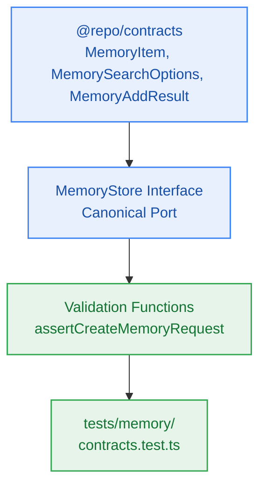

# S6.1 — Shared Memory Contracts, DTO Types & MemoryStore Interface

> **Work Unit:** WU-M6-1 · **Effort:** 3 · **Priority:** p0 · **Risk Tier:** LOW  
> **Owner:** `developer-agent` · **Depends on:** — (sprint entry point)



## Goal
Establish the shared TypeScript contract types, DTO validation helpers, and canonical `MemoryStore` interface under `@repo/contracts`.

## Acceptance Criteria
1. Export `MemoryStore` interface with methods: `add`, `search`, `get`, `delete`, `deleteUserMemories`, and `list`.
2. Export `MemoryItem`, `MemorySearchOptions`, `MemoryAddResult`, `MemoryDeleteResult`, `MemoryCategory`, and `MemoryStoreMode`.
3. Provide validation functions `assertCreateMemoryRequest` (validates content length 3..5000 chars, valid category) and `assertMemorySearchOptions`.
4. Enforce domain memory isolation (`BR-018`): zero vendor memory SDK types exposed across `@repo/contracts` boundary.
5. Ensure the closed 17-member RFC 9457 error catalogue remains exactly 17 entries with zero modifications.

## Change Matrix (frozen)
| Class | Paths |
|---|---|
| **new_files** | `packages/contracts/src/memory.ts`, `tests/memory/contracts.test.ts` |
| **allowed_files** | `packages/contracts/src/**`, `tests/memory/**` |
| **forbidden_files** | `packages/metering/**`, `packages/auth/**`, `packages/ingestion/**`, `packages/config/**`, `packages/ui/**`, `packages/workspace/**`, `packages/db/**`, `packages/reasoning/**`, `packages/memory/**`, `tests/*.test.ts`, `infra/**`, `apps/**`, `_documentation/**` |

## Verification Hook
```bash
bun test tests/memory/contracts.test.ts && bun test packages/contracts/tests/errors.test.ts && bun run typecheck
```

## Rollout / Compatibility
Expand-only. Adds new memory contract types to `@repo/contracts` without altering any existing interfaces or schemas.
