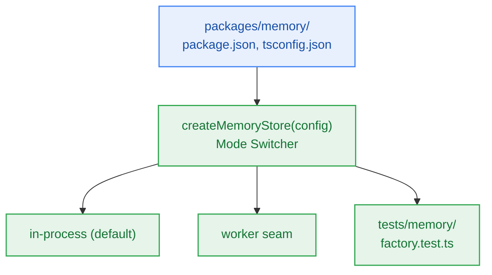

# S6.2 — Package Scaffolding `@repo/memory`, Configuration & Seam Factory

> **Work Unit:** WU-M6-2 · **Effort:** 3 · **Priority:** p0 · **Risk Tier:** LOW  
> **Owner:** `developer-agent` · **Depends on:** S6.1



## Goal
Scaffold the `@repo/memory` workspace package inside the monorepo, establish build/typecheck configurations, and author the dynamic `createMemoryStore` factory seam.

## Acceptance Criteria
1. Author `packages/memory/package.json` with dependencies on `@repo/contracts` and `@repo/config`, and `tsconfig.json` extending `@repo/config/tsconfig.node.json`.
2. Export `createMemoryStore(config?: Partial<MemoryStoreConfig>): MemoryStore` from `@repo/memory/src/factory.ts`.
3. Support environment variable `MEMORY_STORE_MODE` defaulting to `"in-process"`, with support for `"worker"` mode.
4. Ensure `turbo run build --filter=@repo/memory` and `turbo run typecheck --filter=@repo/memory` pass cleanly.
5. Zero circular package dependencies across the monorepo.

## Change Matrix (frozen)
| Class | Paths |
|---|---|
| **new_files** | `packages/memory/package.json`, `packages/memory/tsconfig.json`, `packages/memory/src/index.ts`, `packages/memory/src/factory.ts`, `tests/memory/factory.test.ts` |
| **allowed_files** | `packages/memory/**`, `tests/memory/**` |
| **forbidden_files** | `packages/contracts/**`, `packages/metering/**`, `packages/auth/**`, `packages/ingestion/**`, `packages/config/**`, `packages/ui/**`, `packages/workspace/**`, `packages/db/**`, `packages/reasoning/**`, `tests/*.test.ts`, `infra/**`, `apps/**`, `_documentation/**` |

## Verification Hook
```bash
bun test tests/memory/factory.test.ts && turbo run build --filter=@repo/memory && turbo run typecheck --filter=@repo/memory
```

## Rollout / Compatibility
Expand-only. Adds a new internal monorepo package `@repo/memory` without altering existing packages.
