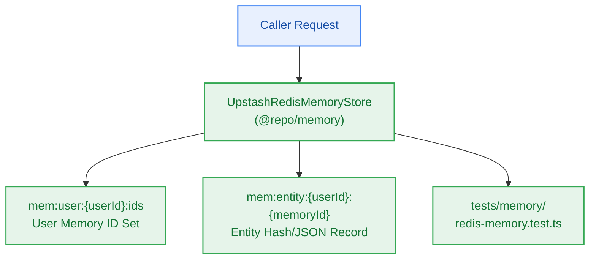

# S6.3 — In-Process Upstash Redis Entity & Working Memory Store Adapter

> **Work Unit:** WU-M6-3 · **Effort:** 3 · **Priority:** p0 · **Risk Tier:** MEDIUM  
> **Owner:** `developer-agent` · **Depends on:** S6.2



## Goal
Implement the Upstash Redis persistence adapter for user working memory, entity association records, and metadata storage with strict tenant-scoped key isolation.

## Acceptance Criteria
1. Implement `UpstashRedisMemoryStore` inside `@repo/memory/src/redis-memory.ts`.
2. Persist entity data under `mem:entity:{userId}:{memoryId}` and index user memory IDs under `mem:user:{userId}:ids`.
3. Support `add`, `get`, `list`, `delete`, and `deleteUserMemories` operations.
4. Enforce strict multi-tenant key isolation: operations require verified `userId`; User B cannot read or delete User A's keys (`BR-002`, `BR-018`).
5. Ensure `deleteUserMemories(userId)` purges all entity keys and removes the user's ID set completely.

## Change Matrix (frozen)
| Class | Paths |
|---|---|
| **new_files** | `packages/memory/src/redis-memory.ts`, `tests/memory/redis-memory.test.ts` |
| **allowed_files** | `packages/memory/**`, `tests/memory/**` |
| **forbidden_files** | `packages/contracts/**`, `packages/metering/**`, `packages/auth/**`, `packages/ingestion/**`, `packages/config/**`, `packages/ui/**`, `packages/workspace/**`, `packages/db/**`, `packages/reasoning/**`, `infra/**`, `apps/**`, `_documentation/**` |

## Verification Hook
```bash
bun test tests/memory/redis-memory.test.ts && turbo run typecheck --filter=@repo/memory
```

## Rollout / Compatibility
Expand-only. Introduces Redis entity memory adapter without modifying any existing Redis keys or rate-limiting/metering logic.
