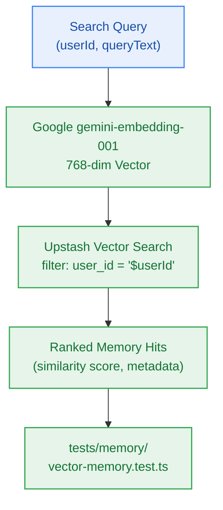

# S6.4 — In-Process Upstash Vector Semantic Memory Retrieval Adapter with Tenant Filtering

> **Work Unit:** WU-M6-4 · **Effort:** 4 · **Priority:** p0 · **Risk Tier:** MEDIUM  
> **Owner:** `developer-agent` · **Depends on:** S6.3



## Goal
Implement the Upstash Vector semantic memory retrieval adapter, generating 768-dimensional dense embeddings and executing vector similarity queries with strict multi-tenant metadata filtering.

## Acceptance Criteria
1. Implement `UpstashVectorMemoryStore` inside `@repo/memory/src/vector-memory.ts`.
2. Generate 768-dim dense embeddings using Google `gemini-embedding-001` (with in-process ONNX fallback).
3. Upsert vectors with ID `mem_{userId}_{memoryId}` and metadata payload `{ user_id: userId, memory_id: memoryId, category }`.
4. Enforce mandatory tenant filter: all queries MUST inject `user_id = '${userId}'` (`BR-002`, `BR-019`).
5. Multi-tenant boundary verified: User B querying identical strings seeded by User A receives an empty array (`AC-6.4`).
6. Memory query executes with latency p95 < 150ms adhering to SLA (`AC-6.3`, `NFR-008`).

## Change Matrix (frozen)
| Class | Paths |
|---|---|
| **new_files** | `packages/memory/src/vector-memory.ts`, `tests/memory/vector-memory.test.ts` |
| **allowed_files** | `packages/memory/**`, `tests/memory/**` |
| **forbidden_files** | `packages/contracts/**`, `packages/metering/**`, `packages/auth/**`, `packages/ingestion/**`, `packages/config/**`, `packages/ui/**`, `packages/workspace/**`, `packages/db/**`, `packages/reasoning/**`, `infra/**`, `apps/**`, `_documentation/**` |

## Verification Hook
```bash
bun test tests/memory/vector-memory.test.ts && turbo run typecheck --filter=@repo/memory
```

## Rollout / Compatibility
Expand-only. Utilizes dedicated memory vector IDs `mem_{userId}_{memoryId}` in Upstash Vector without impacting document chunk vectors (`doc_chunk_*`).
