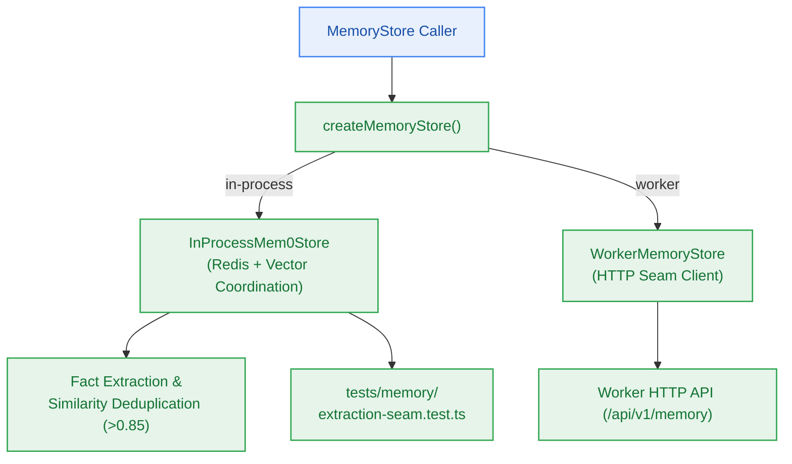

# S6.5 — In-Process Mem0 Engine Adapter & Remote Worker Extraction Seam

> **Work Unit:** WU-M6-5 · **Effort:** 4 · **Priority:** p0 · **Risk Tier:** MEDIUM  
> **Owner:** `developer-agent` · **Depends on:** S6.4



## Goal
Implement the unified `InProcessMem0Store` coordinating Redis entity storage and Vector search with fact deduplication, and implement `WorkerMemoryStore` to prove extraction seam portability.

## Acceptance Criteria
1. Implement `InProcessMem0Store` in `@repo/memory/src/mem0-store.ts` implementing `MemoryStore`.
2. Coordinate fact extraction and semantic deduplication: if new memory has cosine similarity > 0.85 to existing memory, update existing record rather than creating a duplicate.
3. Implement `WorkerMemoryStore` in `@repo/memory/src/worker-store.ts` implementing `MemoryStore` over HTTP seam.
4. Verify extraction seam portability: switching between `in-process` and `worker` mode executes identically via `MemoryStore` interface with zero caller changes (`AC-6.1`, `FR-020`, `NFR-019`).
5. Ensure zero external vendor memory charges: strictly $0.00/month infrastructure ceiling (`NFR-014`, `NFR-016`).

## Change Matrix (frozen)
| Class | Paths |
|---|---|
| **new_files** | `packages/memory/src/mem0-store.ts`, `packages/memory/src/worker-store.ts`, `tests/memory/mem0-store.test.ts`, `tests/memory/extraction-seam.test.ts` |
| **allowed_files** | `packages/memory/**`, `tests/memory/**` |
| **forbidden_files** | `packages/contracts/**`, `packages/metering/**`, `packages/auth/**`, `packages/ingestion/**`, `packages/config/**`, `packages/ui/**`, `packages/workspace/**`, `packages/db/**`, `packages/reasoning/**`, `infra/**`, `apps/**`, `_documentation/**` |

## Verification Hook
```bash
bun test tests/memory/extraction-seam.test.ts && bun test tests/memory/mem0-store.test.ts && turbo run typecheck --filter=@repo/memory
```

## Rollout / Compatibility
Expand-only. Delivers the core memory engine and seam adapters in `@repo/memory` without impacting existing runtime services.
