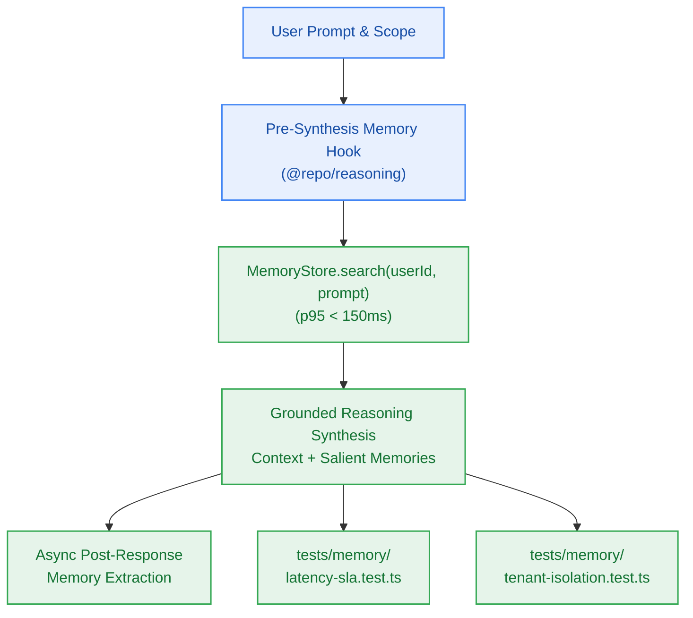

# S6.6 — Reasoning Pipeline Memory Recall Hook, E2E Isolation Suite & Latency SLA

> **Work Unit:** WU-M6-6 · **Effort:** 4 · **Priority:** p0 · **Risk Tier:** MEDIUM  
> **Owner:** `developer-agent` · **Depends on:** S6.5



## Goal
Integrate memory recall into `@repo/reasoning`, execute an asynchronous memory extraction hook post-response, and certify multi-tenant isolation and latency SLAs across the monorepo.

## Acceptance Criteria
1. Author `packages/reasoning/src/memory-hook.ts` providing pre-synthesis recall and post-response extraction hooks.
2. In pre-synthesis recall, query `MemoryStore.search(userId, prompt, { limit: 5 })` and format memories into the system prompt context as user preferences/facts.
3. In post-response hook, dispatch fact extraction and memory storage asynchronously without blocking the SSE token streaming response.
4. Multi-tenant isolation test suite verifies 100% boundary isolation: User B querying memories seeded by User A returns an empty array across 50 iterations (`AC-6.4`, `BR-002`, `BR-019`).
5. Latency benchmark verifies memory search p95 latency < 150ms (`AC-6.3`, `NFR-008`).
6. Full monorepo builds and typechecks cleanly (10/10 packages) with zero errors.

## Change Matrix (frozen)
| Class | Paths |
|---|---|
| **new_files** | `packages/reasoning/src/memory-hook.ts`, `tests/memory/tenant-isolation.test.ts`, `tests/memory/latency-sla.test.ts`, `tests/memory/reasoning-memory.test.ts` |
| **allowed_files** | `packages/reasoning/**`, `tests/memory/**`, `packages/memory/**`, `packages/contracts/**` |
| **forbidden_files** | `packages/metering/**`, `packages/auth/**`, `packages/ingestion/**`, `packages/config/**`, `packages/ui/**`, `packages/workspace/**`, `packages/db/**`, `infra/**`, `apps/**`, `_documentation/**` |

## Verification Hook
```bash
bun test tests/memory/ && bun test tests/reasoning/ && turbo run build && turbo run typecheck
```

## Rollout / Compatibility
Expand-only. Seamlessly incorporates long-term memory into the grounded reasoning pipeline without breaking existing `/chat` contract signatures.
