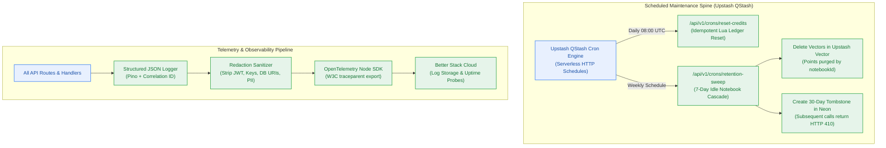

# Milestone Charter — M7: Autonomous Maintenance Crons & Observability (v0.7.0)

> **Status:** Completed (Gate G6 PASS · Follows M6 Pluggable Memory)  
> **Author:** pm-agent (Stage 2 Owner) · **Date:** 2026-10-27  
> **Target Version:** `v0.7.0` · **Risk Tier:** HIGH  
> **Grounding:** `project-brief.md` (FR-015, FR-040..FR-042; BR-010..BR-012, BR-025..BR-027, BR-037, BR-044; NFR-009, NFR-017, NFR-026, NFR-031, NFR-032; ADR-0004)  

---

## 1. Executive Summary & Outcome

Milestone M7 introduces production-grade autonomous maintenance and centralized observability (`v0.7.0`). It deploys serverless crons via Upstash QStash to execute the daily 08:00 UTC credit reset (`BR-025`) and the weekly 7-day retention cascade sweeper (`BR-037`). Idle notebooks are safely purged with vector deletion and 30-day tombstones returning HTTP 410 `NOTEBOOK_EXPIRED` (`BR-044`). The milestone also establishes structured JSON logging via Pino, W3C trace propagation, strict credential and PII redaction (`NFR-026`), and OTLP telemetry forwarding to Better Stack.

*(Note: Per ADR-0004, Upstash Vector never suspends from inactivity; the artificial 48-hour Qdrant keepalive probe is officially deprecated).*

---

## 2. In Scope

- **Autonomous Maintenance Crons (`FR-015`, `FR-040`):**
  - Daily 08:00 UTC credit ledger reset via QStash HTTP trigger and idempotent Redis Lua script (`BR-025`, `BR-026`).
  - Weekly retention sweeper identifying notebooks idle for ≥ 7 days (`BR-037`).
- **7-Day Retention Cascade & Tombstones (`FR-041`, `BR-044`):**
  - Deletes all associated vector points in Upstash Vector for idle notebooks.
  - Updates Neon Postgres record to tombstone status with a 30-day TTL.
  - Returns HTTP 410 `NOTEBOOK_EXPIRED` with RFC 9457 error payload if tombstoned notebook is requested.
- **Centralized Telemetry & Logging (`FR-042`, `NFR-009`, `BR-010`):**
  - Structured JSON logs with schema `{ timestamp, level, correlation_id, service, event, payload }`.
  - W3C `traceparent` header propagation across all internal function calls.
  - OpenTelemetry SDK exporting spans to Better Stack via OTLP/HTTP.
- **Strict PII & Secret Redaction (`NFR-026`, `BR-012`):**
  - Regex filtering stripping Authorization Bearer tokens, Clerk JWTs, Upstash/Google API keys, and connection strings before stdout emission.

---

## 3. Out of Scope

- Marketing landing page visual styling (owned by Milestone M8).
- Multi-user concurrency load testing scripts (owned by Milestone M9).
- Final production CI/CD tag push (owned by Milestone GA).

---

## 4. Acceptance Criteria & Gate Status

| ID | Criterion | Evidence Target | Gate |
|:---:|---|---|:---:|
| **AC-7.1** | Daily Credit Reset | QStash webhook invokes reset; user balances reset to 10 at 08:00 UTC idempotently | G5 |
| **AC-7.2** | Retention Cascade Purge | Idle notebook (≥ 7 days) has vectors deleted; request returns HTTP 410 Tombstone | G5 |
| **AC-7.3** | Structured Logging Format | 100% of logs emit valid JSON carrying `correlation_id` and W3C trace context | G6 |
| **AC-7.4** | Secret Redaction Attestation | Injected Bearer tokens and API keys are redacted to `[REDACTED]` in log output | G6 |

---

## 5. Next Steps & Pipeline Handoff

1. Follows completion and sign-off of Milestone M6 (Pluggable Memory).
2. `sprint-agent` authors `m7-maintenance-observability/sprint-status.yaml` and story cards.
3. Hands off to `developer-agent` for crons and telemetry pipeline implementation.
