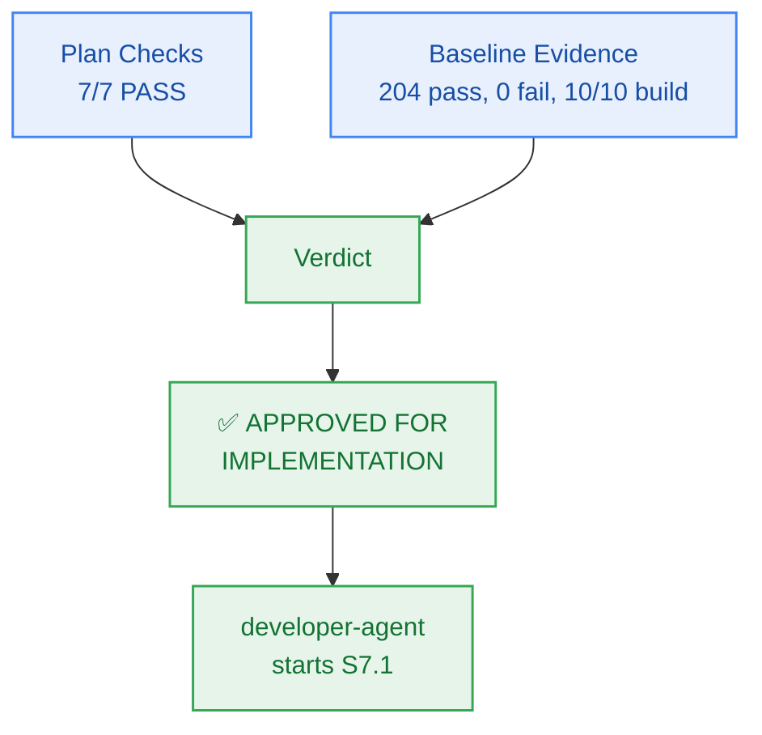

# M7 Sprint Plan — PM Verification & Approval

> **Author:** `pm-agent` (Stage 2 Owner) · **Date:** 2026-10-27  
> **Scope of this record:** Approval of the Milestone M7 **plan** for handoff to `developer-agent`.  
> **Explicitly not:** Code-complete sign-off or story-level verification — those remain `test-agent`'s.

---

## 1. Verification Results

### 1.1 Plan Checks (Checkpoint 2 / Gate G5)

| # | Check | Result | Evidence |
|:--:|---|:---:|---|
| 1 | Every external capability tagged, research-backed, or classified `CUSTOM-DOMAIN-LOGIC` | **PASS** | Upstash QStash webhook receiver with HMAC signature verification; Pino structured JSON logger; OpenTelemetry Node SDK with HTTP OTLP export to Better Stack; Upstash Vector batch point deletion; Neon Postgres 30-day tombstone queries; preserves $0.00/month infrastructure ceiling (`NFR-009`, `NFR-016`) |
| 2 | Milestone has concrete verifiable criteria (checks, not vibes) | **PASS** | `milestone.md` §4 AC-7.1..AC-7.4, each with explicit evidence target and grounded FR/BR/NFR |
| 3 | Every story passes the 5-point atomicity test; no padding | **PASS** | 6 stories for 6 work units (WU-M7-1..WU-M7-6); all cohesive, single-session scopes with bounded Change Matrices |
| 4 | Every story carries `build_vs_buy_ref`, `tests`, `observability` | **PASS** | All 6 stories on board `M7-S1` carry all three fields |
| 5 | Story dependency ordering forms a DAG with no cycles | **PASS** | Verified sequential DAG: `S7.1 → S7.2 → S7.3 → S7.4 → S7.5 → S7.6`; all referenced story IDs resolve cleanly |
| 6 | File paths in stories match actual repo structure and conventions | **PASS** | Paths verified against `packages/contracts`, `packages/observability`, `packages/db`, and `tests/observability/`; conforms strictly to the Two-Floor boundary |
| 7 | Every required specialist dispatch issued and logged `ACCEPTED` | **PASS** | `planning-dispatch-log.md` carries DSP-031..DSP-035, all logged `ACCEPTED` |
| — | Board exists with frozen Change Matrices | **PASS** | `sprint-status.yaml` parses; 6 stories × `new_files`/`allowed_files`/`forbidden_files`; zero root files in any `allowed_files` |
| — | Contracts parse | **PASS** | `packages/contracts/src/observability.ts` specified; `component-catalog.yaml` carries `comp-observability` and `comp-maintenance`; `api-contract.openapi.yaml` carries `/crons/retention-sweep` and `/crons/reset-credits` endpoints |

**Plan verdict: 7/7 + 2 structural checks PASS.**

### 1.2 Baseline Evidence (repository state at approval time)

| Check | Result | Evidence |
|---|---|---|
| `bun test` (full monorepo suite) | **PASS** | **204 pass, 0 fail, 1396 expect() calls** across 41 test files (runtime: 2.63s) |
| `bun run build` | **PASS** | **10/10 tasks successful** (`@repo/auth`, `@repo/config`, `@repo/contracts`, `@repo/db`, `@repo/ingestion`, `@repo/memory`, `@repo/metering`, `@repo/reasoning`, `@repo/ui`, `@repo/workspace`) |
| `bun run typecheck` | **PASS** | **10/10 packages clean**, 0 TypeScript errors across the monorepo |
| `bun test tests/package-exports.test.ts` | **PASS** | 4 pass, 0 fail, 22 expect() calls |
| `bun test packages/contracts/tests/errors.test.ts` | **PASS** | 5 pass, 0 fail, 95 expect() calls; closed 17-member RFC 9457 catalogue remains intact |
| `git status` | **PASS** | Working tree clean (zero unstaged/untracked runtime code diffs) |

---

## 2. Findings & Preconditions

Milestone M7 begins with an exemplary, 100% green monorepo baseline following the complete verification of Milestone M6:
- Monorepo builds cleanly with zero errors across all 10 existing packages.
- Monorepo typechecks cleanly with zero errors.
- Full test suite passes 204/204 tests with 1,396 expect() assertions.
- Closed RFC 9457 error catalogue remains intact at 17 members (`NOTEBOOK_EXPIRED` is member #13).
- Working tree has zero code regressions.

> **PM characterization:** The runway for Milestone M7 implementation is completely clear. No blocking preconditions are required.

---

## 3. Verdict

> ## ✅ APPROVED FOR IMPLEMENTATION — Unconditional

**Approved artifacts:**
- `_documentation/planning/milestones/m7-maintenance-observability/milestone.md`
- `_documentation/planning/milestones/m7-maintenance-observability/sprint-status.yaml` (6 stories, frozen Change Matrices)
- `_documentation/planning/milestones/m7-maintenance-observability/stories/*` (6 cards)
- `_documentation/planning/architecture/05-m7-autonomous-maintenance-and-observability.md` (QStash crons, retention cascade sweeper, 30-day tombstone, Pino logging, OpenTelemetry tracing)
- `_documentation/planning/contracts/component-catalog.yaml` (`comp-observability` and `comp-maintenance` component definitions)
- `_documentation/planning/contracts/api-contract.openapi.yaml` (`/crons/retention-sweep` and `/crons/reset-credits` endpoints)
- `_documentation/planning/contracts/config-schema.yaml` (`BETTER_STACK_SOURCE_TOKEN` and QStash signing keys)

**Implementation sequence:**
`developer-agent` starts at **S7.1** and proceeds in dependency order `S7.2 → S7.3 → S7.4 → S7.5 → S7.6`. Story closure requires passing evidence certified by `test-agent`; this approval certifies readiness for implementation.

**Gate state:** `Gate G5 → PASS (plan approved)`.

---

## 4. Sealed Decisions

| ID | Decision | Owner | Rationale |
|---|---|---|---|
| `M7-PM-001` | Scope grounded in FR-015, FR-040..042, BR-010..012, BR-025..027, BR-037..040, BR-044, NFR-009, NFR-017, NFR-026, NFR-031, NFR-032; classified HIGH risk | `pm-agent` | Establishes explicit scope boundaries; governs automated vector and relational deletion routines |
| `M7-PM-002` | Unconditional approval for M7 implementation handoff | `pm-agent` | Baseline is 100% green (204/204 pass, 10/10 build/typecheck clean); zero blocking preconditions needed |
| `M7-ARCH-001` | Dedicated first-floor package `@repo/observability` encapsulating Pino logger, AsyncLocalStorage correlation context, secret redactor, and OpenTelemetry OTLP tracing | `architect-agent` | Clean domain decoupling conforming to the Two-Floor architecture; zero Next.js server dependencies |
| `M7-ARCH-002` | QStash webhook receiver with cryptographic `Upstash-Signature` verification guarding crons `/api/v1/crons/reset-credits` and `/api/v1/crons/retention-sweep` | `architect-agent` | Enforces HMAC SHA-256 cryptographic security against unauthorized external triggers |
| `M7-ARCH-003` | 7-day retention cascade sweeper purging Upstash Vector points and relational child nodes, setting 30-day tombstone returning HTTP 410 `NOTEBOOK_EXPIRED` | `architect-agent` | Satisfies zero-cost vector quota limits while providing deterministic expiration feedback via RFC 9457 Problem Details |
| `M7-ARCH-004` | Deep secret and PII redactor sanitizing Bearer tokens, Clerk keys, database URIs, and API tokens before log emission | `architect-agent` | Enforces non-negotiable security invariant NFR-026 across all log and trace output surfaces |
| `M7-SPR-001` | Six single-session stories `S7.1 → S7.2 → S7.3 → S7.4 → S7.5 → S7.6` with frozen Change Matrices | `sprint-agent` | Derived from capability boundaries; strictly obeys Two-Floor boundary |
| `M7-SPR-002` | Comprehensive E2E test harness verifying QStash webhook verification, daily reset, retention purge, tombstone HTTP 410, and secret redaction without requiring live cloud connectivity | `sprint-agent` | Guarantees deterministic CI verification without consuming external quotas |
