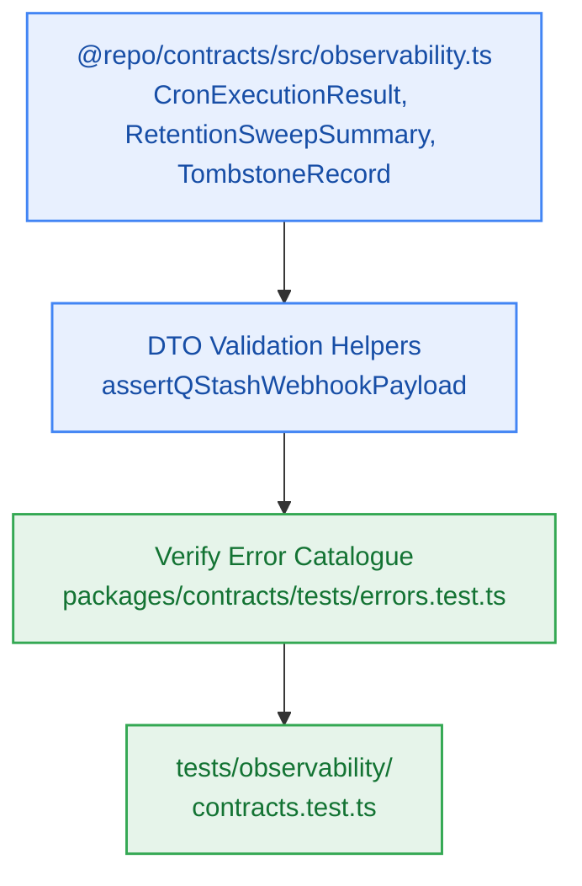

# S7.1 — Shared Maintenance & Observability Contracts, DTO Types & RFC 9457 Invariance

> **Work Unit:** WU-M7-1 · **Effort:** 3 · **Priority:** p0 · **Risk Tier:** LOW  
> **Owner:** `developer-agent` · **Depends on:** — (sprint entry point)



## Goal
Establish canonical TypeScript contract types, DTO validation helpers, and correlation context interfaces for autonomous maintenance crons, retention sweeps, structured logging, and OpenTelemetry spans under `@repo/contracts`. Verify that the closed 17-member RFC 9457 error catalogue remains intact.

## Acceptance Criteria
1. Export `CronExecutionResult`, `RetentionSweepSummary`, `TombstoneRecord`, `LogRecord`, `LogLevel`, `SpanContext`, `QStashWebhookPayload`, and `HeartbeatPayload` from `@repo/contracts`.
2. Provide validation functions `assertQStashWebhookPayload` and `assertRetentionSweepOptions`.
3. Export standard correlation header constants: `HEADER_CORRELATION_ID = "x-correlation-id"` and `HEADER_TRACEPARENT = "traceparent"`.
4. Ensure the closed 17-member RFC 9457 error catalogue remains exactly 17 entries with zero modifications, verifying that `NOTEBOOK_EXPIRED` (status 410) is member #13.

## Change Matrix (frozen)
| Class | Paths |
|---|---|
| **new_files** | `packages/contracts/src/observability.ts`, `tests/observability/contracts.test.ts` |
| **allowed_files** | `packages/contracts/src/**`, `tests/observability/**` |
| **forbidden_files** | `packages/metering/**`, `packages/auth/**`, `packages/ingestion/**`, `packages/config/**`, `packages/ui/**`, `packages/workspace/**`, `packages/db/**`, `packages/reasoning/**`, `packages/memory/**`, `packages/observability/**`, `tests/*.test.ts`, `infra/**`, `apps/**`, `_documentation/**` |

## Verification Hook
```bash
bun test tests/observability/contracts.test.ts && bun test packages/contracts/tests/errors.test.ts && bun run typecheck
```

## Rollout / Compatibility
Expand-only. Adds new contract types and validators to `@repo/contracts` without altering any existing interfaces or schemas.
