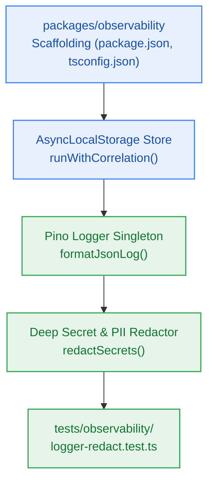

# S7.2 — Package Scaffolding @repo/observability, AsyncLocalStorage Context, Pino Logger & Redactor

> **Work Unit:** WU-M7-2 · **Effort:** 4 · **Priority:** p0 · **Risk Tier:** MEDIUM  
> **Owner:** `developer-agent` · **Depends on:** S7.1



## Goal
Scaffold the `@repo/observability` package, implement transparent asynchronous request correlation tracking using Node's `AsyncLocalStorage`, configure the high-performance Pino structured JSON logger conforming to platform standards, and build the recursive secret and PII redactor.

## Acceptance Criteria
1. `packages/observability/package.json`, `tsconfig.json`, and `src/index.ts` build and typecheck cleanly across the Turborepo monorepo.
2. `runWithCorrelation({ correlationId, traceparent }, fn)` executes `fn` with context accessible via `getCorrelationId()` and `getTraceparent()`.
3. `getLogger()` emits JSON logs strictly adhering to `{ timestamp, level, correlation_id, service, event, payload }`.
4. Deep redactor scans strings, arrays, and nested objects, replacing sensitive strings matching regex patterns (`Bearer [JWT]`, Clerk `sk_` keys, database connection URIs, Upstash/Google API keys, passwords) with `[REDACTED]` (`NFR-026`, `BR-012`).

## Change Matrix (frozen)
| Class | Paths |
|---|---|
| **new_files** | `packages/observability/package.json`, `packages/observability/tsconfig.json`, `packages/observability/src/index.ts`, `packages/observability/src/logger.ts`, `packages/observability/src/context.ts`, `packages/observability/src/redact.ts`, `tests/observability/logger-redact.test.ts` |
| **allowed_files** | `packages/observability/**`, `tests/observability/**` |
| **forbidden_files** | `packages/contracts/**`, `packages/metering/**`, `packages/auth/**`, `packages/ingestion/**`, `packages/config/**`, `packages/ui/**`, `packages/workspace/**`, `packages/db/**`, `packages/reasoning/**`, `packages/memory/**`, `infra/**`, `apps/**`, `_documentation/**` |

## Verification Hook
```bash
bun test tests/observability/logger-redact.test.ts && turbo run build --filter=@repo/observability && turbo run typecheck --filter=@repo/observability
```

## Rollout / Compatibility
Expand-only. Introduces `@repo/observability` as package #11 in the monorepo workspace.
