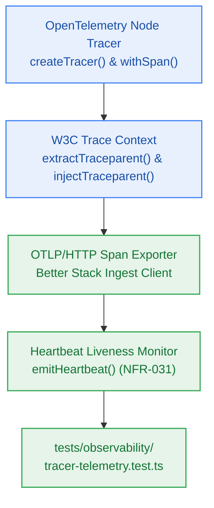

# S7.3 — OpenTelemetry Tracing Provider, W3C Traceparent Propagator & Better Stack OTLP Export

> **Work Unit:** WU-M7-3 · **Effort:** 4 · **Priority:** p1 · **Risk Tier:** MEDIUM  
> **Owner:** `developer-agent` · **Depends on:** S7.2



## Goal
Implement vendor-neutral OpenTelemetry distributed tracing and span instrumentation with W3C `traceparent` context propagation, configure an OTLP/HTTP exporter wrapper forwarding telemetry spans to Better Stack within free-tier quotas, and create a heartbeat liveness monitor for scheduled cron jobs (`NFR-031`).

## Acceptance Criteria
1. `createTracer(serviceName)` and `withSpan(name, fn)` create and execute active spans with span names, custom attributes, and status codes.
2. W3C `traceparent` parsing and generation utilities strictly conform to the standard format `00-{traceId}-{spanId}-{flags}`.
3. OTLP HTTP exporter wrapper formats and sends span batches to `OTEL_EXPORTER_OTLP_ENDPOINT` with `BETTER_STACK_SOURCE_TOKEN` header and a non-blocking timeout guard (500ms cap) that will never stall or fail caller threads.
4. `emitHeartbeat(jobName, status)` records cron execution telemetry to health endpoints, validating liveness (`NFR-031`).

## Change Matrix (frozen)
| Class | Paths |
|---|---|
| **new_files** | `packages/observability/src/tracer.ts`, `packages/observability/src/heartbeat.ts`, `tests/observability/tracer-telemetry.test.ts` |
| **allowed_files** | `packages/observability/**`, `tests/observability/**` |
| **forbidden_files** | `packages/contracts/**`, `packages/metering/**`, `packages/auth/**`, `packages/ingestion/**`, `packages/config/**`, `packages/ui/**`, `packages/workspace/**`, `packages/db/**`, `packages/reasoning/**`, `packages/memory/**`, `infra/**`, `apps/**`, `_documentation/**` |

## Verification Hook
```bash
bun test tests/observability/tracer-telemetry.test.ts && turbo run typecheck --filter=@repo/observability
```

## Rollout / Compatibility
Expand-only. Operates in mock/offline mode when external OTLP collector credentials are absent.
