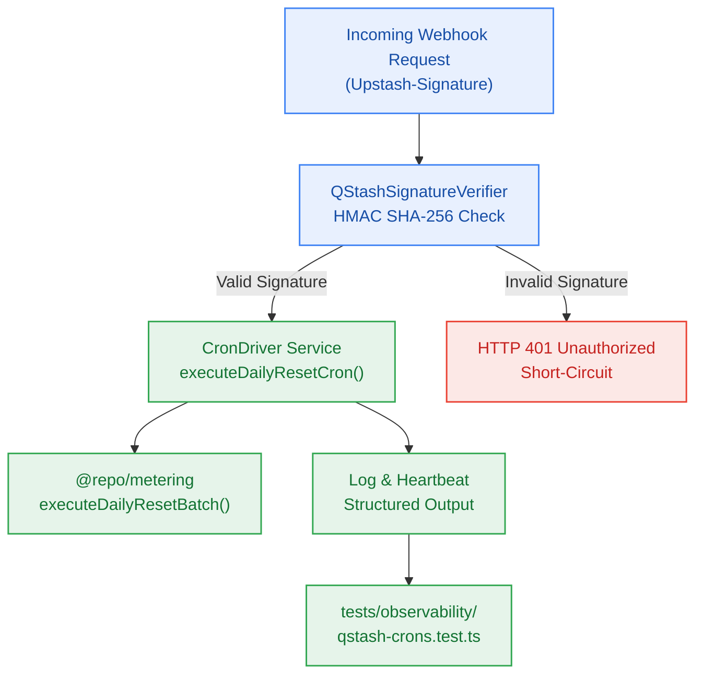

# S7.4 — QStash Webhook Receiver with Cryptographic Signature Verification & Crons Driver

> **Work Unit:** WU-M7-4 · **Effort:** 4 · **Priority:** p0 · **Risk Tier:** HIGH  
> **Owner:** `developer-agent` · **Depends on:** S7.3



## Goal
Build the QStash webhook receiver with cryptographic HMAC SHA-256 signature verification (`Upstash-Signature`) guarding maintenance routes against unauthorized execution, and implement the scheduled crons driver orchestrating the daily 08:00 UTC credit reset batch.

## Acceptance Criteria
1. `QStashSignatureVerifier` validates incoming `Upstash-Signature` headers against the raw request body using `QSTASH_CURRENT_SIGNING_KEY` and fallback `QSTASH_NEXT_SIGNING_KEY`.
2. Reject requests with missing or cryptographically mismatched signatures with `false` or HTTP 401.
3. `executeDailyResetCron()` invokes `@repo/metering`'s `executeDailyResetBatch()`, records processed accounts and expired balances, and returns `CronExecutionResult`.
4. Successfully resets credits idempotently under concurrent invocations (`BR-025`, `BR-026`).
5. Emits structured JSON log with `correlation_id` and green heartbeat pulse upon job completion.

## Change Matrix (frozen)
| Class | Paths |
|---|---|
| **new_files** | `packages/observability/src/qstash-receiver.ts`, `packages/observability/src/cron-driver.ts`, `tests/observability/qstash-crons.test.ts` |
| **allowed_files** | `packages/observability/**`, `tests/observability/**` |
| **forbidden_files** | `packages/contracts/**`, `packages/metering/**`, `packages/auth/**`, `packages/ingestion/**`, `packages/config/**`, `packages/ui/**`, `packages/workspace/**`, `packages/db/**`, `packages/reasoning/**`, `packages/memory/**`, `infra/**`, `apps/**`, `_documentation/**` |

## Verification Hook
```bash
bun test tests/observability/qstash-crons.test.ts && turbo run typecheck --filter=@repo/observability
```

## Rollout / Compatibility
Expand-only. Validates webhook security and coordinates credit reset execution without altering existing metering logic.
