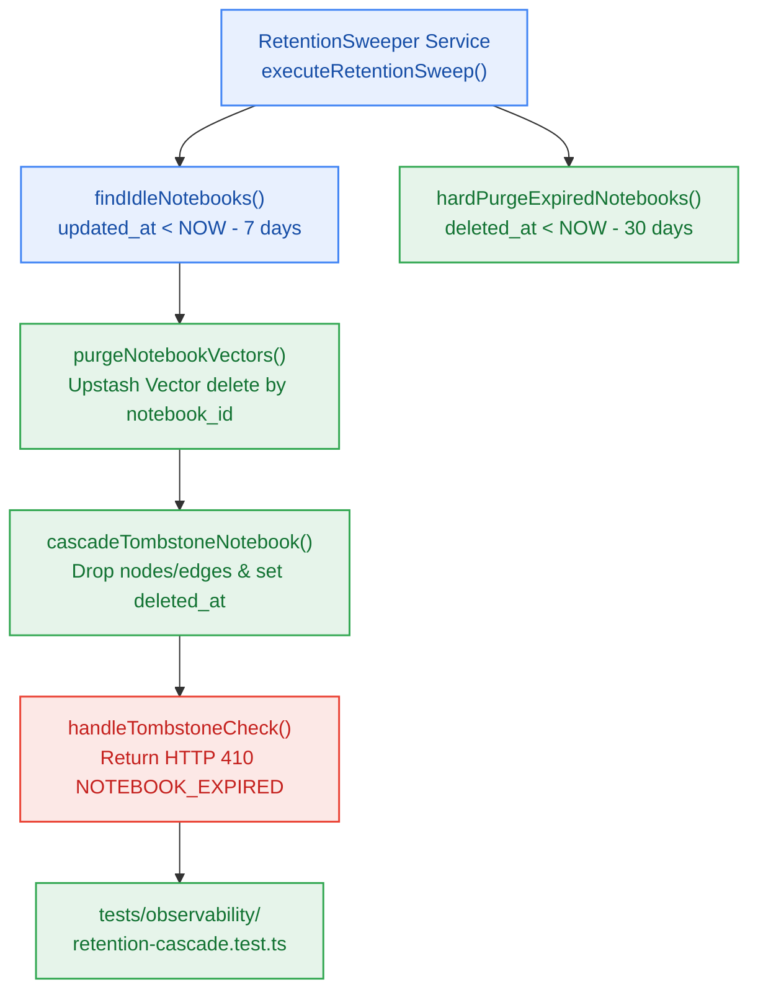

# S7.5 — 7-Day Retention Cascade Sweeper, Vector Purge, DB Cascade & 30-Day Tombstones

> **Work Unit:** WU-M7-5 · **Effort:** 5 · **Priority:** p0 · **Risk Tier:** HIGH  
> **Owner:** `developer-agent` · **Depends on:** S7.4



## Goal
Implement the 7-day retention cascade sweeper and 30-day tombstone engine. Idle notebooks are detected via Neon Postgres queries, associated vector points are deleted from Upstash Vector, relational child nodes/edges are purged, and a 30-day tombstone is established that returns HTTP 410 `NOTEBOOK_EXPIRED` (RFC 9457) before permanent hard purging.

## Acceptance Criteria
1. `findIdleNotebooks(db, cutoffDate)` returns notebooks with `deleted_at IS NULL` and `updated_at < cutoffDate` (7 days of inactivity).
2. `purgeNotebookVectors(vectorClient, notebookId)` deletes all vector embeddings associated with `notebookId` from Upstash Vector (`BR-039`).
3. `cascadeTombstoneNotebook(db, notebookId)` deletes child `notebook_nodes` and `notebook_edges` and sets `deleted_at = NOW()`, `expires_at = NOW() + 30 days`, `is_tombstoned = true` (`BR-040`, `BR-044`).
4. `hardPurgeExpiredNotebooks(db)` hard-deletes notebook records where `deleted_at IS NOT NULL` and `expires_at < NOW()`.
5. Access to a tombstoned notebook returns RFC 9457 HTTP 410 `NOTEBOOK_EXPIRED` ProblemDocument with deletion timestamp (`AC-7.2`).

## Change Matrix (frozen)
| Class | Paths |
|---|---|
| **new_files** | `packages/db/src/retention.ts`, `packages/observability/src/retention-sweeper.ts`, `tests/observability/retention-cascade.test.ts` |
| **allowed_files** | `packages/db/**`, `packages/observability/**`, `tests/observability/**` |
| **forbidden_files** | `packages/contracts/**`, `packages/metering/**`, `packages/auth/**`, `packages/ingestion/**`, `packages/config/**`, `packages/ui/**`, `packages/workspace/**`, `packages/reasoning/**`, `packages/memory/**`, `infra/**`, `apps/**`, `_documentation/**` |

## Verification Hook
```bash
bun test tests/observability/retention-cascade.test.ts && turbo run typecheck --filter=@repo/observability --filter=@repo/db
```

## Rollout / Compatibility
Expand-only. Utilizes existing `deleted_at`, `expires_at`, and `idle_since` fields on the `notebooks` table created in Milestone M1.
