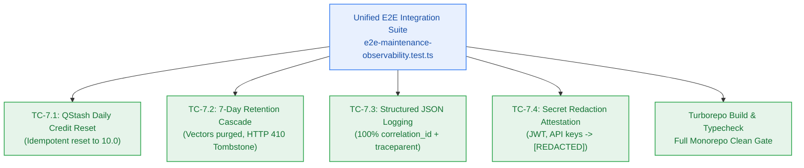

# S7.6 — End-to-End Maintenance & Observability Integration Suite & Verification Evidence

> **Work Unit:** WU-M7-6 · **Effort:** 3 · **Priority:** p0 · **Risk Tier:** MEDIUM  
> **Owner:** `developer-agent` · **Depends on:** S7.5



## Goal
Deliver a comprehensive, mock-backed end-to-end integration test harness that exercises the entire Milestone M7 autonomous maintenance crons and observability pipeline, certifying acceptance criteria AC-7.1 through AC-7.4 with zero external network dependencies and clean monorepo verification.

## Acceptance Criteria
1. **Daily Credit Reset (AC-7.1):** Simulated QStash webhook invokes reset; user balances reset to 10.0 credits at 08:00 UTC idempotently.
2. **Retention Cascade Purge (AC-7.2):** Idle notebook (≥ 7 days) has vectors deleted in Upstash Vector, child relational records dropped, and requests return HTTP 410 `NOTEBOOK_EXPIRED`.
3. **Structured Logging Format (AC-7.3):** 100% of emitted logs conform to structured JSON schema with `correlation_id` and W3C trace context.
4. **Secret Redaction Attestation (AC-7.4):** Injected Bearer tokens, Clerk keys, and database connection URIs are verified redacted to `[REDACTED]`.
5. Monorepo full build (`bun run build`) and typecheck (`bun run typecheck`) pass cleanly with zero errors.

## Change Matrix (frozen)
| Class | Paths |
|---|---|
| **new_files** | `tests/observability/e2e-maintenance-observability.test.ts` |
| **allowed_files** | `tests/observability/**`, `packages/observability/**` |
| **forbidden_files** | `packages/contracts/**`, `packages/metering/**`, `packages/auth/**`, `packages/ingestion/**`, `packages/config/**`, `packages/ui/**`, `packages/workspace/**`, `packages/db/**`, `packages/reasoning/**`, `packages/memory/**`, `infra/**`, `apps/**`, `_documentation/**` |

## Verification Hook
```bash
bun test tests/observability/e2e-maintenance-observability.test.ts && bun test && bun run build && bun run typecheck
```

## Rollout / Compatibility
Expand-only. Consolidates Milestone M7 verification evidence without modifying any production packages.
