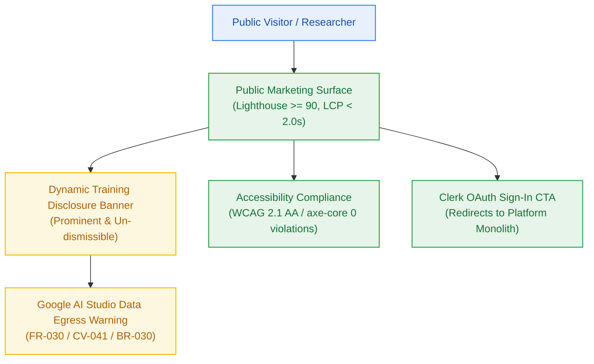

# Milestone Charter — M8: Public Marketing Landing & Dynamic Privacy Governance (v0.8.0)

> **Status:** Planned (Follows M7 Maintenance & Observability)  
> **Author:** pm-agent (Stage 2 Owner) · **Date:** 2026-10-23  
> **Target Version:** `v0.8.0` · **Risk Tier:** MEDIUM  
> **Grounding:** `project-brief.md` (FR-030; BR-028..BR-030; NFR-018..NFR-019; CV-041; EPIC-008)  

---

## 1. Executive Summary & Outcome

Milestone M8 establishes the public-facing entry point and regulatory transparency layer for the platform (`v0.8.0`). It delivers a high-speed public marketing landing page achieving a Google Lighthouse Performance score ≥ 90 and LCP < 2.0s on 4G connections (`NFR-018`). Crucially, M8 satisfies mandatory data governance requirements by implementing an un-dismissible, dynamic AI provider training disclosure banner across all public and prompt views (`FR-030`, `CV-041`), transparently warning users regarding Google AI Studio's free-tier data logging policies.

---

## 2. In Scope

- **Public Marketing Surface (`NFR-018`, `[Q-001]`):**
  - Statically generated marketing landing route (`/`) hosted directly within `apps/platform` using Next.js 15 App Router (`[Q-001]`), sharing `@repo/ui` component tokens and deploying under a single Vercel Hobby project with zero cross-domain auth redirects.
  - Responsive landing view articulating value proposition, zero-dollar architecture, and grounded synthesis features.
  - Performance optimization: LCP < 2.0s, CLS < 0.1, FID < 100ms.
- **Dynamic Privacy & Training Disclosure Governance (`FR-030`, `CV-041`):**
  - Un-dismissible frontend disclosure component rendered on the public landing page and above all prompt input surfaces (`BR-030`).
  - Clear copy informing users that queries and documents are processed via Google AI Studio free tier under Google's model training terms.
- **Accessibility Certification (`NFR-019`):**
  - WCAG 2.1 AA compliance across all public UI components.
  - Automated `axe-core` CI scans reporting zero critical or serious accessibility violations.
  - Full keyboard navigability and screen-reader accessible ARIA attributes.
- **Authentication Hand-off (`FR-001`):**
  - Seamless redirection from public landing CTA to Clerk social OAuth session initialization.

---

## 3. Out of Scope

- Hardening against synthetic concurrency saturation (owned by Milestone M9).
- Production deployment DNS cutover (owned by Milestone GA).

---

## 4. Acceptance Criteria & Gate Status

| ID | Criterion | Evidence Target | Gate |
|:---:|---|---|:---:|
| **AC-8.1** | Lighthouse Performance SLA | Google Lighthouse CI reports Performance score ≥ 90 on mobile & desktop | G5 |
| **AC-8.2** | WCAG 2.1 AA Accessibility | `axe-core` automated scan exits 0 with zero critical or serious violations | G5 |
| **AC-8.3** | Training Disclosure Rendered | Disclosure banner rendered prominently on landing page and prompt inputs (`FR-030`) | G6 |
| **AC-8.4** | Un-dismissible Banner Invariant | Banner cannot be closed or hidden via localStorage or UI dismissal controls (`BR-030`) | G6 |

---

## 5. Next Steps & Pipeline Handoff

1. Follows completion and sign-off of Milestone M7 (Maintenance & Observability).
2. `sprint-agent` authors `m8-landing-disclosure/sprint-status.yaml` and story cards.
3. Hands off to `developer-agent` for frontend UI and accessibility implementation.
