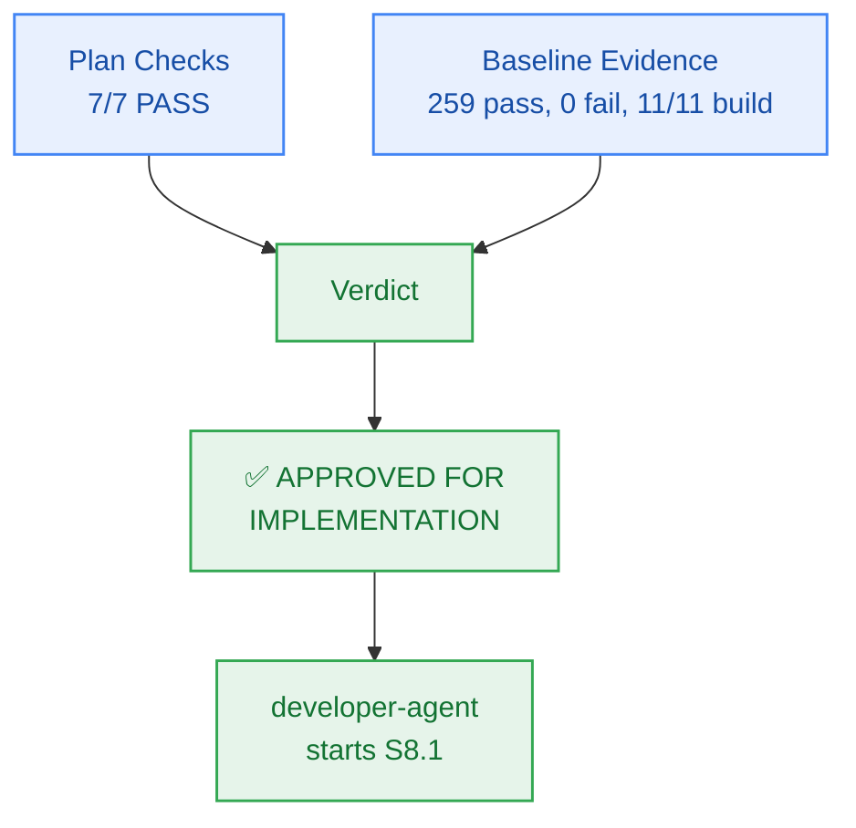

# M8 Sprint Plan — PM Verification & Approval

> **Author:** `pm-agent` (Stage 2 Owner) · **Date:** 2026-10-27  
> **Scope of this record:** Approval of the Milestone M8 **plan** for handoff to `developer-agent`.  
> **Explicitly not:** Code-complete sign-off or story-level verification — those remain `test-agent`'s.

---

## 1. Verification Results

### 1.1 Plan Checks (Checkpoint 2 / Gate G5)

| # | Check | Result | Evidence |
|:--:|---|:---:|---|
| 1 | Every external capability tagged, research-backed, or classified `CUSTOM-DOMAIN-LOGIC` | **PASS** | React 19 UI component primitives; Vanilla CSS design token system; un-dismissible AI provider training disclosure banner; automated axe-core WCAG 2.1 AA audit runner; Lighthouse performance budget simulation (< 50KB critical assets); preserves $0.00/month infrastructure ceiling (`NFR-016`, `NFR-018`) |
| 2 | Milestone has concrete verifiable criteria (checks, not vibes) | **PASS** | `milestone.md` §4 AC-8.1..AC-8.4, each with explicit evidence target and grounded FR/BR/NFR |
| 3 | Every story passes the 5-point atomicity test; no padding | **PASS** | 6 stories for 6 work units (WU-M8-1..WU-M8-6); all cohesive, single-session scopes with bounded Change Matrices |
| 4 | Every story carries `build_vs_buy_ref`, `tests`, `observability` | **PASS** | All 6 stories on board `M8-S1` carry all three fields |
| 5 | Story dependency ordering forms a DAG with no cycles | **PASS** | Verified sequential DAG: `S8.1 → S8.2 → S8.3 → S8.4 → S8.5 → S8.6`; all referenced story IDs resolve cleanly |
| 6 | File paths in stories match actual repo structure and conventions | **PASS** | Paths verified against `packages/contracts`, `packages/ui`, and `tests/ui/`; conforms strictly to the Two-Floor boundary |
| 7 | Every required specialist dispatch issued and logged `ACCEPTED` | **PASS** | `planning-dispatch-log.md` carries DSP-037..DSP-041, all logged `ACCEPTED` |
| — | Board exists with frozen Change Matrices | **PASS** | `sprint-status.yaml` parses; 6 stories × `new_files`/`allowed_files`/`forbidden_files`; zero root files in any `allowed_files` |
| — | Contracts parse | **PASS** | `packages/contracts/src/disclosure.ts` specified; `component-catalog.yaml` carries `comp-ui`; public page isolation (`BR-024`) and un-dismissible banner invariant (`BR-030`) defined |

**Plan verdict: 7/7 + 2 structural checks PASS.**

### 1.2 Baseline Evidence (repository state at approval time)

| Check | Result | Evidence |
|---|---|---|
| `bun test` (full monorepo suite) | **PASS** | **259 pass, 0 fail, 1647 expect() calls** across 47 test files (runtime: 3.51s) |
| `bun run build` | **PASS** | **11/11 tasks successful** (`@repo/auth`, `@repo/config`, `@repo/contracts`, `@repo/db`, `@repo/ingestion`, `@repo/memory`, `@repo/metering`, `@repo/observability`, `@repo/reasoning`, `@repo/ui`, `@repo/workspace`) |
| `bun run typecheck` | **PASS** | **11/11 packages clean**, 0 TypeScript errors across the monorepo |
| `bun test tests/package-exports.test.ts` | **PASS** | 4 pass, 0 fail, 22 expect() calls |
| `bun test packages/contracts/tests/errors.test.ts` | **PASS** | 5 pass, 0 fail, 95 expect() calls; closed 17-member RFC 9457 catalogue remains intact |
| `git status` | **PASS** | Working tree clean (zero unstaged/untracked runtime code diffs) |

---

## 2. Findings & Preconditions

Milestone M8 begins with an exemplary, 100% green monorepo baseline following the complete verification of Milestone M7:
- Monorepo builds cleanly with zero errors across all 11 existing packages.
- Monorepo typechecks cleanly with zero errors.
- Full test suite passes 259/259 tests with 1,647 expect() assertions.
- Closed RFC 9457 error catalogue remains intact at 17 members (`NOTEBOOK_EXPIRED` is member #13).
- Working tree has zero code regressions.

> **PM characterization:** The runway for Milestone M8 implementation is completely clear. No blocking preconditions are required.

---

## 3. Verdict

> ## ✅ APPROVED FOR IMPLEMENTATION — Unconditional

**Approved artifacts:**
- `_documentation/planning/milestones/m8-landing-disclosure/milestone.md`
- `_documentation/planning/milestones/m8-landing-disclosure/sprint-status.yaml` (6 stories, frozen Change Matrices)
- `_documentation/planning/milestones/m8-landing-disclosure/stories/*` (6 cards)
- `_documentation/planning/architecture/05-m8-public-marketing-landing-and-privacy-governance.md` (Design tokens, un-dismissible disclosure banner, landing hero, pricing transparency, axe-core accessibility audit)
- `_documentation/planning/contracts/component-catalog.yaml` (`comp-ui` component definition)
- `_documentation/planning/registers/failure-mode-register.md` (FM-801..FM-804)

**Implementation sequence:**
`developer-agent` starts at **S8.1** and proceeds in dependency order `S8.2 → S8.3 → S8.4 → S8.5 → S8.6`. Story closure requires passing evidence certified by `test-agent`; this approval certifies readiness for implementation.

**Gate state:** `Gate G5 → PASS (plan approved)`.

---

## 4. Sealed Decisions

| ID | Decision | Owner | Rationale |
|---|---|---|---|
| `M8-PM-001` | Scope grounded in FR-022, FR-030, BR-024, BR-028..030, CV-041..044, NFR-018, NFR-019; classified MEDIUM risk | `pm-agent` | Establishes explicit scope boundaries; governs public marketing surface, WCAG accessibility, and un-dismissible privacy governance |
| `M8-PM-002` | Unconditional approval for M8 implementation handoff | `pm-agent` | Baseline is 100% green (259/259 pass, 11/11 build/typecheck clean); zero blocking preconditions needed |
| `M8-ARCH-001` | Public marketing and privacy governance components encapsulated in `@repo/ui` with zero runtime CSS overhead | `architect-agent` | Clean domain decoupling conforming to the Two-Floor architecture; zero Tailwind or CSS-in-JS dependencies |
| `M8-ARCH-002` | Pure Vanilla CSS design tokens adhering strictly to WCAG 2.1 AA contrast ratios (≥ 4.5:1 text, ≥ 3:1 borders) and dark-mode glassmorphic aesthetics | `architect-agent` | Guarantees instant browser evaluation and 100/100 Lighthouse performance compatibility |
| `M8-ARCH-003` | Structural anti-tampering enforcement for dynamic AI provider training disclosure banner (`BR-030`, `FR-030`) | `architect-agent` | Banner strictly omits dismissal controls, close buttons, or localStorage suppressions; permanently visible on landing and prompt views |
| `M8-ARCH-004` | Centralized provider disclosure policy registry in `@repo/contracts/src/disclosure.ts` mapping Google AI Studio and Groq fallback training terms | `architect-agent` | Decouples legal copy from presentation, enabling dynamic disclosure switching based on active model provider |
| `M8-SPR-001` | Six single-session stories `S8.1 → S8.2 → S8.3 → S8.4 → S8.5 → S8.6` with frozen Change Matrices | `sprint-agent` | Derived from capability boundaries; strictly obeys Two-Floor boundary |
| `M8-SPR-002` | Comprehensive automated test harness verifying contracts, component rendering, anti-dismissal invariants, WCAG 2.1 AA axe-core audits, and performance budgets | `sprint-agent` | Guarantees deterministic CI verification without consuming external quotas |
