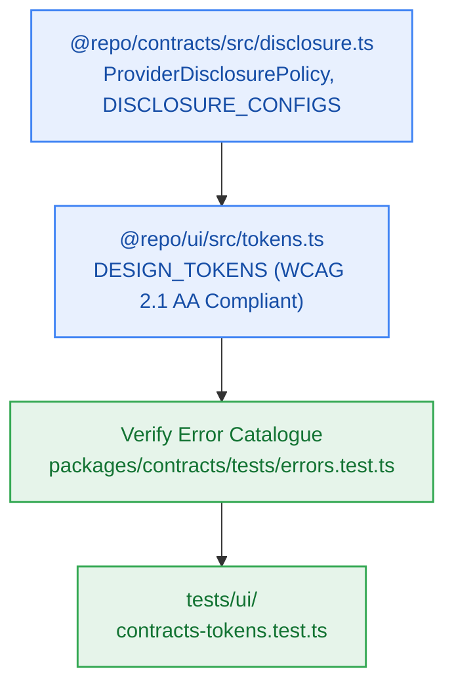

# S8.1 — Shared UI Design Tokens, Component Types & Provider Disclosure Contracts

> **Work Unit:** WU-M8-1 · **Effort:** 3 · **Priority:** p0 · **Risk Tier:** LOW  
> **Owner:** `developer-agent` · **Depends on:** — (sprint entry point)



## Goal
Establish canonical TypeScript contract types, legal disclosure policies (`ProviderDisclosurePolicy`, `DISCLOSURE_CONFIGS`), and WCAG 2.1 AA compliant design tokens (`DESIGN_TOKENS`) in `@repo/contracts` and `@repo/ui`. Verify that the closed 17-member RFC 9457 error catalogue remains intact.

## Acceptance Criteria
1. Export `ProviderDisclosurePolicy`, `ProviderType` (`"google-ai-studio" | "groq"`), and immutable `DISCLOSURE_CONFIGS` from `@repo/contracts/src/disclosure.ts`.
2. Google AI Studio configuration explicitly includes training terms disclosure text: *"Prompts and documents are processed via Google AI Studio free tier. In accordance with Google terms of service, prompt inputs and generated outputs may be reviewed by human reviewers and utilized to train Google AI models."* with official policy link `https://ai.google.dev/terms`.
3. Export extended `DESIGN_TOKENS` in `@repo/ui/src/tokens.ts` with WCAG 2.1 AA compliant colors (contrast ratio ≥ 4.5:1 for normal text, ≥ 3:1 for large text and interactive boundaries), spacing scales, border radii, focus outlines, and glassmorphic elevations.
4. Ensure the closed 17-member RFC 9457 error catalogue remains exactly 17 entries with zero modifications.

## Change Matrix (frozen)
| Class | Paths |
|---|---|
| **new_files** | `packages/contracts/src/disclosure.ts`, `packages/ui/src/tokens.ts`, `tests/ui/contracts-tokens.test.ts` |
| **allowed_files** | `packages/contracts/src/**`, `packages/ui/src/**`, `tests/ui/**` |
| **forbidden_files** | `packages/metering/**`, `packages/auth/**`, `packages/ingestion/**`, `packages/config/**`, `packages/workspace/**`, `packages/db/**`, `packages/reasoning/**`, `packages/memory/**`, `packages/observability/**`, `tests/*.test.ts`, `infra/**`, `apps/**`, `_documentation/**` |

## Verification Hook
```bash
bun test tests/ui/contracts-tokens.test.ts && bun test packages/contracts/tests/errors.test.ts && bun run typecheck
```

## Rollout / Compatibility
Expand-only. Adds new privacy disclosure contracts and design tokens without modifying existing interfaces or database schemas.
