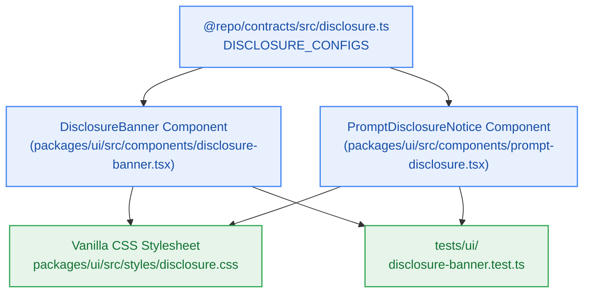

# S8.2 — Dynamic Un-dismissible AI Provider Training Disclosure Banner & Prompt Wrapper

> **Work Unit:** WU-M8-2 · **Effort:** 4 · **Priority:** p0 · **Risk Tier:** MEDIUM  
> **Owner:** `developer-agent` · **Depends on:** S8.1



## Goal
Implement the prominent, permanent, un-dismissible AI provider training disclosure banner component `DisclosureBanner` and workspace prompt wrapper `PromptDisclosureNotice` adhering strictly to `FR-030`, `CV-041`, and `BR-030`.

## Acceptance Criteria
1. `DisclosureBanner` renders a high-contrast warning container (`#FEF7E0` background, `#FBBC04` border) displaying the provider badge ("Google Gemini Free Tier" or "Groq Fallback"), official model training warning copy, and external documentation link (`FR-030`, `CV-041`).
2. `BR-030` Anti-Tampering Invariant: The banner component strictly omits any close or dismiss button, does not accept `onDismiss` callbacks, cannot be hidden or suppressed via `localStorage`, session cookies, or client-side storage flags, and remains permanently mounted.
3. `PromptDisclosureNotice` renders a compact, high-contrast warning badge and copy anchored directly above prompt textarea input surfaces.
4. Styles in `packages/ui/src/styles/disclosure.css` deliver fluid glassmorphic elevation with high-contrast text (`#7A4D00` on `#FEF7E0`, meeting the 4.5:1 contrast requirement) and dark-mode support.

## Change Matrix (frozen)
| Class | Paths |
|---|---|
| **new_files** | `packages/ui/src/components/disclosure-banner.tsx`, `packages/ui/src/components/prompt-disclosure.tsx`, `packages/ui/src/styles/disclosure.css`, `tests/ui/disclosure-banner.test.ts` |
| **allowed_files** | `packages/ui/src/**`, `tests/ui/**` |
| **forbidden_files** | `packages/metering/**`, `packages/auth/**`, `packages/ingestion/**`, `packages/config/**`, `packages/workspace/**`, `packages/db/**`, `packages/reasoning/**`, `packages/memory/**`, `packages/observability/**`, `tests/*.test.ts`, `infra/**`, `apps/**`, `_documentation/**` |

## Verification Hook
```bash
bun test tests/ui/disclosure-banner.test.ts && turbo run build --filter=@repo/ui && turbo run typecheck --filter=@repo/ui
```

## Rollout / Compatibility
Expand-only. Introduces new React components into `@repo/ui` without modifying existing contracts.
