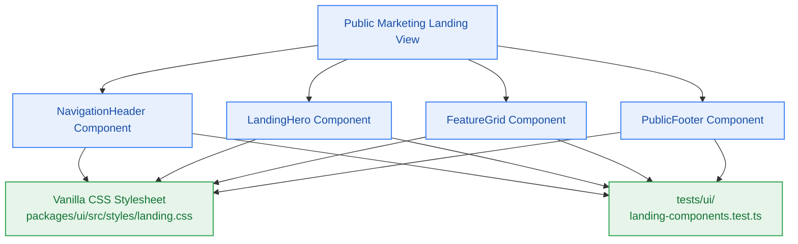

# S8.3 — Public Marketing Landing Page Hero, Navigation, Feature Grid & Public Footer

> **Work Unit:** WU-M8-3 · **Effort:** 4 · **Priority:** p0 · **Risk Tier:** MEDIUM  
> **Owner:** `developer-agent` · **Depends on:** S8.2



## Goal
Implement the core public-facing marketing surface components in `@repo/ui`: `LandingHero`, `NavigationHeader`, `FeatureGrid`, and `PublicFooter`, delivering an unauthenticated, SEO-indexable marketing presentation (`FR-022`, `BR-024`).

## Acceptance Criteria
1. `LandingHero` articulates the core value proposition: *"Multi-Modal Contextual Reasoning Powered by Grounded Citations"*, highlighting transparent $0.00 infrastructure and dual action CTAs.
2. `NavigationHeader` renders brand logo, navigation links (`#features`, `#pricing`, `#architecture`), and primary Clerk OAuth CTA linking cleanly to `/sign-in`.
3. `FeatureGrid` presents the 4 core platform capabilities (Reasoning, Ingestion, Graph, Memory) with zero layout shift (CLS < 0.1).
4. `PublicFooter` renders copyright notice, GitHub repository link, architecture document references, and legal terms.
5. `BR-024` Public Page Isolation: Components accept pure static props without accessing Clerk cookies, user tokens, or authenticated database sessions.
6. Responsive styling in `packages/ui/src/styles/landing.css` provides fluid multi-device adaptation (mobile, tablet, desktop).

## Change Matrix (frozen)
| Class | Paths |
|---|---|
| **new_files** | `packages/ui/src/components/landing-hero.tsx`, `packages/ui/src/components/navigation-header.tsx`, `packages/ui/src/components/feature-grid.tsx`, `packages/ui/src/components/public-footer.tsx`, `packages/ui/src/styles/landing.css`, `tests/ui/landing-components.test.ts` |
| **allowed_files** | `packages/ui/src/**`, `tests/ui/**` |
| **forbidden_files** | `packages/metering/**`, `packages/auth/**`, `packages/ingestion/**`, `packages/config/**`, `packages/workspace/**`, `packages/db/**`, `packages/reasoning/**`, `packages/memory/**`, `packages/observability/**`, `tests/*.test.ts`, `infra/**`, `apps/**`, `_documentation/**` |

## Verification Hook
```bash
bun test tests/ui/landing-components.test.ts && turbo run build --filter=@repo/ui && turbo run typecheck --filter=@repo/ui
```

## Rollout / Compatibility
Expand-only. Introduces public landing components into `@repo/ui` with zero impact on backend packages.
