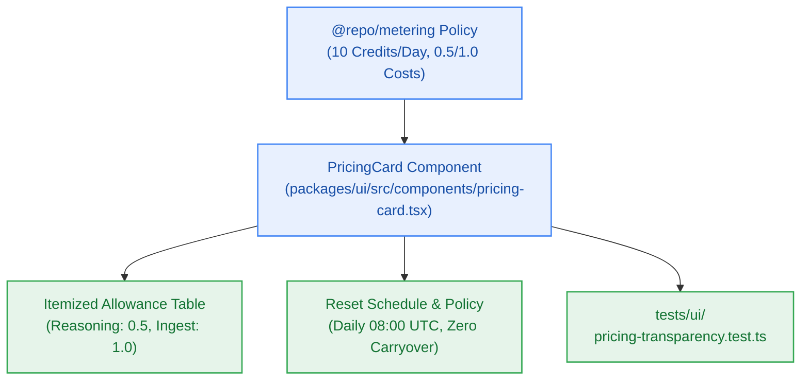

# S8.4 — Zero-Cost Pricing Transparency & Daily Quota Breakdown Surface

> **Work Unit:** WU-M8-4 · **Effort:** 3 · **Priority:** p1 · **Risk Tier:** LOW  
> **Owner:** `developer-agent` · **Depends on:** S8.3



## Goal
Implement the transparent `PricingCard` and daily quota breakdown section detailing the 10 daily credit grant, per-action debit costs (0.5 LLM, 1.0 Ingest), and zero-charge guarantee (`FR-022`, `BR-025`, `BR-026`).

## Acceptance Criteria
1. `PricingCard` showcases "Free Community Tier: $0.00 / forever" with explicit itemized daily allowance (10 credits granted daily at 08:00 UTC, `BR-025`).
2. Action cost table details: Grounded Reasoning Query (0.5 credits = up to 20 queries/day), Document Ingestion (1.0 credit = up to 10 documents/day).
3. Explicitly explains the idempotent reset rule (`BR-025`) and unspent credit expiration (`BR-026`: zero roll-over carryover) with complete transparency.
4. Renders without any billing inputs, credit card forms, or third-party payment scripts.
5. Employs clean glassmorphic styling with high contrast text conforming to WCAG 2.1 AA.

## Change Matrix (frozen)
| Class | Paths |
|---|---|
| **new_files** | `packages/ui/src/components/pricing-card.tsx`, `tests/ui/pricing-transparency.test.ts` |
| **allowed_files** | `packages/ui/src/**`, `tests/ui/**` |
| **forbidden_files** | `packages/metering/**`, `packages/auth/**`, `packages/ingestion/**`, `packages/config/**`, `packages/workspace/**`, `packages/db/**`, `packages/reasoning/**`, `packages/memory/**`, `packages/observability/**`, `tests/*.test.ts`, `infra/**`, `apps/**`, `_documentation/**` |

## Verification Hook
```bash
bun test tests/ui/pricing-transparency.test.ts && turbo run build --filter=@repo/ui && turbo run typecheck --filter=@repo/ui
```

## Rollout / Compatibility
Expand-only. Introduces the PricingCard component into `@repo/ui` with zero runtime dependencies.
