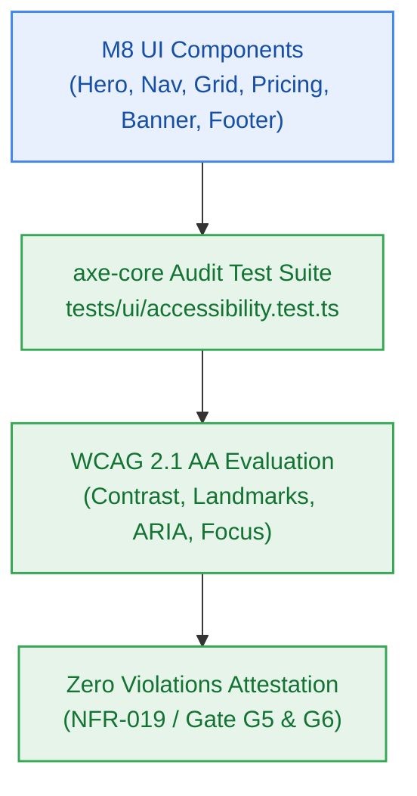

# S8.5 — Automated WCAG 2.1 AA Accessibility Certification Suite Using axe-core

> **Work Unit:** WU-M8-5 · **Effort:** 4 · **Priority:** p0 · **Risk Tier:** MEDIUM  
> **Owner:** `developer-agent` · **Depends on:** S8.4



## Goal
Validate WCAG 2.1 AA compliance across all public marketing and privacy disclosure components using automated `axe-core` accessibility audits (`NFR-019`).

## Acceptance Criteria
1. Automated accessibility audit suite in `tests/ui/accessibility.test.ts` scanning `LandingHero`, `NavigationHeader`, `FeatureGrid`, `PricingCard`, `PublicFooter`, and `DisclosureBanner`.
2. `axe-core` rule evaluation reports zero critical and zero serious accessibility violations (`NFR-019`).
3. Asserts semantic HTML5 landmark tags (`<header>`, `<nav>`, `<main>`, `<section>`, `<footer>`), valid `aria-label`, `aria-describedby`, and `role` attributes.
4. Asserts visible focus indicator styling (`:focus-visible` with ≥ 2px outline and ≥ 3:1 contrast against background).
5. Asserts color contrast ratio ≥ 4.5:1 on all text elements and ≥ 3:1 on large text and interactive boundaries.

## Change Matrix (frozen)
| Class | Paths |
|---|---|
| **new_files** | `tests/ui/accessibility.test.ts` |
| **allowed_files** | `packages/ui/src/**`, `tests/ui/**` |
| **forbidden_files** | `packages/metering/**`, `packages/auth/**`, `packages/ingestion/**`, `packages/config/**`, `packages/workspace/**`, `packages/db/**`, `packages/reasoning/**`, `packages/memory/**`, `packages/observability/**`, `tests/*.test.ts`, `infra/**`, `apps/**`, `_documentation/**` |

## Verification Hook
```bash
bun test tests/ui/accessibility.test.ts
```

## Rollout / Compatibility
Test-only addition. Adds automated accessibility regression gating to the test suite without altering public contracts.
