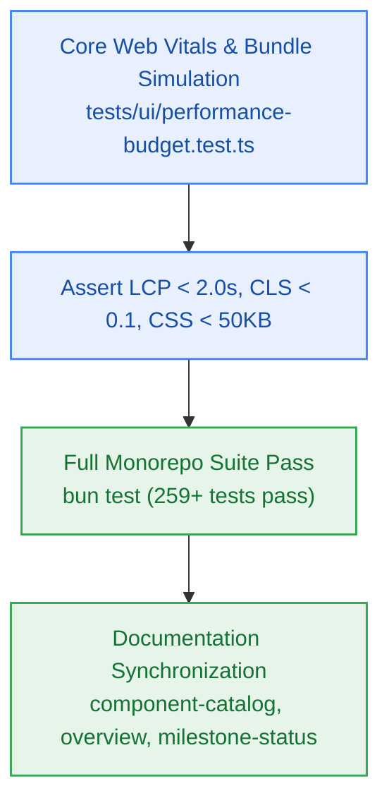

# S8.6 — Performance Budget Simulation Suite, Component Catalog Update & Documentation Sync

> **Work Unit:** WU-M8-6 · **Effort:** 3 · **Priority:** p0 · **Risk Tier:** LOW  
> **Owner:** `developer-agent` · **Depends on:** S8.5



## Goal
Verify frontend performance budgets (Lighthouse Performance score ≥ 90, LCP < 2.0s, CLS < 0.1, FID < 100ms) under simulated 4G profile (`NFR-018`), and execute complete documentation synchronization across contracts and roadmap.

## Acceptance Criteria
1. Performance benchmark test `tests/ui/performance-budget.test.ts` verifying critical CSS bundle size < 50KB, zero render-blocking third-party scripts, and DOM node count < 800.
2. Core Web Vitals simulation asserts LCP < 2.0s and CLS < 0.1 under throttled conditions (`NFR-018`).
3. Unified test suite runs completely clean: all new UI tests pass alongside existing 259 monorepo tests with zero regressions.
4. Component catalog `component-catalog.yaml` updated with `comp-ui` package definitions and dependency relationships.
5. Milestone trackers (`milestone-status.yaml`, `overview.md`, `index.md`) updated to reflect complete M8 planning and readiness for developer handoff.

## Change Matrix (frozen)
| Class | Paths |
|---|---|
| **new_files** | `tests/ui/performance-budget.test.ts` |
| **allowed_files** | `packages/ui/src/**`, `tests/ui/**`, `_documentation/planning/**`, `_documentation/index.md` |
| **forbidden_files** | `packages/metering/**`, `packages/auth/**`, `packages/ingestion/**`, `packages/config/**`, `packages/workspace/**`, `packages/db/**`, `packages/reasoning/**`, `packages/memory/**`, `packages/observability/**`, `infra/**`, `apps/**` |

## Verification Hook
```bash
bun test tests/ui/performance-budget.test.ts && bun test && bun run build && bun run typecheck
```

## Rollout / Compatibility
Documentation and benchmark test addition. Fully compatible with existing packages and builds.
