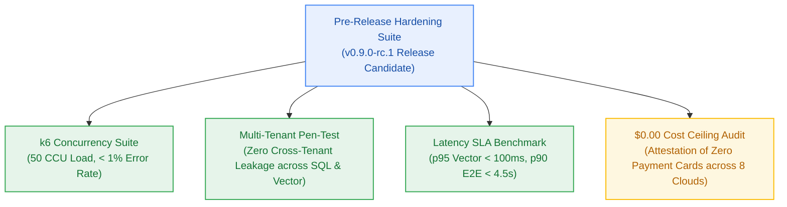

# Milestone Charter — M9: Benchmark Suite, Hardening & Security Audit (v0.9.0-rc.1)

> **Status:** Planned (Follows M8 Landing & Disclosure)  
> **Author:** pm-agent (Stage 2 Owner) · **Date:** 2026-10-23  
> **Target Version:** `v0.9.0-rc.1` · **Risk Tier:** HIGH  
> **Grounding:** `project-brief.md` (FR-016..FR-018; BR-047..BR-048; NFR-001..NFR-005, NFR-011..NFR-013, NFR-016, NFR-025..NFR-032; EPIC-009)  

---

## 1. Executive Summary & Outcome

Milestone M9 delivers the pre-release hardening, performance benchmarking, and security attestation for the Release Candidate `v0.9.0-rc.1`. It subjects the platform to automated k6 concurrency stress tests simulating 50 concurrent active users (`NFR-005`), validates all latency SLAs under load, conducts rigorous multi-tenant penetration testing, and audits the $0.00/month infrastructure ceiling across all integrated cloud provider accounts (`NFR-016`).

---

## 2. In Scope

- **Concurrency & Stress Testing (`NFR-005`):**
  - Automated k6 load testing scripts simulating 50 concurrent users executing mixed workloads (ingestion, decomposition, vector search, streaming synthesis).
  - Error rate under maximum load verified strictly < 1.0%.
- **Latency SLA Verification (`NFR-001`–`NFR-003`):**
  - Vector search p95 latency < 100 ms on collections up to 25,000 points.
  - LLM Time-to-First-Token p90 latency < 1,500 ms.
  - End-to-end multi-step reasoning pipeline p90 latency < 4,500 ms.
- **Security & Multi-Tenant Penetration Audit (`NFR-007`, `BR-002`):**
  - Fuzzing and penetration testing targeting relational queries, vector filters, and memory stores.
  - Verification that forged JWT claims or missing tenant filters cannot access another user's documents.
- **Zero-Dollar Ceiling Attestation (`NFR-016`):**
  - Formal audit verifying $0.00 spend and zero credit cards on file across:
    1. Vercel Hobby
    2. Clerk Auth
    3. Neon Postgres
    4. Upstash (Redis, Vector, QStash)
    5. Google AI Studio
    6. Groq
    7. Filebase S3
    8. Better Stack

---

## 3. Out of Scope

- Cutting the production tag `v1.0.0` (owned by Milestone GA).
- Commercial credit card integration (permanently excluded).

---

## 4. Acceptance Criteria & Gate Status

| ID | Criterion | Evidence Target | Gate |
|:---:|---|---|:---:|
| **AC-9.1** | 50 CCU Concurrency Pass | k6 test completes with 50 virtual users and < 1% error rate | G5 |
| **AC-9.2** | Latency SLA Compliance | p95 vector < 100ms; p90 TTFT < 1,500ms; p90 E2E < 4,500ms verified in test run | G5 |
| **AC-9.3** | Zero Tenant Leakage | 100% of adversarial cross-tenant penetration tests return HTTP 404/403 | G6 |
| **AC-9.4** | $0.00 Free Tier Attestation | Signed audit report confirming zero payment cards and $0.00 billing across all 8 vendors | G6 |

---

## 5. Next Steps & Pipeline Handoff

1. Follows completion and sign-off of Milestone M8 (Landing & Disclosure).
2. `sprint-agent` authors `m9-hardening-benchmark/sprint-status.yaml` and story cards.
3. Hands off to `test-agent` and `developer-agent` for benchmark execution.
