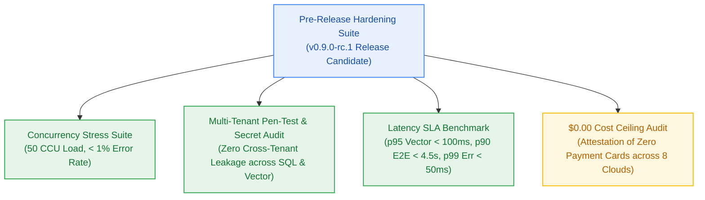

# Milestone Charter — M9: Benchmark Suite, Hardening & Security Audit (v0.9.0-rc.1)

> **Status:** Approved for Implementation (Follows M8 Landing & Disclosure)  
> **Author:** `pm-agent` (Stage 2 Owner) · **Date:** 2026-10-27  
> **Target Version:** `v0.9.0-rc.1` · **Risk Tier:** HIGH  
> **Grounding:** `project-brief.md` (`FR-013`, `FR-016`..`FR-018`; `BR-002`, `BR-036`, `BR-047`..`BR-048`; `NFR-001`..`NFR-005`, `NFR-007`, `NFR-011`..`NFR-013`, `NFR-016`, `NFR-025`..`NFR-032`; `EPIC-009`)  

---

## 1. Executive Summary & Outcome

Milestone M9 delivers pre-release hardening, performance benchmarking, multi-tenant penetration verification, and security attestation for the Release Candidate `v0.9.0-rc.1`. It subjects the platform to automated concurrency stress tests simulating 50 concurrent active users (`NFR-005`), validates all latency SLAs under load, conducts rigorous multi-tenant penetration testing, and audits the $0.00/month infrastructure ceiling across all 8 cloud provider accounts (`NFR-016`).

---

## 2. In Scope

- **Concurrency & Stress Testing (`FR-013`, `NFR-005`):**
  - Automated load testing scripts simulating 50 concurrent active users executing mixed workloads (ingestion, decomposition, vector search, streaming synthesis, credit debits).
  - Error rate under maximum load verified strictly < 1.0% (target < 0.5%).
- **Latency SLA Verification (`NFR-001`–`NFR-003`, `NFR-027`):**
  - Vector search p95 latency < 100 ms on collections up to 25,000 points.
  - LLM Time-to-First-Token p90 latency < 1,500 ms.
  - End-to-end multi-step reasoning pipeline p90 latency < 4,500 ms.
  - RFC 9457 Problem Details error serialization p99 latency < 50 ms.
- **Security & Multi-Tenant Penetration Audit (`NFR-006`, `NFR-007`, `NFR-026`, `BR-002`, `BR-036`):**
  - Fuzzing and penetration testing targeting relational queries, vector filters, and memory stores.
  - Verification that forged JWT claims, tampered signatures, or missing tenant filters cannot access another user's documents.
  - Verification of Scoped Retrieval Debit Ordering (`BR-036`, `AC-4.4`): unauthorized notebook probes fail with HTTP 404 before credit debit.
  - Automated regex scanning verifying zero unredacted API keys, database connection strings, JWT secrets, or stack traces in log sinks or API responses (`NFR-026`).
- **Zero-Dollar Ceiling Attestation (`NFR-016`):**
  - Formal automated audit verifying $0.00 spend and zero credit cards on file across all 8 vendors:
    1. Vercel Hobby
    2. Clerk Auth
    3. Neon Postgres
    4. Upstash (Redis, Vector, QStash)
    5. Google AI Studio
    6. Groq
    7. Filebase S3
    8. Better Stack

---

## 3. Out of Scope

- Cutting the production tag `v1.0.0` (owned by Milestone GA).
- Commercial credit card integration (permanently excluded).
- Adding new feature capabilities during the RC hardening freeze.

---

## 4. Acceptance Criteria & Gate Status

| ID | Criterion | Evidence Target | Gate | Story |
|:---:|---|---|:---:|:---:|
| **AC-9.1** | 50 CCU Concurrency Pass | Load test with 50 virtual users achieves error rate < 1.0% | G5 | S9.2 |
| **AC-9.2** | Latency SLA Compliance | p95 vector < 100ms; p90 TTFT < 1,500ms; p90 E2E < 4,500ms; p99 error < 50ms | G5 | S9.3 |
| **AC-9.3** | Zero Tenant & Secret Leakage | 100% of penetration tests return 404/403; zero credentials detected in regex scan | G6 | S9.4 |
| **AC-9.4** | $0.00 Free-Tier Attestation | Automated audit passes across all 8 vendors; signed attestation report generated | G6 | S9.5 |

---

## 5. Next Steps & Pipeline Handoff

1. Follows completion and sign-off of Milestone M8 (Landing & Disclosure).
2. `sprint-agent` authors `m9-hardening-benchmark/sprint-status.yaml` and story cards (S9.1 to S9.6).
3. `pm-agent` approves implementation plan unconditionally in `pm-approval.md`.
4. Hands off to `developer-agent` for implementation via `handoff-021-sprint-to-developer-m9.md`.
