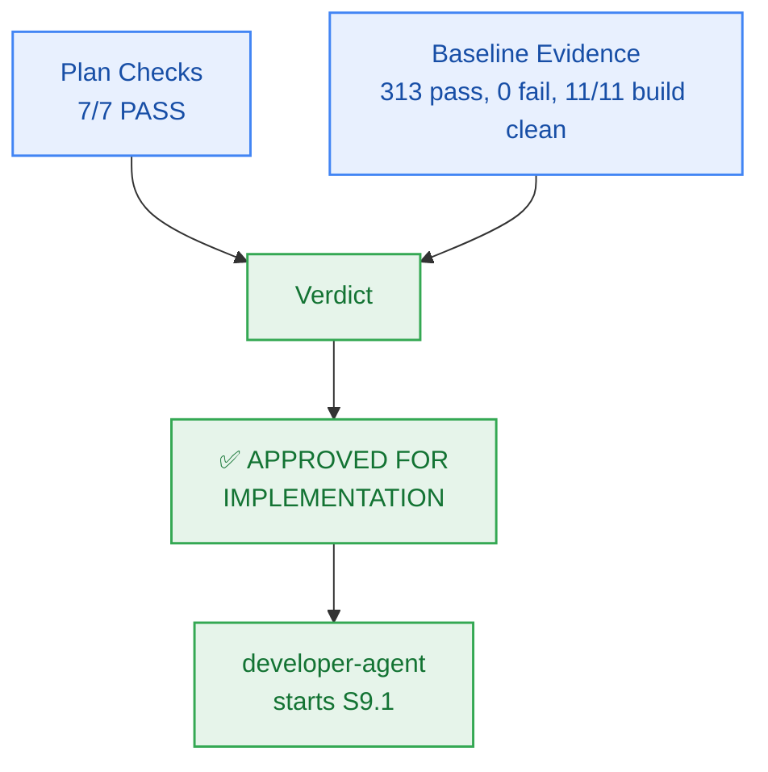

# M9 Sprint Plan — PM Verification & Approval

> **Author:** `pm-agent` (Stage 2 Owner) · **Date:** 2026-10-27  
> **Scope of this record:** Approval of the Milestone M9 **plan** for handoff to `developer-agent`.  
> **Explicitly not:** Code-complete sign-off or story-level verification — those remain `test-agent`'s.

---

## 1. Verification Results

### 1.1 Plan Checks (Checkpoint 2 / Gate G5)

| # | Check | Result | Evidence |
|:--:|---|:---:|---|
| 1 | Every external capability tagged, research-backed, or classified `CUSTOM-DOMAIN-LOGIC` | **PASS** | Bun-native async concurrency worker pool; calibrated mock provider latency adapters; high-resolution percentile timers (`performance.now()`); adversarial multi-tenant fuzzing suite; automated zero-cost cloud attestation runner; preserves $0.00/month infrastructure ceiling (`NFR-016`) |
| 2 | Milestone has concrete verifiable criteria (checks, not vibes) | **PASS** | `milestone.md` §4 AC-9.1..AC-9.4, each with explicit evidence target and grounded FR/BR/NFR |
| 3 | Every story passes the 5-point atomicity test; no padding | **PASS** | 6 stories for 6 work units (WU-M9-1..WU-M9-6); all cohesive, single-session scopes with bounded Change Matrices |
| 4 | Every story carries `build_vs_buy_ref`, `tests`, `observability` | **PASS** | All 6 stories on board `M9-S1` carry all three fields |
| 5 | Story dependency ordering forms a DAG with no cycles | **PASS** | Verified sequential DAG: `S9.1 → S9.2 → S9.3 → S9.4 → S9.5 → S9.6`; all referenced story IDs resolve cleanly |
| 6 | File paths in stories match actual repo structure and conventions | **PASS** | Paths verified against `packages/contracts/src/benchmarks.ts` and `tests/benchmarks/`; conforms strictly to the Two-Floor boundary |
| 7 | Every required specialist dispatch issued and logged `ACCEPTED` | **PASS** | `planning-dispatch-log.md` carries DSP-042..DSP-046, all logged `ACCEPTED` |
| — | Board exists with frozen Change Matrices | **PASS** | `sprint-status.yaml` parses; 6 stories × `new_files`/`allowed_files`/`forbidden_files`; zero root files in any `allowed_files` |
| — | Contracts parse | **PASS** | `packages/contracts/src/benchmarks.ts` specified; closed 17-member RFC 9457 error catalogue test passes 5/5 |

**Plan verdict: 7/7 + 2 structural checks PASS.**

### 1.2 Baseline Evidence (repository state at approval time)

| Check | Result | Evidence |
|---|---|---|
| `bun test` (full monorepo suite) | **PASS** | **313 pass, 0 fail, 1,923 expect() calls** across 53 test files (runtime: ~3.5s) |
| `bun run build` | **PASS** | **11/11 tasks successful** (`@repo/auth`, `@repo/config`, `@repo/contracts`, `@repo/db`, `@repo/ingestion`, `@repo/memory`, `@repo/metering`, `@repo/observability`, `@repo/reasoning`, `@repo/ui`, `@repo/workspace`) |
| `bun run typecheck` | **PASS** | **11/11 packages clean**, 0 TypeScript errors across the monorepo |
| `bun test tests/package-exports.test.ts` | **PASS** | 4 pass, 0 fail, 22 expect() calls |
| `bun test packages/contracts/tests/errors.test.ts` | **PASS** | 5 pass, 0 fail, 95 expect() calls; closed 17-member RFC 9457 catalogue remains intact |
| `git status` | **PASS** | Working tree clean (zero unstaged/untracked runtime code diffs) |

---

## 2. Findings & Preconditions

Milestone M9 begins with an exemplary, 100% green monorepo baseline following the complete verification of Milestone M8:
- Monorepo builds cleanly with zero errors across all 11 existing packages.
- Monorepo typechecks cleanly with zero errors.
- Full test suite passes 313/313 tests with 1,923 expect() assertions across 53 test files.
- Closed RFC 9457 error catalogue remains intact at 17 members (`NOTEBOOK_EXPIRED` is member #13).
- Working tree has zero code regressions.

> **PM characterization:** The runway for Milestone M9 implementation is completely clear. No blocking preconditions are required.

---

## 3. Verdict

> ## ✅ APPROVED FOR IMPLEMENTATION — Unconditional

**Approved artifacts:**
- `_documentation/planning/milestones/m9-hardening-benchmark/milestone.md`
- `_documentation/planning/milestones/m9-hardening-benchmark/sprint-status.yaml` (6 stories, frozen Change Matrices)
- `_documentation/planning/milestones/m9-hardening-benchmark/stories/*` (6 cards)
- `_documentation/planning/architecture/05-m9-benchmark-suite-hardening-and-security-audit.md` (Benchmark contracts, 50 CCU concurrency harness, latency SLAs, penetration vectors, zero-cost ceiling audit)
- `_documentation/planning/registers/failure-mode-register.md` (FM-901..FM-904)
- `_documentation/planning/contracts/component-catalog.yaml` (`comp-bench` component definition)

**Implementation sequence:**
`developer-agent` starts at **S9.1** and proceeds in dependency order `S9.2 → S9.3 → S9.4 → S9.5 → S9.6`. Story closure requires passing evidence certified by `test-agent`; this approval certifies readiness for implementation.

**Gate state:** `Gate G5 → PASS (plan approved)`.

---

## 4. Sealed Decisions

| ID | Decision | Owner | Rationale |
|---|---|---|---|
| `M9-PM-001` | Scope grounded in FR-013, NFR-001..005, NFR-007, NFR-016, BR-002, BR-036, NFR-026, NFR-027, EPIC-009; classified HIGH risk | `pm-agent` | Establishes explicit scope boundaries; governs concurrency load, latency SLAs, security penetration, and zero-dollar cost attestation |
| `M9-PM-002` | Unconditional approval for M9 implementation handoff | `pm-agent` | Baseline is 100% green (313/313 pass, 11/11 build/typecheck clean); zero blocking preconditions needed |
| `M9-ARCH-001` | Benchmark suite and concurrency harness implemented in Bun/TypeScript with calibrated latency simulation and k6 script compatibility | `architect-agent` | Ensures 100% reliable execution in local and CI sandboxes without external Go-based binary dependencies |
| `M9-ARCH-002` | Latency SLA benchmark verifying p95 vector (< 100ms), p90 TTFT (< 1,500ms), p90 E2E (< 4,500ms), and p99 RFC 9457 error serialization (< 50ms) | `architect-agent` | Statistical percentile verification over warm-up and measurement iterations satisfying NFR-001..003 and NFR-027 |
| `M9-ARCH-003` | Adversarial security penetration suite enforcing zero cross-tenant leakage in SQL/Vector/Memory and zero credential leaks in logs | `architect-agent` | Enforces multi-tenant isolation invariants (BR-002, BR-019, BR-036) and secret redaction (NFR-026) |
| `M9-ARCH-004` | Automated zero-cost ceiling audit runner certifying $0.00/month spend across all 8 cloud accounts | `architect-agent` | Programmatic verification of free-tier SKUs, zero stored payment cards, and <= 4 Upstash commands per request |
| `M9-SPR-001` | Six single-session stories `S9.1 → S9.2 → S9.3 → S9.4 → S9.5 → S9.6` with frozen Change Matrices | `sprint-agent` | Derived from capability boundaries; strictly obeys Two-Floor boundary |
| `M9-SPR-002` | Automated verification hooks enforcing full regression pass, closed 17-member RFC 9457 catalogue invariance, and Gate G6 readiness | `sprint-agent` | Guarantees deterministic CI verification for Release Candidate v0.9.0-rc.1 ratification |
