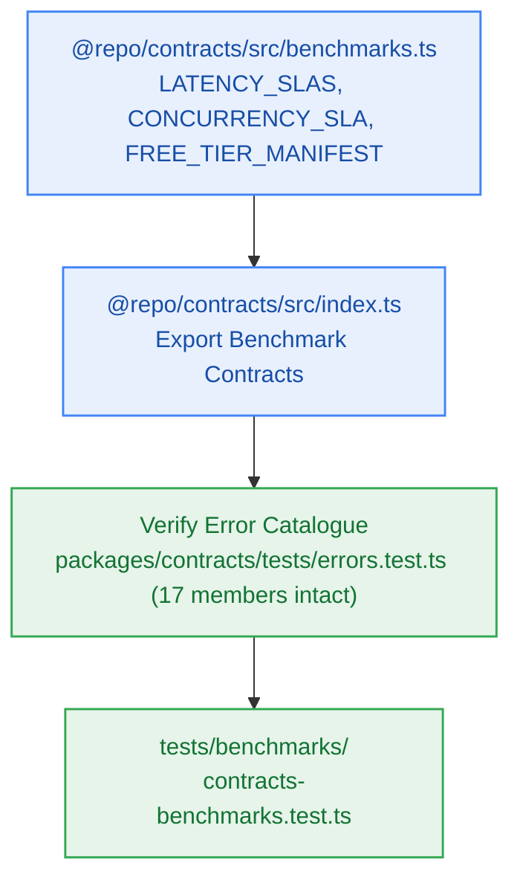

# S9.1 — Benchmark Contracts, SLA Thresholds, Performance Metrics Schema & Scenario Definitions

> **Work Unit:** WU-M9-1 · **Effort:** 3 · **Priority:** p0 · **Risk Tier:** LOW  
> **Owner:** `developer-agent` · **Depends on:** — (sprint entry point)



## Goal
Establish canonical TypeScript contract types, SLA threshold constants (`LATENCY_SLAS`, `CONCURRENCY_SLA`), free-tier cloud manifest (`FREE_TIER_MANIFEST`), and scenario schemas in `@repo/contracts/src/benchmarks.ts`. Re-export benchmark contracts from `@repo/contracts/src/index.ts` and verify that the closed 17-member RFC 9457 error catalogue remains unmodified.

## Acceptance Criteria
1. Export `LatencySLAConfig`, `ConcurrencySLAConfig`, `FreeTierCloudManifest`, `BenchmarkScenario`, and `BenchmarkRunSummary` from `@repo/contracts/src/benchmarks.ts`.
2. Export immutable `LATENCY_SLAS`:
   - `vectorSearchP95Ms: 100` (`NFR-001`)
   - `llmTtftP90Ms: 1500` (`NFR-002`)
   - `e2eReasoningP90Ms: 4500` (`NFR-003`)
   - `errorSerializationP99Ms: 50` (`NFR-027`)
3. Export immutable `CONCURRENCY_SLA`:
   - `concurrentUsers: 50` (`NFR-005`)
   - `maxErrorRatePercent: 1.0` (`NFR-005`)
   - `targetDurationSeconds: 60`
4. Export immutable `FREE_TIER_MANIFEST` documenting all 8 cloud provider accounts (Vercel, Clerk, Neon, Upstash, Google AI Studio, Groq, Filebase, Better Stack) with $0.00 limits and `creditCardRequired: false` (`NFR-016`).
5. Export all benchmark contracts from `@repo/contracts/src/index.ts`.
6. Ensure the closed 17-member RFC 9457 error catalogue remains exactly 17 entries with zero modifications.

## Change Matrix (frozen)
| Class | Paths |
|---|---|
| **new_files** | `packages/contracts/src/benchmarks.ts`, `tests/benchmarks/contracts-benchmarks.test.ts` |
| **allowed_files** | `packages/contracts/src/**`, `tests/benchmarks/**` |
| **forbidden_files** | `packages/metering/**`, `packages/auth/**`, `packages/ingestion/**`, `packages/config/**`, `packages/workspace/**`, `packages/db/**`, `packages/reasoning/**`, `packages/memory/**`, `packages/observability/**`, `packages/ui/**`, `tests/ui/**`, `tests/reasoning/**`, `tests/workspace/**`, `infra/**`, `apps/**`, `_documentation/**` |

## Verification Hook
```bash
bun test tests/benchmarks/contracts-benchmarks.test.ts && bun test packages/contracts/tests/errors.test.ts && bun run typecheck
```

## Rollout / Compatibility
Expand-only. Adds typed benchmark contracts without altering any existing database schema or runtime API routes.
